# AWS 6経路 タイムアウト設計詳解

情報の基準日：**2026-10-08（日本時間）**。Excel：[同じ資料を開く](AWS_Timeout_Design_Guide.xlsx)。

この資料の秒数は、整合する設計例です。実環境の設定値や測定結果ではありません。

## 目次

- [00 読み方](#s00)
- [01 設定一覧](#s01)
- [02 整合性計算](#s02)
- [03 イントラネットの画面](#s03)
- [04 イントラネットの画面非同期](#s04)
- [05 イントラネットの帳票出力](#s05)
- [06 イントラネットのAPI](#s06)
- [07 インターネットのAPI](#s07)
- [08 SalesforceのAPI](#s08)
- [09 タイムアウトの時計と動作原理](#s09)
- [10 すべてを整合させる時間予算の作り方](#s10)
- [11 Valkey・RDS Proxy・Auroraを深く理解する](#s11)
- [12 非同期処理の時間・状態・再試行](#s12)
- [13 認証・PrivateLink・検査装置の仕組みと設定](#s13)
- [14 登場の背景と、古い説明から変わった点](#s14)
- [15 異常時の動作と、証拠から原因を探す方法](#s15)
- [16 設定場所と、実環境へ反映する順序](#s16)
- [17 設定と実装例](#s17)
- [18 検証計画](#s18)
- [19 用語集](#s19)
- [20 公式出典](#s20)

<a id="s00"></a>

## 00 読み方・前提

### 資料の目的

指定された6経路について、誰がどの時計を持ち、どこで時間を使い、どの順に失敗を返すべきかを一つの設計例として整理する。短い要約だけでなく、各接続点の設定名、仕組み、背景、異常時、設定手順、検証項目まで含める。

### 情報の基準日

2026年10月8日（日本時間）。公式資料を閲覧して確認した仕様を記載する。公開資料の更新日が表示されないものは、閲覧日とURLを出典表に残す。仕様はRegion・engine・runtime・account quotaによって適用条件がある。

### 確定仕様と提案を区別

「既定値・範囲」は引用先のservice仕様。「提案値」は本資料が作った設計例であり、AWSが一律に推奨する値でも、現在の実環境から取得した値でもない。「条件付き」は構成が採用されている場合だけ必要な項目。「要実測」は性能・業務判断が必要な項目。

### 基本前提

同一Regionを基本とし、同期APIは小～中規模JSONのBUFFERED方式、一般の標準Lambda、業務ECSの例はFargate Linuxを想定する。DB engineは未提供なのでAurora PostgreSQLとAurora MySQLを分ける。EC2のOS、Web server、帳票製品、client SDK、PAN-OS版は特定しない。

### 共有リソースの扱い

画面・帳票入口・非同期バック呼出しは同じ画面ALBを使う。画面ALBのidle90秒は共通値。ECSの処理上限はendpoint別20/75/50秒。RDS ProxyとAuroraを共有する場合はborrow2秒や業務SQL5秒が共通方針となり、長いbatchは別の適用範囲を用意する。

### 構成上の読み替え

ValkeyがRDS ProxyへSQLを中継するわけではなく、ECSからcacheとDBへ分岐する。token取得はAPI本体と別通信。SQSの後ろは受付HTTPとは別の処理。GWLB検査は装置からGWLB/GWLBEへ戻るpacket pathを含む。Salesforce側consumer endpointとAWSのexecute-api endpointは別物。

### Excelの読み順

まず00_読み方、次に02_整合性計算で主要値を確認し、03～08で経路別に読む。01_設定一覧は正式名を調べる辞書。09以降は動作原理、DB、非同期、認証、歴史、運用、実装例、検証計画。20_公式出典から原資料を開く。

### Excelでの編集

02_整合性計算の入力値を変更すると、条件の余裕とOK/要見直しが再計算される。ほかの説明・設定一覧は初期案の固定記述であり、自動更新されない。変更した値を採用する際は本文と実設定も同時に更新する。計算OKは性能・構成成立の保証ではない。

### 今回行った検証と範囲

公式資料の調査、生成したExcel/Markdownの構造・文字列・書式・内部リンク・数式cache・整合条件を検査する。AWS accountやSalesforceへの接続、実際のtimeout負荷試験は実施しない。検証計画の項目は、今後環境で実施する受入試験である。

### 最初に押さえる六つの時間予算

| 経路 | 処理上限の設計例 | 共有/接続の時計 |
| --- | --- | --- |
| 画面 | cache0.5＋DB12＋その他3＋応答2＝17.5 ≤ ECS20 < client30 | 画面ALB idle90 / ECS keepalive120 |
| 画面非同期 | 受付ECS5 < client10。バック50 < HTTP55 < soft60 < hard70 | SQS visibility420 ≥ 6×70＋window0 |
| 帳票 | EC260 < HTTP65。前2＋65＋後3＝70 ≤ ECS75 < client90 | 帳票ALB idle70 / 画面ALB idle90 |
| 社内API | ECS20 < client30。cache/DBは画面と同じ分岐 | API用ALB idle60 |
| 公開API | ECS20 < REST統合25 < API client30。token取得10は別HTTP | GWLB TCP idle350 / API ALB idle60 |
| Salesforce API | Apex例callout30。token10＋API30＋余裕5＝業務45 | NLB TCP idle350 / Private REST統合25 |

<a id="s01"></a>

## 01 設定一覧：正式名称・仕様・提案値

「既定値・範囲」は公式仕様、「設計例」は本資料の提案です。clockの起点と適用範囲を確認してから設定します。

### クライアント

| ID | 接続点 | 正式設定名 | 時計 / 起点 | 既定・範囲・条件 | 設計例 | 設定のポイント | 出典 |
| --- | --- | --- | --- | --- | --- | --- | --- |
| <a id="setting-C01"></a>C01 | 画面・社内APIクライアント | total request deadline（アプリ実装） | 総時間／呼び出し開始から | 実装依存。ブラウザーやSDKの既定値に依存しない。 | 通常30秒 | 名前解決、接続、送受信、retryを含める。HTTPを中断しただけではDB処理が止まらないため、サーバ側の取消と結果確認も必要。 | 設計例 |
| <a id="setting-C02"></a>C02 | 帳票画面クライアント | total request deadline（アプリ実装） | 総時間／帳票要求開始から | 実装依存 | 90秒 | 通常画面30秒と帳票90秒をendpoint別に設定。共有ALBのidleを長くしても通常画面のdeadlineは延びない。 | 設計例 |
| <a id="setting-C03"></a>C03 | HTTPを発信する各クライアント | connect timeout / TLS handshake timeout | 接続／新しい接続を作る間 | ライブラリ依存。DNSを含むかも確認。 | 接続段階全体3秒以内 | TCPだけ3秒、DNSは無制限、という抜け道を防ぐ。新規接続全体をdeadlineで囲む。Valkeyは別途0.2秒。 | 設計例 |
| <a id="setting-C04"></a>C04 | HTTPを発信する各クライアント | write timeout / response read timeout | 送信・読取／I/O開始または無通信から | ライブラリごとに「総時間」「I/O間隔」が異なる。 | 通常APIのread 25秒を目安、最終的にC01で30秒 | 巨大送信や少しずつ届く応答はread timeoutだけでは止まらない。write/readとも残りdeadline以下に切り詰める。 | 設計例 |
| <a id="setting-C05"></a>C05 | HTTP接続プール | pool acquire timeout / idle eviction | 借用待ち／プール要求時、idle／最後の利用から | ライブラリ依存 | 借用1秒、未使用接続45秒で破棄 | API用ALB60秒より早くクライアントが未使用接続を捨てる。処理中の接続は破棄しない。借用待ちも総deadlineに含める。 | 設計例 |
| <a id="setting-C06"></a>C06 | 公開API・Salesforceの業務一件 | token + API end-to-end deadline（アプリ実装） | 総時間／トークン確認開始から | 業務契約として決める | 45秒（token10 + API30 + 余裕5） | トークンがcacheにあれば10秒の取得は省略。API Gatewayの統合時間にトークン取得時間は含まれない。 | 設計例 |
| <a id="setting-C07"></a>C07 | Salesforce Apex | HttpRequest.setTimeout(Integer) | callout待機／リクエストごと | 既定10秒、指定1～120000ms | 業務API 30000ms | Apex使用時の例。Named Credentialを使っても待機設定は別問題。Flow・MuleSoft・外部連携のtimeoutへそのまま転用しない。 | [S49](https://help.salesforce.com/s/articleView?id=000212634&language=en_US&type=1) [S50](https://resources.docs.salesforce.com/latest/latest/en-us/sfdc/pdf/salesforce_apex_developer_guide.pdf) |
| <a id="setting-C08"></a>C08 | Salesforce Apex transaction | cumulative callout timeout limit | 累積／同じApex transaction内 | 120秒のプラットフォーム制約 | 今回の業務一件は45秒以内 | token取得、業務API、retry、ほかのcalloutの実際の待機を合計する。非同期Apexでも無条件に120秒超へ延びるわけではない。 | [S50](https://resources.docs.salesforce.com/latest/latest/en-us/sfdc/pdf/salesforce_apex_developer_guide.pdf) |

### ALB・ECS

| ID | 接続点 | 正式設定名 | 時計 / 起点 | 既定・範囲・条件 | 設計例 | 設定のポイント | 出典 |
| --- | --- | --- | --- | --- | --- | --- | --- |
| <a id="setting-A01"></a>A01 | ALB（イントラネット画面用） | idle_timeout.timeout_seconds | 無通信／最後の送受信から | 既定60秒、1～4000秒 | 90秒 | 画面・帳票・Lambdaからバックコンテナへの通信が共有する。最大の無通信待ちを考慮し90秒。ルールやtarget group単位のidle設定ではない。 | [S01](https://docs.aws.amazon.com/elasticloadbalancing/latest/application/edit-load-balancer-attributes.html) |
| <a id="setting-A02"></a>A02 | ALB（イントラネットAPI用） | idle_timeout.timeout_seconds | 無通信／最後の送受信から | 既定60秒、1～4000秒 | 60秒 | 業務処理20秒より十分長いidle保護。社内APIクライアント30秒が総時間を制限する。 | [S01](https://docs.aws.amazon.com/elasticloadbalancing/latest/application/edit-load-balancer-attributes.html) |
| <a id="setting-A03"></a>A03 | ALB（帳票用） | idle_timeout.timeout_seconds | 無通信／最後の送受信から | 既定60秒、1～4000秒 | 70秒 | EC2の業務上限60秒より長くする。ECSからのHTTP総deadline65秒とは時計の種類が違う。 | [S01](https://docs.aws.amazon.com/elasticloadbalancing/latest/application/edit-load-balancer-attributes.html) |
| <a id="setting-A04"></a>A04 | ALB（インターネットAPI用） | idle_timeout.timeout_seconds | 無通信／最後の送受信から | 既定60秒、1～4000秒 | 60秒 | API Gateway統合25秒、ECS20秒より長いidle保護。ALBを延長してもGatewayの25秒は延びない。 | [S01](https://docs.aws.amazon.com/elasticloadbalancing/latest/application/edit-load-balancer-attributes.html) |
| <a id="setting-A05"></a>A05 | ALB（Salesforce API用） | idle_timeout.timeout_seconds | 無通信／最後の送受信から | 既定60秒、1～4000秒 | 60秒 | Private API Gateway統合25秒に合わせ、ECS20秒が先に応答を返す。 | [S01](https://docs.aws.amazon.com/elasticloadbalancing/latest/application/edit-load-balancer-attributes.html) |
| <a id="setting-A06"></a>A06 | 上記すべてのALB | client_keep_alive.seconds | 接続寿命／client接続が成立してから | 既定3600秒、60～604800秒 | 3600秒を維持（復旧要件で短縮） | 1リクエストの業務timeoutではない。経過後に追加1リクエストを受け、Connection: close/GOAWAYで穏やかに閉じる。変更前の接続は古い値を保持。 | [S01](https://docs.aws.amazon.com/elasticloadbalancing/latest/application/edit-load-balancer-attributes.html) |
| <a id="setting-A07"></a>A07 | 各ALB → ECS/EC2 | target connection / TLS handshake timeout | 接続確立／ALBがtargetへ接続する時 | 接続10秒、TLS handshake10秒。独立した可変属性は提供されない。 | AWS管理の10秒を前提に設計 | idle_timeoutを90秒にしても接続10秒は変更されない。通常は接続済みの健全targetを使い、接続故障は別途試験する。 | [S02](https://docs.aws.amazon.com/elasticloadbalancing/latest/application/load-balancer-troubleshooting.html) |
| <a id="setting-A08"></a>A08 | 通常API・画面target group | deregistration_delay.timeout_seconds | 切替猶予／target登録解除から | 既定300秒、0～3600秒 | 30秒（通常API専用TGのみ） | 処理20秒＋終了処理の余裕。画面TGが帳票も処理するならA09の90秒を使用。設定はTG単位、ALB idleはLB単位。 | [S03](https://docs.aws.amazon.com/elasticloadbalancing/latest/application/edit-target-group-attributes.html) |
| <a id="setting-A09"></a>A09 | 帳票を処理する画面TG・帳票EC2 TG・バックTG | deregistration_delay.timeout_seconds | 切替猶予／target登録解除から | 既定300秒、0～3600秒 | 90秒 | 画面帳票75秒、EC2帳票60秒、バック50秒を保護。idleとの大小関係だけでなく、SIGTERM受信時点と残処理も検証する。 | [S03](https://docs.aws.amazon.com/elasticloadbalancing/latest/application/edit-target-group-attributes.html) |
| <a id="setting-A10"></a>A10 | 全ALB target group（IP/instance） | HealthCheckTimeoutSeconds / HealthCheckIntervalSeconds | 健全性確認／各check開始から | timeout既定5秒・2～120秒、interval既定30秒・5～300秒 | timeout5秒、interval15秒 | 業務リクエストの許容処理時間ではない。軽いreadiness endpointを使い、重い帳票をcheckしない。 | [S04](https://docs.aws.amazon.com/elasticloadbalancing/latest/application/target-group-health-checks.html) |
| <a id="setting-A11"></a>A11 | 全ALB target group | HealthyThresholdCount / UnhealthyThresholdCount | 回数／連続check結果 | 既定 healthy5・unhealthy2、いずれも2～10 | healthy2、unhealthy2 | おおよその障害検出はinterval×回数にcheck待機等を加えた時間。厳密な30秒保証にはならない。 | [S04](https://docs.aws.amazon.com/elasticloadbalancing/latest/application/target-group-health-checks.html) |
| <a id="setting-E01"></a>E01 | 通常画面・社内/公開/SF APIのECSアプリ | request deadline（endpointごとのアプリ設定） | 総時間／サーバが要求を受けてから | ECS自体に一律のHTTP request timeout属性はない。 | 20秒 | 受信待ち・認証・DB・JSON作成・送信準備を含める。例外を整形して返すため、20秒まで計算だけを続けない。 | 設計例 |
| <a id="setting-E02"></a>E02 | 画面ECSの帳票endpoint | request deadline（アプリ設定） | 総時間／帳票要求を受けてから | アプリ実装 | 75秒 | 帳票HTTP呼出し65秒＋前後処理最大5秒を含め、さらに5秒の余裕。通常endpointのE01とは別にする。 | 設計例 |
| <a id="setting-E03"></a>E03 | バックコンテナECS | request deadline（アプリ設定） | 総時間／バック要求を受けてから | アプリ実装 | 50秒 | LambdaのHTTP呼出し55秒より先に結果を返す。業務結果を永続化してから成功応答し、同じjobIdの重複に耐える。 | 設計例 |
| <a id="setting-E04"></a>E04 | ECSのHTTP server / reverse proxy | server keep-alive idle timeout | 無通信／ALBからの最後の利用後 | 実装依存。NGINXならkeepalive_timeout。 | 120秒 | 最大の共有ALB idle90秒より長くする。業務deadline20/50/75秒とは別設定。ALBが先に未使用接続を閉じる余裕を取る。 | [S01](https://docs.aws.amazon.com/elasticloadbalancing/latest/application/edit-load-balancer-attributes.html) [S54](https://nginx.org/en/docs/http/ngx_http_core_module.html) |
| <a id="setting-E05"></a>E05 | ECS Fargate Linux container | stopTimeout | 終了猶予／正常終了要求から強制killまで | 未指定30秒、最大120秒。platform条件あり。 | 120秒 | SIGTERMを処理し新規受付を止め、残処理を最大90秒程度で収める。ECS on EC2・Windows containerは対象環境の制約を確認。 | [S05](https://docs.aws.amazon.com/AmazonECS/latest/developerguide/task_definition_parameters.html) |
| <a id="setting-E06"></a>E06 | ECS container依存関係 | startTimeout | 起動依存待ち／依存条件を満たすまで | Fargate Linuxの最大120秒、依存関係に適用 | 必要な依存がある時だけ120秒 | 1HTTPリクエストを120秒待たせる設定ではない。containerのHEALTHY等の依存成立待ち。依存のない構成へ機械的に追加しない。 | [S05](https://docs.aws.amazon.com/AmazonECS/latest/developerguide/task_definition_parameters.html) |
| <a id="setting-E07"></a>E07 | ECSサービス | healthCheckGracePeriodSeconds | 起動猶予／taskが起動してから | 未指定0秒 | 60秒を起点に起動実測で調整 | ECS schedulerが異常checkを無視する時間。ALBが未健全targetへ転送するようになる設定ではない。 | [S06](https://docs.aws.amazon.com/AmazonECS/latest/APIReference/API_CreateService.html) |
| <a id="setting-E08"></a>E08 | ECS container health check | healthCheck.timeout / interval / retries / startPeriod | 健全性／check開始・起動から | timeout既定5秒、interval30秒、retries3、startPeriod0秒 | 5秒 / 15秒 / 3回 / 30秒 | container内の生存確認とALB readinessを区別。DB障害だけで全container再起動が連鎖しない設計にする。 | [S05](https://docs.aws.amazon.com/AmazonECS/latest/developerguide/task_definition_parameters.html) |
| <a id="setting-E09"></a>E09 | NGINXを採用するECS（条件付き） | proxy_connect_timeout / proxy_read_timeout / proxy_send_timeout | 接続とI/O間隔／upstreamへの通信 | 各既定60秒。read/sendは処理総時間ではない。 | connect3秒、read/send90秒（共有画面の例） | read90秒で少しずつ返す応答を総90秒に制限できるわけではない。必ずE01/E02/E03のdeadlineを別に実装。 | [S53](https://nginx.org/en/docs/http/ngx_http_proxy_module.html) |
| <a id="setting-E10"></a>E10 | NGINX等の受信server（条件付き） | client_header_timeout / client_body_timeout / send_timeout | ヘッダ受信・body受信・応答送信のI/O待ち | 製品依存。NGINXは通常60秒。 | ヘッダ10秒、body/send30秒を起点に確認 | 帳票JSONのサイズ・送信帯域に合わせる。I/O間隔の制限であり総deadlineの代替にはしない。 | [S54](https://nginx.org/en/docs/http/ngx_http_core_module.html) |
| <a id="setting-E11"></a>E11 | ECS Service Connectを追加している場合のみ | timeout.perRequestTimeoutSeconds / idleTimeoutSeconds | request総時間とidle／追加proxyの時計 | HTTP系idle既定300秒、TCP既定3600秒。TCPでperRequest指定不可。 | 通常25秒、バック55秒、帳票80秒。idle120秒の例 | 指定経路にないため本案の必須設定ではない。採用済みなら隠れたproxyの上限を確認し、業務deadlineより外側に置く。 | [S07](https://docs.aws.amazon.com/AmazonECS/latest/APIReference/API_TimeoutConfiguration.html) |

### Valkey

| ID | 接続点 | 正式設定名 | 時計 / 起点 | 既定・範囲・条件 | 設計例 | 設定のポイント | 出典 |
| --- | --- | --- | --- | --- | --- | --- | --- |
| <a id="setting-V01"></a>V01 | ECS → Valkey client | connect timeout（client library） | 接続／cache接続開始から | library依存 | 0.2秒（200ms） | 小さなGETの低遅延設計例。DNS/TLSやフェイルオーバーで短すぎる場合は計測で調整するが、DBへ進む時間を残す。 | 設計例 |
| <a id="setting-V02"></a>V02 | ECS → Valkey client | command/read timeout（client library） | command待ち／GET等の発行から | library依存。serverのtimeoutとは別。 | 0.3秒（300ms） | GETが遅い時にアプリが待つ上限。接続とcommandを含めcache段階総0.5秒で打ち切る。 | 設計例 |
| <a id="setting-V03"></a>V03 | ECSのcache処理 | total cache phase deadline / retry count | 総時間／cache確認開始から | アプリ実装 | 0.5秒、通常の自動retryなし | cache missとcache障害を区別。閲覧cacheならDBへfallback。認証・lock・idempotency記録なら失敗時に迂回してよいとは限らない。 | 設計例 |
| <a id="setting-V04"></a>V04 | node-based ElastiCache parameter group | timeout | idle／最後のcommand等の活動から | 0はidle切断なし。family別に確認。古い表では>=20秒。 | 600秒（対応するcustom parameter groupの場合） | これはGET実行上限ではない。default parameter groupは直接変更しない。Serverlessではこのserver側項目は設定不可。 | [S08](https://docs.aws.amazon.com/AmazonElastiCache/latest/dg/BestPractices.Clients.Redis.ServerTimeout.html) [S09](https://docs.aws.amazon.com/AmazonElastiCache/latest/dg/ParameterGroups.Engine.html) |
| <a id="setting-V05"></a>V05 | Valkey接続プール（client） | idle eviction / connection validation | idle管理／最後の利用から | library依存 | 未使用240秒で破棄、借用時に健全性確認 | server側600秒より先に破棄。pool下限が常時接続を保つ場合はidle evictionの適用条件を確認する。 | 設計例 |
| <a id="setting-V06"></a>V06 | Valkey node / client TCP socket | tcp-keepalive / SO_KEEPALIVE | 通信生存確認／idle後のprobe | engine/familyとOS依存。serverlessのserver値は変更不可。 | client側60秒からprobe。node側は対応可否を確認 | TCP probeは業務commandの終了を保証しない。AWS表には古い0秒と変更後300秒が並ぶので、現行familyをdescribeして確認。 | [S09](https://docs.aws.amazon.com/AmazonElastiCache/latest/dg/ParameterGroups.Engine.html) [S38](https://docs.aws.amazon.com/AWSEC2/latest/UserGuide/security-group-connection-tracking.html) |
| <a id="setting-V07"></a>V07 | ECSのcacheデータ | TTL（EXPIRE / SET EXなど） | データ期限／保存または期限更新から | アプリがデータ鮮度に応じて決定 | 閲覧cache300秒±jitterの例 | 5分で古い値を捨てることと、0.3秒でGETを諦めることは別。業務lockやidempotencyの期限へ同じ値を流用しない。 | 設計例 |

### RDS・Aurora

| ID | 接続点 | 正式設定名 | 時計 / 起点 | 既定・範囲・条件 | 設計例 | 設定のポイント | 出典 |
| --- | --- | --- | --- | --- | --- | --- | --- |
| <a id="setting-D01"></a>D01 | ECSのDB connection pool | pool acquire timeout | 借用待ち／connection要求から | library依存。HikariCP connectionTimeout既定30000ms。 | 通常1秒、HikariCP例は3000ms | 既存connection待ちと新規作成が重なる実装がある。HikariCPの3000msは新規作成を含む取得上限として扱い、別の3秒を二重加算しない。 | [S19](https://github.com/brettwooldridge/HikariCP) |
| <a id="setting-D02"></a>D02 | ECS → RDS Proxy driver | connection timeout / login timeout | 接続／新しいDB client接続の確立 | driverと認証方式に依存 | 3秒以内 | DNS・TCP・TLS・認証が対象に含まれるか確認。pgJDBC connectTimeout=3（秒）、Connector/J connectTimeout=3000（ms）の例。 | [S17](https://jdbc.postgresql.org/documentation/use/) [S18](https://dev.mysql.com/doc/connector-j/en/connector-j-connp-props-networking.html) |
| <a id="setting-D03"></a>D03 | RDS Proxy default target group | ConnectionBorrowTimeout | DB接続借用／ProxyがDB connectionを探す時 | 既定120秒、API範囲0～300秒 | 2秒 | DB接続枯渇やfailover中の待ち。SQL実行の上限ではない。クライアントcommand8秒の内側にSQL5秒と一緒に収める。 | [S10](https://docs.aws.amazon.com/AmazonRDS/latest/UserGuide/rds-proxy-connections.html) [S12](https://docs.aws.amazon.com/AmazonRDS/latest/APIReference/API_ConnectionPoolConfiguration.html) |
| <a id="setting-D04"></a>D04 | RDS Proxy本体 | IdleClientTimeout | idle／前request完了後に次requestが来ない間 | 既定1800秒。実環境のAPI/console制約を確認。 | 1800秒を維持 | ECS→Proxyの未使用connectionが対象。長く実行中のSQLを1800秒で打ち切る設定ではなく、Proxy→DBのpoolidleとも別。 | [S10](https://docs.aws.amazon.com/AmazonRDS/latest/UserGuide/rds-proxy-connections.html) [S11](https://docs.aws.amazon.com/AmazonRDS/latest/UserGuide/rds-proxy-modifying-proxy.html) |
| <a id="setting-D05"></a>D05 | RDS Proxy → Aurora connection pool | MaxConnectionsPercent / MaxIdleConnectionsPercent | 容量・接続再利用（timeoutではない） | Aurora系既定100%、idle比率は指定maxの半分 | 80% / 40%を起点に容量検証 | 例でありAWSの推奨値ではない。実利用に30%以上のheadroomを持てるか、max allowedメトリクス・pinning・task数で判定する。 | [S10](https://docs.aws.amazon.com/AmazonRDS/latest/UserGuide/rds-proxy-connections.html) [S12](https://docs.aws.amazon.com/AmazonRDS/latest/APIReference/API_ConnectionPoolConfiguration.html) |
| <a id="setting-D06"></a>D06 | ECSのDB connection pool | idleTimeout / maxLifetime | 未使用時間と接続寿命／最後の使用・接続生成から | HikariCP等に依存。Proxy client寿命24時間は固定。 | idle240秒、maxLifetime1800秒 | 240 < Proxy idle1800、1800 < 86400。途中のconntrack350秒も検討。HikariCPのidleTimeoutはminIdle条件と掃除の遅れがある。 | [S10](https://docs.aws.amazon.com/AmazonRDS/latest/UserGuide/rds-proxy-connections.html) [S19](https://github.com/brettwooldridge/HikariCP) [S38](https://docs.aws.amazon.com/AWSEC2/latest/UserGuide/security-group-connection-tracking.html) |
| <a id="setting-D07"></a>D07 | ECSのDB driver | socket/read timeout / network timeout | I/O待ち／driverがDBからの応答を待つ時 | driverごとに単位とリセット条件が異なる | 8秒（PG socketTimeout=8、MySQL socketTimeout=8000の例） | borrow2 + SQL5 + 取消余裕1を見込む。socketだけで総8秒を保証できない実装には別のcommand deadlineを付ける。 | [S17](https://jdbc.postgresql.org/documentation/use/) [S18](https://dev.mysql.com/doc/connector-j/en/connector-j-connp-props-networking.html) |
| <a id="setting-D08"></a>D08 | ECSのDB access層 | DB phase deadline / transaction deadline | 総時間／DB段階・transaction開始から | アプリ実装。ORMの実効性を確認。 | DB段階12秒、transaction8秒 | 複数SQLが各5秒なら合計は増える。残り時間に応じて各SQL上限を縮める。rollback/commit待ちも8秒・12秒の外へ漏らさない。 | 設計例 |
| <a id="setting-D09"></a>D09 | Aurora PostgreSQLの業務接続 | statement_timeout | SQL総時間／commandがDBに届いてから | 既定0（無効）、単位省略時ms | 5000ms（5秒） | SQL実行だけでなくstatement内のlock待ち等も含む。業務専用role・Proxy InitQuery等で適用。バッチ・保守roleへ一律適用しない。 | [S15](https://www.postgresql.org/docs/17/runtime-config-client.html) |
| <a id="setting-D10"></a>D10 | Aurora PostgreSQLの業務接続 | lock_timeout | lock取得待ち／各lock取得試行から | 既定0（無効）、単位省略時ms | 1000ms（1秒） | statement5秒の内側の待ちであり、5秒に必ず1秒を足すわけではない。lock timeout後はtransactionをrollbackする。 | [S15](https://www.postgresql.org/docs/17/runtime-config-client.html) |
| <a id="setting-D11"></a>D11 | Aurora PostgreSQLの業務接続 | idle_in_transaction_session_timeout | transaction内idle／次commandを待つ間 | 既定0（無効）、単位省略時ms | 5000ms（5秒） | BEGIN後にアプリが黙ったままlockを持つ事故を抑える。実行中SQLの総時間制限ではない。切断したconnectionをpoolへ返さない。 | [S15](https://www.postgresql.org/docs/17/runtime-config-client.html) |
| <a id="setting-D12"></a>D12 | 対応するAurora PostgreSQL版のみ | transaction_timeout | transaction総時間／transaction開始から | PG17の機能。採用Aurora版で存在確認が必要。既定0。 | 8000msの候補（未対応版はアプリD08） | SHOW/pg_settingsで存在を確認してから設定。上流PostgreSQLのlatestにある機能がすべてAuroraにもあるとは考えない。 | [S15](https://www.postgresql.org/docs/17/runtime-config-client.html) |
| <a id="setting-D13"></a>D13 | Aurora MySQLの読み取りSQL | max_execution_time / MAX_EXECUTION_TIME hint | 対象SELECTの実行／SQL開始から | 既定0（無効）、ms。主にread-only SELECT対象。 | 5000ms（対象SELECT） | UPDATE/INSERT/DELETEやすべてのstored procedureを一律5秒で停止できる設定ではない。更新はD15/D08で別に扱う。 | [S16](https://dev.mysql.com/doc/refman/8.0/en/server-system-variables.html) |
| <a id="setting-D14"></a>D14 | Aurora MySQLのInnoDB業務接続 | innodb_lock_wait_timeout | InnoDB行lock待ち／待ち開始から | 一般的既定50秒、秒単位。採用engine値を確認。 | 1秒 | metadata lock用lock_wait_timeoutとは別。lock待ち終了時にstatementだけrollbackする動作もあるため、アプリ側でtransaction全体をrollback。 | [S57](https://dev.mysql.com/doc/refman/8.0/en/innodb-parameters.html) |
| <a id="setting-D15"></a>D15 | Aurora MySQLを使うdriver/ORM | query timeout / explicit cancellation | SQL待機・取消／statement開始から | driver・ORM・RDS Proxy経由で実効性が異なる | query5秒 + command8秒 + transaction8秒 | 更新の停止が実際にDBへ届くか検証。socket切断をquery cancel成功と同一視しない。commit結果不明時は冪等keyで結果確認する。 | [S18](https://dev.mysql.com/doc/connector-j/en/connector-j-connp-props-networking.html) |
| <a id="setting-D16"></a>D16 | Aurora MySQL server | wait_timeout / interactive_timeout | 未使用session／最後のSQL等の終了から | 一般的既定28800秒、実パラメータ値を確認 | 業務Proxy経路では安易に短縮せず現行値維持 | SQL実行上限ではない。Proxy管理のDB接続を短いwait_timeoutで頻繁に閉じると、再接続負荷を増やす。 | [S16](https://dev.mysql.com/doc/refman/8.0/en/server-system-variables.html) |
| <a id="setting-D17"></a>D17 | Aurora MySQL server | net_read_timeout / net_write_timeout | データ読取・書込のI/O待ち | 一般的既定30秒 / 60秒、秒単位 | 現行30秒 / 60秒を起点に実測 | DB client command8秒と対象SQL5秒が先に制限。server変数を短くすると大きいJSON/結果の送信にも影響する。 | [S16](https://dev.mysql.com/doc/refman/8.0/en/server-system-variables.html) |
| <a id="setting-D18"></a>D18 | RDS Proxy target group | InitQuery / session設定方式 | 初期化／新規DB connectionを作る時 | 未設定。全接続への統一設定を用意できる。 | 業務用Proxyでstatement/lockを統一する候補 | PGでSETやset_configを毎回使うとpinningが増える可能性。動的deadlineを優先する場合もpinningメトリクスで容量影響を評価。 | [S12](https://docs.aws.amazon.com/AmazonRDS/latest/APIReference/API_ConnectionPoolConfiguration.html) [S13](https://docs.aws.amazon.com/AmazonRDS/latest/UserGuide/rds-proxy-pinning.html) |
| <a id="setting-D19"></a>D19 | Aurora Serverless v2 cluster | ServerlessV2ScalingConfiguration.MinCapacity / MaxCapacity | 容量（timeoutではない） | engine・Regionで許容範囲が異なる | 本番例Min2 / Max16 ACU。負荷試験で決定 | 自動拡張があることはSQL5秒を保証しない。小さすぎるMin、低いMax、lock、非効率SQLは別々に調べる。 | [H05](https://press.aboutamazon.com/2022/4/aws-announces-general-availability-of-amazon-aurora-serverless-v2) [S14](https://docs.aws.amazon.com/AmazonRDS/latest/AuroraUserGuide/aurora-serverless-v2-auto-pause.html) |
| <a id="setting-D20"></a>D20 | Aurora Serverless v2 cluster | SecondsUntilAutoPause / MinCapacity=0 | idle停止／ユーザー接続のない期間 | 0 ACU対応版のみauto-pause。RDS Proxy関連clusterは自動停止しない。 | 今回のProxy併用本番例ではauto-pauseを前提にしない | Proxyの継続接続があるため、Min0にしただけで休眠・再開する設計にはならない。Proxyを外した開発環境では復帰時間を別予算にする。 | [S14](https://docs.aws.amazon.com/AmazonRDS/latest/AuroraUserGuide/aurora-serverless-v2-auto-pause.html) |

### SQS・Lambda

| ID | 接続点 | 正式設定名 | 時計 / 起点 | 既定・範囲・条件 | 設計例 | 設定のポイント | 出典 |
| --- | --- | --- | --- | --- | --- | --- | --- |
| <a id="setting-Q01"></a>Q01 | 画面ECS → SQS SDK | connect/read timeout / total SendMessage deadline | 送信待ち／SDK呼出し開始から | SDK依存。max_attemptsは初回を含む。 | 接続1秒、read2秒、送信総4秒、最大2attempts | 2回×（1+2）秒をそのまま使えば6秒以上になる。残り総4秒で各attemptを縮め、曖昧な成功にjobId/冪等化で対応。 | [S52](https://docs.aws.amazon.com/sdkref/latest/guide/feature-retry-behavior.html) |
| <a id="setting-Q02"></a>Q02 | 画面ECSのjob受付endpoint | acceptance request deadline | 総時間／画面からjob受付要求を受けた時 | アプリ実装 | 5秒（client10秒） | SQS受理・jobId保存と受付応答を短くする。SQSへ送った後に画面へ返せなかった場合の重複受付も検証する。 | 設計例 |
| <a id="setting-Q03"></a>Q03 | SQS queue | VisibilityTimeout | 不可視／consumerがメッセージを受け取ってから | 既定30秒、0～43200秒 | 420秒（6×Lambda70 + window0） | Lambda用AWS推奨式に合わせる。420秒はjobの完成予定時刻ではない。単なる70秒より大きくしthrottling等の再試行余裕を確保。 | [S20](https://docs.aws.amazon.com/AWSSimpleQueueService/latest/APIReference/API_SetQueueAttributes.html) [S21](https://docs.aws.amazon.com/AWSSimpleQueueService/latest/SQSDeveloperGuide/sqs-visibility-timeout.html) [S23](https://docs.aws.amazon.com/lambda/latest/dg/services-sqs-configure.html) |
| <a id="setting-Q04"></a>Q04 | SQS queue / 自前consumer | ReceiveMessageWaitTimeSeconds / WaitTimeSeconds | 受信待ち／ReceiveMessage開始から | 既定0秒、0～20秒 | 自前consumerなら20秒（HTTP read25秒以上） | Lambda ESMのpollerはAWS管理なのでSDK read25秒を利用者が直接設定する項目ではない。queue属性とpoller実装を混同しない。 | [S20](https://docs.aws.amazon.com/AWSSimpleQueueService/latest/APIReference/API_SetQueueAttributes.html) [S22](https://docs.aws.amazon.com/AWSSimpleQueueService/latest/SQSDeveloperGuide/best-practices-setting-up-long-polling.html) [S26](https://docs.aws.amazon.com/lambda/latest/dg/with-sqs.html) |
| <a id="setting-Q05"></a>Q05 | SQS queue | DelaySeconds | 配信遅延／送信後、受信可能になるまで | 既定0秒、0～900秒 | 0秒 | visibilityは受信後、delayは受信前。画面を待たせるためにvisibilityを増やす使い方ではない。 | [S20](https://docs.aws.amazon.com/AWSSimpleQueueService/latest/APIReference/API_SetQueueAttributes.html) |
| <a id="setting-Q06"></a>Q06 | SQS queue | MessageRetentionPeriod | 保存期限／メッセージの保存期間 | 既定345600秒（4日）、60～1209600秒（14日） | 345600秒（4日） | HTTPが切れてもメッセージは残る。保存期限は古い仕事を実行してよい期限とは別。業務のexpiresAtも持たせる。 | [S20](https://docs.aws.amazon.com/AWSSimpleQueueService/latest/APIReference/API_SetQueueAttributes.html) |
| <a id="setting-Q07"></a>Q07 | SQS source queue → DLQ | RedrivePolicy.maxReceiveCount / DLQ retention | 再配信回数と保存期限 | DLQ未設定なら回数上限による退避なし。設定方式を確認。 | maxReceiveCount5、DLQ保存14日 | 失敗jobを隔離して調査。standard queueのDLQ保存は元のenqueue時刻の影響があるのでsourceより長くする。5回×420秒は厳密な処理終了時刻でない。 | [S20](https://docs.aws.amazon.com/AWSSimpleQueueService/latest/APIReference/API_SetQueueAttributes.html) [S56](https://docs.aws.amazon.com/AWSSimpleQueueService/latest/SQSDeveloperGuide/sqs-dead-letter-queues.html) |
| <a id="setting-L01"></a>L01 | 標準Lambda function | Timeout | 実行総時間／function invocation | 既定3秒、1～900秒 | 70秒 | handler内のHTTPや後処理を70秒より先に止める。2026年追加のManaged Instancesでは対象async/ESMに5400秒上限があるが本案は標準Lambda。 | [S25](https://docs.aws.amazon.com/lambda/latest/dg/configuration-timeout.html) [H13](https://aws.amazon.com/about-aws/whats-new/2026/09/aws-lambda-90-minute-function/) |
| <a id="setting-L02"></a>L02 | SQS → Lambda event source mapping | MaximumBatchingWindowInSeconds / BatchSize | batch蓄積／pollerがbatchを集める間 | standard queue window0～300秒、FIFOはwindow対象外 | window0秒、BatchSize1 | 1jobが重い本案は1件ずつ。後でwindow5秒にすると推奨visibilityも425秒へ。batch内を直列処理するなら全件合計をLambda上限内へ。 | [S23](https://docs.aws.amazon.com/lambda/latest/dg/services-sqs-configure.html) |
| <a id="setting-L03"></a>L03 | SQS → Lambda event source mapping | FunctionResponseTypes=ReportBatchItemFailures | 失敗報告／handler応答時 | 通常はbatch単位の成功/失敗 | 有効化 | 部分成功で済んだjobを再実行しない。タイムアウトして応答そのものがない場合は部分成功を返せないので、冪等化は依然必要。 | [S24](https://docs.aws.amazon.com/lambda/latest/dg/services-sqs-errorhandling.html) |
| <a id="setting-L04"></a>L04 | Lambda → 画面ALB → バックECS | HTTP total deadline / connect/read timeout | 総時間／バックHTTP要求開始から | library依存 | 総55秒、接続3秒、readは残り時間以下 | バックECS50秒より長く、Lambda70秒より短い。retryなしを起点とし、再配信によるretryはjobIdで制御。ALB idle90秒はこの総時間を延長しない。 | 設計例 |
| <a id="setting-L05"></a>L05 | Lambda handler | soft execution deadline / remaining time guard | 総時間／handler入口と残り実行時間 | アプリ実装。context remaining timeを参照。 | soft60秒、終了処理10秒を予約 | 最大55秒のHTTPと前後処理5秒を60秒へ収める。残り時間が不足する時は新しい仕事を始めず失敗として返す。 | 設計例 |
| <a id="setting-L06"></a>L06 | ESMとLambda/ECS同時処理容量 | ScalingConfig.MaximumConcurrency / reserved concurrency | 同時実行数（timeoutではない） | 通常ESMとprovisioned modeでは制御方法が異なる | 10並列を例に、ECS/DBの収容力で決める | pollerが増えてもバック50秒を守れる数に抑える。reserved concurrencyをESM上限より小さくしてthrottlingを自作しない。 | [S23](https://docs.aws.amazon.com/lambda/latest/dg/services-sqs-configure.html) |
| <a id="setting-L07"></a>L07 | job状態管理・画面polling | job deadline / expiresAt / poll interval | 業務経過／受付から、poll間隔 | アプリ契約。SQSの必須属性ではない。 | 初回完了SLO120秒、処理期限3600秒、poll2～5秒 | SLO超過で「遅延中」を表示し、受付済jobを勝手に再送しない。3600秒超のjobは未実行なら期限切れとして記録。利用者取消も状態で伝える。 | 設計例 |

### 帳票

| ID | 接続点 | 正式設定名 | 時計 / 起点 | 既定・範囲・条件 | 設計例 | 設定のポイント | 出典 |
| --- | --- | --- | --- | --- | --- | --- | --- |
| <a id="setting-R01"></a>R01 | 画面ECS → 帳票ALB → EC2 | HTTP total deadline / connect/read timeout | 総時間／帳票server呼出し開始から | HTTP client実装 | 総65秒、接続3秒、readは残り時間以下 | 前処理2秒＋呼出し65秒＋後処理3秒=70秒を画面ECS75秒以内へ。read65秒と接続3秒を単純に足して68秒にしない。 | 設計例 |
| <a id="setting-R02"></a>R02 | EC2帳票アプリ | request/render deadline | 総時間／帳票要求を受けてから | OSではなく帳票アプリ／ジョブ実装の設定 | 60秒 | 生成ライブラリ、child process、template読み込み、JSON処理、応答を含める。HTTP切断後に子processだけ動き続けないよう取消する。 | 設計例 |
| <a id="setting-R03"></a>R03 | EC2 HTTP server | keep-alive idle timeout | 無通信／最後のHTTP利用から | Web server製品依存 | 100秒 | 帳票ALB idle70秒より長くする。帳票アプリの60秒deadlineを100秒へ置き換える意味ではない。 | [S01](https://docs.aws.amazon.com/elasticloadbalancing/latest/application/edit-load-balancer-attributes.html) |
| <a id="setting-R04"></a>R04 | EC2 → ECS（JSONを別HTTPで取得する場合のみ） | HTTP total deadline / connect timeout | 総時間／JSON取得呼出し開始から | 利用者記述のJSONが応答か別要求かは未確定 | 取得総15秒、接続3秒 | 同じTCPの応答JSONなら追加設定不要。別要求なら専用data endpointへアクセスし、ECS側12秒。帳票60秒の中に15秒を含める。 | 設計例 |
| <a id="setting-R05"></a>R05 | JSON取得用ECS endpoint（R04の場合のみ） | data request deadline | 総時間／データ要求の受付から | アプリ実装 | 12秒 | 待機中の画面要求へ再入してthread poolを使い尽くさない。専用経路と容量を用意。15秒取得＋35秒生成＋前後5秒=55秒 < EC2 60秒。 | 設計例 |

### API Gateway・ネットワーク

| ID | 接続点 | 正式設定名 | 時計 / 起点 | 既定・範囲・条件 | 設計例 | 設定のポイント | 出典 |
| --- | --- | --- | --- | --- | --- | --- | --- |
| <a id="setting-G01"></a>G01 | Regional REST / Private RESTのmethod integration | timeoutInMillis | 統合総時間／Gatewayがbackend統合を開始してから | BUFFERED既定上限29000ms、設定50～29000ms。延長承認で29秒超。 | 25000ms（25秒） | ECS20秒＋戻り等の余裕を確保。認証前後のGateway外側時間やtoken取得は含まれない。stageへ再deployし実効値を確認。 | [S27](https://docs.aws.amazon.com/apigateway/latest/developerguide/api-gateway-execution-service-limits-table.html) [H08](https://aws.amazon.com/about-aws/whats-new/2024/06/amazon-api-gateway-integration-timeout-limit-29-seconds/) |
| <a id="setting-G02"></a>G02 | API Gateway frontend（REST） | Idle connection timeout | 接続idle／frontend connectionの無通信 | 310秒、変更不可として公開 | AWS管理310秒を把握 | 統合25秒やSTREAM idle300秒とは別。クライアントpool45秒を起点に閉じた接続の再利用を避ける。 | [S27](https://docs.aws.amazon.com/apigateway/latest/developerguide/api-gateway-execution-service-limits-table.html) |
| <a id="setting-G03"></a>G03 | REST method integration | responseTransferMode | 転送方式（timeoutの解釈を切り替える） | 既定BUFFERED。STREAMはHTTP_PROXY/AWS_PROXY等の条件。 | 本案はBUFFEREDを明示 | STREAMなら最大15分・Regional/Privateのidle5分という別設計。少量JSONの本案へheartbeatを足すだけではSTREAMにならない。 | [S31](https://docs.aws.amazon.com/apigateway/latest/developerguide/response-transfer-mode.html) [S32](https://docs.aws.amazon.com/apigateway/latest/developerguide/response-streaming-http.html) |
| <a id="setting-G04"></a>G04 | VPC Link v2 | subnet/SG / connectionType / connectionId / integration-target | 接続経路（独立したrequest timeout項目なし） | 同一account、subnet/SG変更不可、Region/AZ制約 | AVAILABLE確認、HTTPSでALBへ統合 | RESTはLB ARNをintegration-targetに指定する。HTTP API用listener ARNの設定例と混同しない。遅さをLink用timeoutという架空の属性で直さない。 | [S28](https://docs.aws.amazon.com/apigateway/latest/developerguide/apigateway-vpc-links-v2.html) [S29](https://docs.aws.amazon.com/apigateway/latest/developerguide/set-up-private-integration.html) |
| <a id="setting-G05"></a>G05 | VPC Link v2運用 | 60-day inactivity lifecycle | 経路休眠／60日間trafficなし | 60日でINACTIVE、ENI再作成に数分の場合 | 状態監視と実疎通。休眠からの復帰を試験 | 1リクエストの25秒timeoutとは違う。ほぼ使わないAPIでは必要な運用疎通により経路も確認し、延長だけで解決しようとしない。 | [S28](https://docs.aws.amazon.com/apigateway/latest/developerguide/apigateway-vpc-links-v2.html) |
| <a id="setting-G06"></a>G06 | API Gateway → ECSの信頼できるheader | integration.request.header.X-Gateway-Start-Ms = context.requestTimeEpoch | 残り時間の共有／Gateway入口時刻から | REST parameter mappingのcontext変数を利用する設計例 | 入口から22秒を内部予算、ECS min(20秒, 残り−2秒) | ALBの新規target接続10秒が起きると、固定ECS20秒＋接続10秒はGateway25秒を超える。入口時刻でECSの上限を短縮し、headerの上書きと時計差を試験。 | [S58](https://docs.aws.amazon.com/apigateway/latest/developerguide/rest-api-parameter-mapping-sources.html) [S59](https://docs.aws.amazon.com/apigateway/latest/developerguide/api-gateway-variables-for-access-logging.html) |
| <a id="setting-N01"></a>N01 | GWLBE / VPC endpoint service / execute-api endpoint | 独立したHTTP処理timeout属性はなし | 通信経路・接続状態 | 利用者が変更する共通HTTP deadlineは公開されていない | 依存するGWLB/NLB/Gatewayとclientを設定 | GWLBEはrouteの入口、serviceは提供定義、endpointはENI入口。すべてのendpointに「350秒固定」を一括で断定しない。 | [S36](https://docs.aws.amazon.com/vpc/latest/privatelink/concepts.html) [S37](https://docs.aws.amazon.com/vpc/latest/privatelink/privatelink-share-your-services.html) |
| <a id="setting-N02"></a>N02 | GWLB listener | tcp.idle_timeout.seconds | TCP flow idle／最後の有効packetから | 既定350秒、60～6000秒。変更は5-tuple stickiness時。 | 350秒を維持 | APIの処理20秒より十分長い。5-tuple以外では変更できない条件を確認。新しいflowへの適用と既存flowの残存も考慮。 | [S33](https://docs.aws.amazon.com/elasticloadbalancing/latest/gateway/gateway-listeners.html) [S34](https://docs.aws.amazon.com/elasticloadbalancing/latest/gateway/gateway-load-balancers.html) [H10](https://aws.amazon.com/about-aws/whats-new/2024/09/aws-gateway-load-balancer-tcp-idle-timeout/) |
| <a id="setting-N03"></a>N03 | GWLB listener（条件付き） | send_tcp_reset.on_idle_timeout.enabled | idle切断の通知方式 | 既定false | 必要時trueを検証して採用 | idle失効後の無言dropをRSTへ変える機能。処理を完了させる機能ではない。client retryとPOST重複を検証してから選ぶ。 | [S33](https://docs.aws.amazon.com/elasticloadbalancing/latest/gateway/gateway-listeners.html) |
| <a id="setting-N04"></a>N04 | Salesforce経路のNLB TCP listener | tcp.idle_timeout.seconds | TCP flow idle／最後のpacketから | 既定350秒、60～6000秒 | 350秒を維持 | listener属性で設定。TLS listener350秒固定とは違う。PrivateLink cross-Regionではcustom TCP idleが使えない条件もある。 | [S35](https://docs.aws.amazon.com/elasticloadbalancing/latest/network/network-load-balancers.html) [S37](https://docs.aws.amazon.com/vpc/latest/privatelink/privatelink-share-your-services.html) [H09](https://aws.amazon.com/about-aws/whats-new/2024/09/aws-network-load-balancer-tcp-idle-timeout/) |
| <a id="setting-N05"></a>N05 | NLB TLS listenerを採用する場合のみ | TLS connection idle timeout | TLS接続idle／無通信から | 350秒、変更不可 | 350秒（AWS管理） | TLS終端とTCP passthroughは別設計。TLS listenerのheartbeat動作も別。NLBでTLS終端する時はbackendのTLS/Host/SNIを改めて検証。 | [S35](https://docs.aws.amazon.com/elasticloadbalancing/latest/network/network-load-balancers.html) |
| <a id="setting-N06"></a>N06 | GWLB/NLB UDP flow（参考） | UDP flow idle timeout | UDP flow状態／最後のpacketから | 120秒、変更不可 | 120秒（AWS管理） | 本案のHTTP/TLSは内側TCP。GWLB外側GENEVEのUDP6081と、業務TCPの350秒を取り違えない。 | [S34](https://docs.aws.amazon.com/elasticloadbalancing/latest/gateway/gateway-load-balancers.html) [S35](https://docs.aws.amazon.com/elasticloadbalancing/latest/network/network-load-balancers.html) |
| <a id="setting-N07"></a>N07 | Palo Alto VM-Series / PAN-OS | Device > Setup > Session > Session Timeouts: TCP | TCP established idle／無通信から | PAN-OS11.1資料で既定3600秒。App-ID別timeoutが優先。 | global3600秒を維持、該当App-IDの実効値>=350秒を確認 | globalだけを見ない。ssl/web-browsing等の識別後timeout、decryption、session end reasonと両方向routeも確認。実PAN-OS版は未提供。 | [S39](https://docs.paloaltonetworks.com/ngfw/help/11-1/device/device-setup-session/session-timeouts) |
| <a id="setting-N08"></a>N08 | Palo Alto TCP session | TCP init / TCP handshake | 接続確立／SYN→SYN-ACK、SYN-ACK→ACK | PAN-OS11.1既定5秒 / 10秒、各1～60秒 | 既定を維持（client接続3秒が先に制限） | established idle3600秒とは別。小さくしすぎると遅延だけで接続不良、大きくしすぎると障害判定が遅れる。 | [S39](https://docs.paloaltonetworks.com/ngfw/help/11-1/device/device-setup-session/session-timeouts) |
| <a id="setting-N09"></a>N09 | EC2帳票server / Palo Alto applianceのENI | ConnectionTrackingSpecification.TcpEstablishedTimeout | SG connection tracking idle／最後のtrafficから | Nitro v6原則350秒、他は432000秒。例外機種あり。範囲60～432000秒。 | 現行実効値を取得。GWLB/NLBを延長するならそれ以上 | 現行の350秒network例では無通信240秒pool破棄や60秒probeを検討。AWS管理ENIを利用者所有ENIと同じように変更できるとは考えない。 | [S38](https://docs.aws.amazon.com/AWSEC2/latest/UserGuide/security-group-connection-tracking.html) |
| <a id="setting-N10"></a>N10 | 長期TCP接続のclient/server OS | SO_KEEPALIVE / TCP_KEEPIDLE / TCP_KEEPINTVL / TCP_KEEPCNT | 接続生存確認／無通信とprobe間隔 | OS・library・権限に依存 | 必要なsocketのみ60秒 / 15秒 / 3回の設計例 | 最短L4 idle350秒より短いprobe。request総deadlineやSQL cancelを延ばさない。GWLBE経路ではprobeが両方向で通るかpacket観測する。 | [S38](https://docs.aws.amazon.com/AWSEC2/latest/UserGuide/security-group-connection-tracking.html) [S34](https://docs.aws.amazon.com/elasticloadbalancing/latest/gateway/gateway-load-balancers.html) |

### 認証

| ID | 接続点 | 正式設定名 | 時計 / 起点 | 既定・範囲・条件 | 設計例 | 設定のポイント | 出典 |
| --- | --- | --- | --- | --- | --- | --- | --- |
| <a id="setting-T01"></a>T01 | 外部/Salesforce → Cognito token endpoint | HTTP total deadline / connect/read timeout | token取得総時間／取得開始から | client libraryまたはNamed Credential実装に依存 | 総10秒、接続3秒、readは残り以内 | token cache missの時だけ。token取得が失敗したら認証失敗・依存サービス障害を区別し、業務APIを未認証で流さない。 | [S40](https://docs.aws.amazon.com/cognito/latest/developerguide/token-endpoint.html) |
| <a id="setting-T02"></a>T02 | Cognito app client | AccessTokenValidity / TokenValidityUnits.AccessToken | token有効期限／発行からexpまで | 既定1時間。単位設定と利用app clientの制約を確認。 | AccessTokenValidity=3600、単位seconds | 3600秒はtokenの利用可能期間、HTTP待機10秒ではない。M2M client credentialsではrefresh tokenを使わず再取得する。 | [S43](https://docs.aws.amazon.com/cognito-user-identity-pools/latest/APIReference/API_CreateUserPoolClient.html) [S40](https://docs.aws.amazon.com/cognito/latest/developerguide/token-endpoint.html) |
| <a id="setting-T03"></a>T03 | token client cache | refresh-at / expiry margin / single-flight | 再取得時期／token発行後と残り期限 | AWSはおおむね有効期間75%で再取得する指針 | 2700秒より少し前（0～60秒jitter）、残り60秒以上を要求 | 多くのclientが同時にtoken endpointへ殺到しない。client_id・scope等ごとに分離し、失敗時の再取得にも総10秒を適用。 | [S42](https://docs.aws.amazon.com/cognito/latest/developerguide/amazon-cognito-user-pools-using-tokens-caching-tokens.html) |
| <a id="setting-T04"></a>T04 | Cognito custom domainのCloudFront | Cognito-managed distributionのorigin timeout | AWS管理／ドメイン提供経路 | Cognitoが管理するdistribution。利用者が通常のorigin属性を編集する構成ではない。 | 変更対象にせずclient T01とtoken cacheで制御 | CloudFrontの30秒や120秒をCognito管理distributionへ自由に設定できると書かない。顧客所有CloudFrontを別途置いた場合はT06以降。 | [S41](https://docs.aws.amazon.com/cognito/latest/developerguide/cognito-user-pools-add-custom-domain.html) |
| <a id="setting-T05"></a>T05 | API Gateway REST Cognito authorizer | COGNITO_USER_POOLS / Authorization scopes | 認証・認可／API入口でtoken検証 | HTTP APIのJWT authorizerとは別方式 | 業務resource-server scopeをmethodに設定 | token取得を毎回中継するHTTP proxyではない。access tokenをscopeで検証。Lambda authorizerを追加している場合はその実行時間も別途予算化。 | [S44](https://docs.aws.amazon.com/cognito/latest/developerguide/cognito-user-pools-define-resource-servers.html) |
| <a id="setting-T06"></a>T06 | 顧客所有CloudFront（存在する場合のみ） | ConnectionAttempts / ConnectionTimeout | origin接続／各接続attempt | attempts1～3、timeout1～10秒 | attempts1、connect3秒の候補 | Cognitoが作るdistributionには適用しない。本案で顧客所有CloudFrontの存在は未確認。追加する場合のみ設定表へ採用。 | [S46](https://docs.aws.amazon.com/AmazonCloudFront/latest/DeveloperGuide/DownloadDistValuesOrigin.html) [S47](https://docs.aws.amazon.com/AmazonCloudFront/latest/DeveloperGuide/cloudfront-limits.html) |
| <a id="setting-T07"></a>T07 | 顧客所有CloudFront（条件付き） | OriginReadTimeout / ResponseCompletionTimeout | packet間待ちとresponse全体の総時間 | readの公開範囲1～120秒、completion未設定なら総時間制約なし | token中継例read5秒、completion8秒、client10秒 | completion >= readを守る。POSTのread失敗はGET/HEADとretry動作が異なる。token応答を共有cacheへ無条件保存しない。 | [S46](https://docs.aws.amazon.com/AmazonCloudFront/latest/DeveloperGuide/DownloadDistValuesOrigin.html) [S47](https://docs.aws.amazon.com/AmazonCloudFront/latest/DeveloperGuide/cloudfront-limits.html) |
| <a id="setting-T08"></a>T08 | 顧客所有CloudFront（条件付き） | OriginKeepaliveTimeout | origin接続idle／応答後の未使用時間 | 公開範囲1～300秒、quota/設定を確認 | 60秒（origin server側はそれより長く） | 業務request8秒とは別のconnection再利用。所有・制御できるoriginとの組合せでだけ整合を決める。 | [S46](https://docs.aws.amazon.com/AmazonCloudFront/latest/DeveloperGuide/DownloadDistValuesOrigin.html) [S47](https://docs.aws.amazon.com/AmazonCloudFront/latest/DeveloperGuide/cloudfront-limits.html) |
| <a id="setting-T09"></a>T09 | Cognito GetClientTokenを選ぶ場合のみ | ExplicitAuthFlows=ALLOW_CLIENT_TOKEN_AUTH / SDK timeout | M2M認証／専用API呼出し | 2026-08-31追加。domain不要、client secretが必要。 | 別案として検討。総取得10秒を継承 | OAuth /oauth2/token経路を黙って変更しない。SDK/API、PrivateLink対応を利用するにはSalesforce側の認証・接続の実装検証が必要。 | [S45](https://docs.aws.amazon.com/cognito-user-identity-pools/latest/APIReference/API_GetClientToken.html) [H12](https://aws.amazon.com/about-aws/whats-new/2026/08/amazon-cognito-get-client-token/) |

### 横断

| ID | 接続点 | 正式設定名 | 時計 / 起点 | 既定・範囲・条件 | 設計例 | 設定のポイント | 出典 |
| --- | --- | --- | --- | --- | --- | --- | --- |
| <a id="setting-X01"></a>X01 | client・ECS・Lambdaのretry層 | max attempts / backoff / jitter / total retry budget | 再試行総時間／初回から全attempt完了まで | SDK・HTTP clientごとに既定が異なる | 同期APIは通常1attempt。SQS送信は総4秒内で最大2。 | 上位3回×下位3回=最大9回という増幅を避ける。GETでも余力確認、更新は同一idempotency keyなしに再送しない。 | [S52](https://docs.aws.amazon.com/sdkref/latest/guide/feature-retry-behavior.html) |
| <a id="setting-X02"></a>X02 | 全アプリ境界 | deadline propagation / cancellation / correlation ID | 残り予算／入口deadlineからの差分 | アプリ実装。共通AWS属性はない。 | child timeout=min(設定上限, 残り時間−終了余裕) | 外部のdeadline headerは信用せず上限をclamp。時刻差にはmonotonic clockを使い、timeout後のDB取消・job結果を同じIDで追う。 | 設計例 |
| <a id="setting-X03"></a>X03 | job・更新APIの結果保存 | idempotency key / deduplication retention | 重複防止期限／受理・結果保存から | 業務再送・DLQ再投入期間に応じて決定 | 再投入を含む保存期間以上。例21日以上を業務確認 | cache TTL300秒やFIFOの短期dedup窓だけではDLQ再投入を守れない。決済等は永続的な業務unique制約も用いる。 | 設計例 |

<a id="s02"></a>

## 02 整合性計算：足す時間と内包する時間

Excelの**02_整合性計算**では、枠の太いC列の70入力を変更すると、43条件の余裕と判定が再計算されます。本文・図・設定一覧は初期案の固定記述なので、採用した値は本文と実環境へ別途反映します。

入力は秒単位（BatchSizeだけ件数）。たとえばSQL5秒はDB段階12秒に含まれ、lock1秒はSQLの内側です。SQL5＋DB12＋ECS20を全部足しません。逐次段階だけを足し、並列段階は必要な最長経路を確認します。

| 入力名 | 分類 / 設定 | 初期値 | 意味 |
| --- | --- | --- | --- |
| p_client | 同期API / 通常画面・社内/公開/SF APIのclient総時間 | 30 秒 | 公開/SFではtoken取得10秒と別のAPI呼出し。C01/C06。 |
| p_ecs | 同期API / 通常ECS endpoint処理上限 | 20 秒 | E01。受信時の残り時間でさらに短縮する。 |
| p_gateway | 同期API / REST BUFFERED統合時間 | 25 秒 | G01。入力秒×1000をtimeoutInMillisへ。29秒超は承認を確認。 |
| p_screen_idle | HTTP接続 / 共有画面ALB idle | 90 秒 | A01。画面・帳票・バック用ruleが共有するALB全体の属性。 |
| p_api_idle | HTTP接続 / 社内/公開/SF API用ALB idle | 60 秒 | A02/A04/A05。各ALBへ同じ設計値を別々に設定。 |
| p_server_idle | HTTP接続 / ECS HTTP serverのkeepalive idle | 120 秒 | E04。共有ALB90秒より長くする。業務20秒とは別。 |
| p_http_pool_idle | HTTP接続 / HTTP client poolの未使用接続破棄 | 45 秒 | C05。次段のALB/API Gatewayより先に未使用接続を捨てる。 |
| p_cache_connect | 通常処理 / Valkey新規接続の上限 | 0.2 秒 | V01。DNS/TLSを含む総cache段階も別途制限する。 |
| p_cache_command | 通常処理 / Valkey command待機上限 | 0.3 秒 | V02。小さいGETの設計例。 |
| p_cache | 通常処理 / cache段階総時間 | 0.5 秒 | V03。接続とGETを含む。miss時のDB12秒は別の逐次段階。 |
| p_db_phase | 通常処理 / DB段階全体の総時間 | 12 秒 | D08。pool取得・Proxy borrow・SQL・取消/rollbackを内包する。 |
| p_app_misc | 通常処理 / 認証・業務・JSON等の合計予算 | 3 秒 | 並列/逐次の実態を計測する。DB/cacheを再び含めない。 |
| p_response | 通常処理 / 通常APIの応答・終了余裕 | 2 秒 | エラー整形、応答準備などに予約する。巨大downloadは別計算。 |
| p_db_pool | DB内部 / DB connection取得全体 | 3 秒 | D01/D02。HikariCP例。driver新規接続3秒を二重計上しない。 |
| p_borrow | DB内部 / RDS Proxy ConnectionBorrowTimeout | 2 秒 | D03。SQL待ちとは別。共有Proxy TGへ設定。 |
| p_sql | DB内部 / 1 SQLの処理上限 | 5 秒 | PG statement_timeout。MySQL更新は取消の実効性が前提。 |
| p_db_cleanup | DB内部 / DB取消・rollback・応答の余裕 | 1 秒 | 計測で確保する。cancelが届かない時は結果照合が必要。 |
| p_db_command | DB内部 / DB commandの外側総上限 | 8 秒 | D07。socket/read8秒だけでは総8秒を保証しない場合がある。 |
| p_transaction | DB内部 / transaction総上限 | 8 秒 | D08。本計算は1 SQL例。複数SQLでは残り時間で短縮する。 |
| p_db_pool_idle | DB接続 / DB pool idle eviction | 240 秒 | D06。minIdleと掃除の遅れを確認。 |
| p_proxy_idle | DB接続 / RDS Proxy IdleClientTimeout | 1800 秒 | D04。SQL実行時間ではない。 |
| p_db_life | DB接続 / DB pool maxLifetime | 1800 秒 | D06。RDS Proxyの固定client寿命86400秒より短くする。 |
| p_report_client | 帳票 / 帳票client総上限 | 90 秒 | C02。通常client30秒とはendpoint別に設定する。 |
| p_report_ecs | 帳票 / 画面ECSの帳票endpoint総上限 | 75 秒 | E02。帳票HTTPと前後処理を内包する。 |
| p_report_http | 帳票 / ECS→EC2帳票HTTP総上限 | 65 秒 | R01。接続・render・JSON応答をすべて含む。 |
| p_render | 帳票 / EC2 render request総上限 | 60 秒 | R02。受信時点の残り時間で短縮する。 |
| p_report_idle | 帳票 / 帳票ALB idle | 70 秒 | A03。無通信のrender60秒を覆う。 |
| p_report_server_idle | 帳票 / EC2 HTTP server keepalive idle | 100 秒 | R03。帳票ALB70秒より長くする。 |
| p_report_pre | 帳票 / 画面ECS前処理 | 2 秒 | 帳票HTTP65秒より前に使う逐次予算。 |
| p_report_post | 帳票 / 画面ECS後処理 | 3 秒 | JSON加工・応答準備。 |
| p_json_http | 帳票・別JSON / EC2→ECSの別JSON取得HTTP | 15 秒 | R04。EC2から新しいHTTP要求を出す場合だけ。 |
| p_json_ecs | 帳票・別JSON / ECS data endpoint処理 | 12 秒 | R05。通常画面処理へ再入しない専用endpointの例。 |
| p_json_render | 帳票・別JSON / JSON取得後の生成予算 | 35 秒 | EC260秒の中で15＋35＋5秒。 |
| p_json_misc | 帳票・別JSON / EC2前後処理予算 | 5 秒 | 取得と生成以外の合計。 |
| p_accept_client | 非同期受付 / job受付client総上限 | 10 秒 | 受付HTTPだけの時計。完了SLO120秒とは別。 |
| p_accept_ecs | 非同期受付 / job受付ECS総上限 | 5 秒 | Q02。SQS送信・状態保存・202応答を含む。 |
| p_sqs_send | 非同期受付 / SendMessage総上限 | 4 秒 | Q01。最大2attemptsをこの4秒の内側で管理する。 |
| p_accept_misc | 非同期受付 / 送信以外の受付予算 | 0.5 秒 | 状態保存とjobId応答の例。 |
| p_worker | 非同期実行 / バックECSのrequest総上限 | 50 秒 | E03。jobIdの業務結果保存を含む。 |
| p_worker_http | 非同期実行 / Lambda→バックECS HTTP総上限 | 55 秒 | L04。再試行なしを起点とする。 |
| p_lambda_misc | 非同期実行 / Lambda内HTTP以外の予算 | 5 秒 | 前後処理の合計。hard終了用10秒を重複加算しない。 |
| p_lambda_soft | 非同期実行 / Lambda soft deadline | 60 秒 | L05。新しい仕事を止めてfailure応答を作る境界。 |
| p_lambda_end | 非同期実行 / Lambda終了余裕 | 10 秒 | hard70−soft60。 |
| p_lambda_hard | 非同期実行 / 標準Lambda Timeout | 70 秒 | L01。標準Lambdaの最大900秒。LMIの5400秒と区別。 |
| p_visibility | 非同期実行 / SQS VisibilityTimeout | 420 秒 | Q03。推奨6×Lambda hard＋batch window。 |
| p_window | 非同期実行 / MaximumBatchingWindowInSeconds | 0 秒 | L02。Standard queue。FIFOのwindow設定へ転用しない。 |
| p_batch | 非同期実行 / BatchSize（逐次処理の計算） | 1 件 | 1件あたりHTTP55秒の例。並列処理時は別に容量も評価。 |
| p_queue_wait | 初回SLO / 通常時のqueue待ち予算 | 30 秒 | 実測の目標。visibility420秒とは別。 |
| p_result | 初回SLO / 状態反映・pollでの完了検知予算 | 10 秒 | poll2～5秒を含む合計予算例。 |
| p_job_slo | 初回SLO / 初回完了SLO | 120 秒 | 故障・再配信を含む厳密な最大完了時間ではない。 |
| p_sqs_poll | 自前poller / ReceiveMessage long poll | 20 秒 | 自前consumerの場合だけ。Lambda ESM pollerはAWS管理。 |
| p_sqs_read | 自前poller / ReceiveMessage client read | 25 秒 | poll20秒より長い。ESMへこの値を直接指定しない。 |
| p_token_http | 認証 / token取得HTTP総上限 | 10 秒 | T01。通常はcacheに有効tokenがあれば省略。 |
| p_token_ttl | 認証 / access token有効期限 | 3600 秒 | T02。HTTP待機時間と別。 |
| p_token_refresh | 認証 / 再取得目安（jitter前） | 2700 秒 | T03。有効期間約75%。この少し前へ0～60秒jitter。 |
| p_business_misc | 認証 / token＋API以外の業務余裕 | 5 秒 | 全体契約を決める時に予約。 |
| p_business | 認証 / 外部/SFの業務一件の総上限 | 45 秒 | token10＋API30＋余裕5。Apex累積制約は別途確認。 |
| p_gwlb | L4状態 / GWLB TCP flow idle | 350 秒 | N02。5-tuple stickinessの条件。 |
| p_nlb | L4状態 / NLB TCP listener idle | 350 秒 | N04。TLS listenerは350秒固定で、この入力を変更しない。 |
| p_pan | L4状態 / Palo Alto該当App-IDの実効TCP idle | 3600 秒 | N07。global既定ではなく該当sessionの値を入力。 |
| p_eni | L4状態 / 対象ENIの実効TcpEstablishedTimeout | 350 秒 | N09。AWS管理ENIは変更できると仮定しない。 |
| p_network_pool_idle | L4状態 / 長期接続の未使用pool破棄 | 240 秒 | 経路内の最短L4 idleより早く、余裕を含めて破棄する。 |
| p_gateway_internal | deadline伝播 / Gateway入口起点の内部総予算 | 22 秒 | G06。統合25秒に対して先に終了するための保守的な予算。 |
| p_gateway_elapsed | deadline伝播 / Gateway入口→ECS到着までの経過例 | 10 秒 | 異常時の新規接続等を含む例。入力を変えて短縮量を確認。 |
| p_clock_skew | deadline伝播 / 時計差として差し引く余裕 | 1 秒 | epoch伝播からlocal monotonicへ変換する時に確保。 |
| p_ecs_end | deadline伝播 / 短縮ECSの応答終了余裕 | 2 秒 | 残り時間から引いて、業務を止めて応答を準備する。 |
| p_drain_normal | 終了猶予 / 通常API専用TGのderegistration delay | 30 秒 | A08。帳票と共有する画面TGにはこの30秒を使わない。 |
| p_drain_long | 終了猶予 / 帳票・画面共用・バックTGのdrain | 90 秒 | A09。最も長い画面帳票75秒に余裕を取る。 |
| p_stop | 終了猶予 / Fargate Linux container stopTimeout | 120 秒 | E05。SIGTERMで新規受付を止めることが前提。 |
| p_stop_cleanup | 終了猶予 / container終了処理の予算 | 10 秒 | 残処理の取消・log flush等を実測する。 |

| ID | 整合条件 | 初期案の余裕 / 実行可能時間 | 判定 | 前提 |
| --- | --- | --- | --- | --- |
| B01 | cache接続＋command ≤ cache総時間 | 0 秒 | OK | 逐次合計。0秒余裕でも外側deadlineを実装する。 |
| B02 | cache＋DB段階＋その他＋応答 ≤ ECS | 2.5 秒 | OK | 初期案17.5秒、ECS20秒との差2.5秒。SQL5秒はDB12秒に内包。 |
| B03 | ECS < client | 10 秒 | OK | 正常な経路の外側余裕。接続待ちは残りdeadlineで制限する。 |
| B04 | ECS < REST integration | 5 秒 | OK | 固定値だけでは接続待ちを含めた25秒保証にならない。B38～B40も読む。 |
| B05 | REST integration < client | 5 秒 | OK | token取得を統合25秒へ足さない。 |
| B06 | 取得＋borrow＋SQL＋掃除 ≤ DB段階 | 1 秒 | OK | 初期案11秒≤12秒。Hikari新規接続は取得3秒へ内包。 |
| B07 | borrow＋SQL＋掃除 ≤ command総時間 | 0 秒 | OK | socket/readだけで総時間を保証できないdriverには別deadlineが必要。 |
| B08 | 1 SQL例＋borrow＋掃除 ≤ transaction | 0 秒 | OK | 複数SQLを行う時は再配分する。各5秒を何回でも使わない。 |
| B09 | API処理 < API用ALB idle | 40 秒 | OK | 最大無通信がECS処理時間程度である小さいBUFFERED応答の前提。 |
| B10 | ECS keepalive > 共有ALB最大idle | 30 秒 | OK | target serverの未使用接続をALBより先に閉じる競合を避ける。 |
| B11 | client pool idle < 次段最短idle | 15 秒 | OK | 310秒はREST frontend公開値。借用時の健全性確認も必要。 |
| B12 | DB pool idle < Proxy client idle | 1560 秒 | OK | Hikariの掃除遅延・minIdle条件に余裕を持つ。 |
| B13 | DB pool寿命 < Proxy固定24時間 | 84600 秒 | OK | 接続生成からの寿命。SQLや未使用時間のtimerと別。 |
| B14 | EC2 render < ECS→EC2 HTTP | 5 秒 | OK | 受信時の残り予算でrender60秒を縮める。 |
| B15 | 帳票HTTP＋前後処理 ≤ 画面ECS | 5 秒 | OK | 初期案2＋65＋3=70秒、ECS75秒との差5秒。 |
| B16 | 画面ECS帳票処理 < client | 15 秒 | OK | HTTP接続待ちや大きいdownloadは残り予算で短縮する。 |
| B17 | render無通信 < 帳票ALB idle | 10 秒 | OK | 60秒byteが返らないrenderに70秒idle。 |
| B18 | 画面帳票無通信 < 共有画面ALB idle | 15 秒 | OK | 通常画面・非同期バックと同じALBの共有値。 |
| B19 | EC2 keepalive > 帳票ALB idle | 30 秒 | OK | EC2 HTTP server側の未使用時間。 |
| B20 | data endpoint < 別JSON HTTP | 3 秒 | OK | 別要求の場合だけ。JSONが元HTTPの応答ならこの経路は不要。 |
| B21 | JSON取得＋生成＋前後 ≤ EC2 render | 5 秒 | OK | 初期案15＋35＋5=55秒≤60秒。取得15秒を60秒の外に足さない。 |
| B22 | SendMessage＋前後 ≤ 受付ECS | 0.5 秒 | OK | 受理済か不明な状態へjobIdを用意する。 |
| B23 | 受付ECS < 受付client | 5 秒 | OK | 202/jobIdを返して前半のHTTPを閉じる。 |
| B24 | バックECS < LambdaのHTTP | 5 秒 | OK | 別HTTPの総時間。画面ALBの90秒はこの55秒を延ばさない。 |
| B25 | 逐次batch HTTP＋前後 ≤ soft | 0 秒 | OK | 初期案1×55＋5=60秒。batch10件を直列では収まらない。 |
| B26 | soft＋終了余裕 ≤ hard | 0 秒 | OK | soft60＋failure応答余裕10=hard70秒。 |
| B27 | visibility ≥ 6×hard＋window | 0 秒 | OK | AWS推奨。Lambdaの設定検証はhard≤visibility、推奨はそれより長い。 |
| B28 | バック無通信 < 共有画面ALB idle | 40 秒 | OK | shared ALBは帳票75秒も通るため90秒案。 |
| B29 | queue待ち＋soft＋完了検知 ≤ SLO | 20 秒 | OK | 初期案100秒≤120秒。再配信で420秒待つ場合まで保証しない。 |
| B30 | ReceiveMessage read > long poll | 5 秒 | OK | 自前consumerの場合だけ。Lambda ESMへSDK readを指定しない。 |
| B31 | token取得＋API＋余裕 ≤ 業務総時間 | 0 秒 | OK | 初期案10＋30＋5=45秒。token cache hit時は取得を省略。 |
| B32 | 再取得 < token期限 | 900 秒 | OK | 2700秒を基準に早めjitter。遅らせて期限後に取得しない。 |
| B33 | 業務一件 < Apex累積callout上限 | 75 秒 | OK | Apexの場合だけ。別calloutの実際の待機も合算する。 |
| B34 | Palo Alto実効idle ≥ GWLB idle | 3250 秒 | OK | 同じflowの検査区間を想定。App-ID実効値を入力する。 |
| B35 | 対象ENI conntrack ≥ NLB/GWLB idle | 0 秒 | OK | 対象instanceのENIを延長する場合の関係。経路ごとの管理範囲を確認。 |
| B36 | 長期pool idle < 最短L4 idle | 110 秒 | OK | 240秒で掃除して350秒の閉じたflow再利用を避ける設計例。 |
| B37 | 入口内部予算＋時計差 < integration | 2 秒 | OK | 統合開始より早い入口起点を使う保守的な設計。 |
| B38 | 短縮後に業務を開始できる残り | 9 秒 | OK | 初期例ではmin(20,22−10−1−2)=9秒。0なら新しい業務を始めず終了する。 |
| B39 | 経過＋短縮ECS＋時計差＋終了 ≤ 内部 | 0 秒 | OK | 初期例10＋9＋1＋2=22秒。固定20秒なら30秒でGateway25秒を超える。 |
| B40 | batchが少なくとも1件 | 0 件 | OK | 0件・負数ではworker予算が意味を持たない。 |
| B41 | 通常TG drain > 通常ECS処理 | 10 秒 | OK | 新規受付停止からの残処理を実測し、deploy時に途中切断しない。 |
| B42 | 長時間TG drain > 最長endpoint処理 | 15 秒 | OK | 画面帳票75秒・バック50秒・EC2帳票60秒の最大値。 |
| B43 | 最長残処理＋終了処理 ≤ stop | 35 秒 | OK | drain90秒とstop120秒を足して210秒の保証と考えない。SIGTERM時刻と実際の順序も確認。 |

B38は短縮後の実行可能時間です。経過10秒・時計差1秒・終了余裕2秒なら、**min(20, 22−10−1−2)=9秒**にECSを短縮します。残りが0なら新しい業務を始めません。Gateway入口起点22秒の予算は統合開始起点25秒より保守的で、認証等に時間を使った場合も早く切り上げます。

<a id="s03"></a>

## 03 イントラネットの画面

**指定された接続線**

AWSのクライアント → 画面呼び出し → 画面用ALB → ECS → ElastiCache for Valkey → RDS Proxy → Aurora Serverless v2

**論理構成の読み方**

クライアント → 画面用ALB → ECS。ECSがValkeyへ照会し、missならECS自身がRDS Proxy経由でAuroraへ照会する。

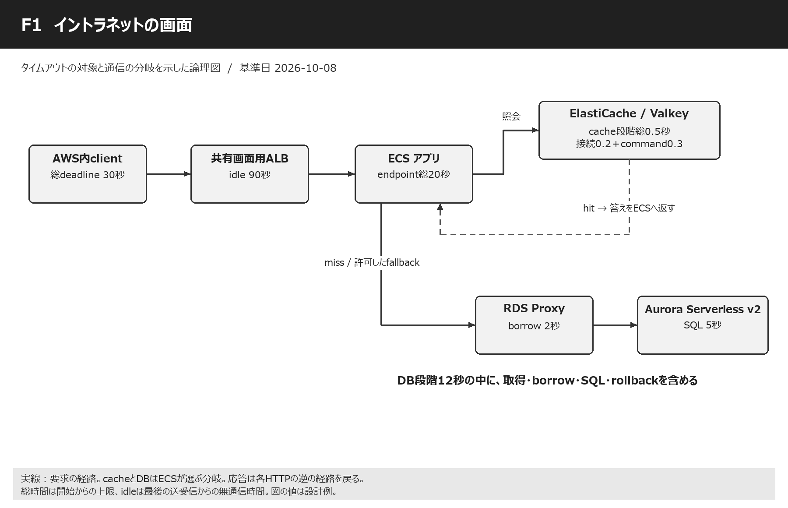

Mermaid対応の閲覧環境では、次の図も利用できます。

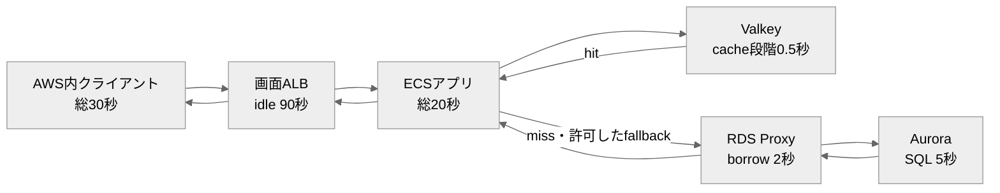

### 各接続点で設定する内容

| 段階 | 接続点 | 設定内容 | 設定ID | 整合性・動作のポイント |
| --- | --- | --- | --- | --- |
| 1 | client → 画面ALB | HTTPS。呼出し側が総30秒を管理。 | [C01](#setting-C01) [C03](#setting-C03) [C04](#setting-C04) [C05](#setting-C05) | 最初の30秒時計は、DB照会を始めてもゼロに戻さない。 |
| 2 | 画面ALB → ECS | ALB idle90秒、ECS request20秒。 | [A01](#setting-A01) [A06](#setting-A06) [A07](#setting-A07) [E01](#setting-E01) [E04](#setting-E04) | ECSが先に意味のあるエラー応答を返す。idle90秒を処理90秒と読まない。 |
| 3 | ECS ↔ Valkey | cache connect0.2秒＋command0.3秒以内。 | [V01](#setting-V01) [V02](#setting-V02) [V03](#setting-V03) [V04](#setting-V04) [V05](#setting-V05) [V06](#setting-V06) [V07](#setting-V07) | hitならDBへの線は使わない。cache障害時のfallback可否をデータ用途で決める。 |
| 4 | ECS → RDS Proxy | DB段階総12秒の内側でpool・接続・borrow。 | [D01](#setting-D01) [D02](#setting-D02) [D03](#setting-D03) [D04](#setting-D04) [D06](#setting-D06) [D07](#setting-D07) [D08](#setting-D08) | ValkeyがSQLを中継する構成ではない。Proxy borrow既定120秒は短い同期要求と衝突する。 |
| 5 | RDS Proxy ↔ Aurora | SQL5秒、lock1秒、transaction8秒。 | [D05](#setting-D05) [D09](#setting-D09) [D10](#setting-D10) [D11](#setting-D11) [D12](#setting-D12) [D13](#setting-D13) [D14](#setting-D14) [D15](#setting-D15) [D16](#setting-D16) [D17](#setting-D17) [D18](#setting-D18) [D19](#setting-D19) [D20](#setting-D20) | DB engine別の設定を選ぶ。PG用のstatement_timeoutをMySQLへ入れない。 |
| 6 | ECS → ALB → clientの応答 | JSON作成・HTML生成・送信・取消も予算に含める。 | [E01](#setting-E01) [X01](#setting-X01) [X02](#setting-X02) | DBが終わった時点で成功ではない。応答が届くまでの余裕を残す。 |

### 図書館のたとえ

画面は「本を見せて」というお願いです。ALBは空いている係を選ぶ案内係、ECSはお願いを聞く係、Valkeyは机の上のよく使うメモ、Auroraは大きな本棚です。メモに答えがあれば本棚まで歩きません。なければECSの係が、接続を貸すRDS Proxyを通して本棚を調べます。

### 通常の動作イメージ

例としてt=0で画面要求、0.1秒でECS受付、0.15秒でcache miss、0.3秒でDB照会、0.7秒で結果、0.9秒で画面応答、と考えます。これは理解のための例で、AWSが保証する速度ではありません。各上限は普段からその長さだけ待つ設定ではなく、異常時に止める柵です。

### cacheが止まった時

cache段階を0.5秒で切り上げてからDBへ進む設計なら、DB時間を残せます。ただしcache障害で全要求がDBへ集中するとDBも止まります。fallbackには同時実行上限、短期circuit breaker、同じkeyへの照会集約を付け、DBへ何でも無制限に流さないようにします。これはアプリ側の設計です。

### SQLが長い時

PGならSQLがDBへ届いてから5秒程度でstatement_timeoutが働き、アプリがrollbackし、20秒より前にエラーを整えます。MySQLの更新は同じSQL変数だけで止まらないため、driver取消が実効的か別試験が必要です。HTTP timeout後にcommitが済むこともあり、更新結果不明は再送前に照会します。 [S15](https://www.postgresql.org/docs/17/runtime-config-client.html) [S16](https://dev.mysql.com/doc/refman/8.0/en/server-system-variables.html)

### 時間を積み上げる

cache0.5＋DB段階12＋その他3＋応答余裕2=17.5秒をECS20秒へ収めます。DB段階の12秒はSQL5秒を内包し、lock1秒もSQLの内側です。20＋12＋5とすべてを足す計算ではありません。予算の最長経路と包含関係を見て足します。

### 同じ画面ALBを帳票と共有

帳票には長い無通信があるため画面ALBのidleは90秒とします。それでも通常画面ECS20秒・client30秒は独立して有効です。idleはALB全体の属性なので、URLルールごとに20秒と90秒を直接設定することはできません。 [S01](https://docs.aws.amazon.com/elasticloadbalancing/latest/application/edit-load-balancer-attributes.html)

<a id="s04"></a>

## 04 イントラネットの画面非同期

**指定された接続線**

AWSのクライアント → 画面呼び出し → 画面用ALB → ECS → SQS → Lambda → 画面用ALB → ECS（バックコンテナ）

**論理構成の読み方**

前半の受付HTTPはjobIdと202等を返して終了。その後LambdaのESMがSQSを受信し、別HTTPで画面ALBのバック用ルールへアクセスする。

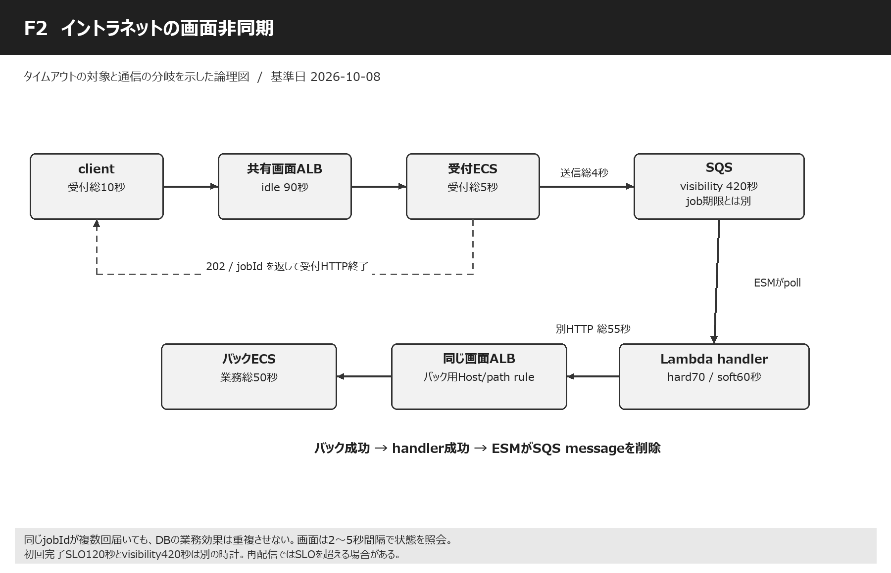

Mermaid対応の閲覧環境では、次の図も利用できます。

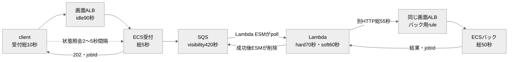

### 各接続点で設定する内容

| 段階 | 接続点 | 設定内容 | 設定ID | 整合性・動作のポイント |
| --- | --- | --- | --- | --- |
| 1 | client → 画面ALB → 受付ECS | 受付client10秒、受付アプリ5秒。 | [Q02](#setting-Q02) [A01](#setting-A01) [C03](#setting-C03) [C05](#setting-C05) | 画面をバック処理終了まで開きっぱなしにしない。 |
| 2 | 受付ECS → SQS | SendMessage総4秒、最大2attempts。 | [Q01](#setting-Q01) [Q05](#setting-Q05) [Q06](#setting-Q06) [X01](#setting-X01) [X03](#setting-X03) | 受理済か不明な時も同じjobIdで再確認。業務状態保存と送信の整合が必要。 |
| 3 | SQS → Lambda ESM | visibility420秒、window0秒、batch1件。 | [Q03](#setting-Q03) [Q04](#setting-Q04) [Q07](#setting-Q07) [L02](#setting-L02) [L03](#setting-L03) | Lambda pollerが受信する。SQSが最初のclient TCP接続を保持する機能ではない。 |
| 4 | Lambda handler | Timeout70秒、soft60秒、最後10秒を確保。 | [L01](#setting-L01) [L05](#setting-L05) [L06](#setting-L06) | 標準Lambdaを想定。処理能力に合わせてESM同時実行を抑える。 |
| 5 | Lambda → 画面ALB | 新しいHTTP総55秒、接続3秒以内。 | [L04](#setting-L04) [A01](#setting-A01) [A06](#setting-A06) [A07](#setting-A07) | 画面ALBのバック用Host/path ruleへ送る。同じALBの同じ先へ戻る必要はない。 |
| 6 | 画面ALB → バックECS | バックrequest50秒、server keepalive120秒。 | [E03](#setting-E03) [E04](#setting-E04) [A09](#setting-A09) [E05](#setting-E05) [X02](#setting-X02) | deadline内で結果を永続化し、同じjobIdの二重実行を防ぐ。 |
| 7 | バックECS → Lambda → SQS削除 | HTTP成功を受け、handlerが成功終了。 | [L03](#setting-L03) [Q07](#setting-Q07) [X03](#setting-X03) | ESMによる削除前にLambdaが止まると再配信され得る。重複の実試験を行う。 |
| 8 | clientの完了確認・取消 | poll2～5秒、初回完了SLO120秒、job期限1時間。 | [L07](#setting-L07) [X03](#setting-X03) | SLO・visibility・message retentionはそれぞれ別の時計。 |

### 整理券のたとえ

食堂で時間のかかる料理を頼んだら、受付は整理券を渡します。お客さんは受付の前でずっと電話をつなぐ必要がありません。SQSは注文箱、Lambdaは箱から注文を取る係、バックECSは調理係です。「受付できた」と「料理ができた」を別の状態として知らせます。

### 一本の長い線ではない

t=0で受付、t=1秒でjobIdを返し前半HTTP終了、t=3秒でLambda受信、t=4秒でバック要求、t=12秒で処理成功、t=13秒で画面のpollingが完了を確認する例です。キューが混雑したらt=3はもっと遅れます。ALB90秒を増やしてもキュー待ちの完了時間は短くなりません。 [S26](https://docs.aws.amazon.com/lambda/latest/dg/with-sqs.html)

### 420秒の意味

注文を取った係が仕事をしている間、ほかの係からその注文を見えにくくします。その時間がvisibilityです。70秒でLambdaを止める本案ではAWS推奨6倍で420秒にします。70秒で失敗しても直ちに再受信されるとは限らず、再び見えるまで待つ場合があります。 [S21](https://docs.aws.amazon.com/AWSSimpleQueueService/latest/SQSDeveloperGuide/sqs-visibility-timeout.html) [S23](https://docs.aws.amazon.com/lambda/latest/dg/services-sqs-configure.html)

### 失敗と重複

バックECSがDBへ保存した直後、応答を返す前に回線が切れると、Lambdaは成功を知りません。SQSへ戻った注文が再実行されても二重登録しないよう、jobIdと業務unique制約を使います。FIFOでも、外部のDB更新とSQS削除を一つのtransactionにはできないため、冪等化を省略しません。 [S26](https://docs.aws.amazon.com/lambda/latest/dg/with-sqs.html)

### 202応答の責任

202は結果の成功を約束する番号ではなく、受付済を知らせる例です。SQS受理前に成功応答して注文を失わないことが大切です。DBに受付だけ保存できてSQS送信が失敗した場合などは、outboxや送信状態の再確認を採用すると整合を取りやすくなります。これは必要時の実装方針で、既存構成に新サービスを勝手に追加する前提ではありません。

### バック用ルーティング

画面ALBへ戻る要求は/_internal/jobs等の専用ruleからバックtarget groupへ送る設計例です。通常画面へ戻って再びSQSへ送るループを防ぎます。Lambda→ALB→バックの認証・SG・Host/SNIも確認します。バックコンテナが同じtask内か別serviceかによって登録するportと容量が変わります。

### job期限と運用

120秒SLOを超えたら「遅延中」と表示し、同じ注文を追加しません。1時間の業務期限を過ぎた未実行jobはexpiredとして記録します。DLQ再投入は受付期限、同じjobId、すでに済んだ処理を確認してから行います。保存14日と再実行してよい14日は別です。 [S56](https://docs.aws.amazon.com/AWSSimpleQueueService/latest/SQSDeveloperGuide/sqs-dead-letter-queues.html)

<a id="s05"></a>

## 05 イントラネットの帳票出力

**指定された接続線**

AWSのクライアント → 画面呼び出し → 画面用ALB → ECS → 帳票用ALB → EC2（帳票用サーバ） → JSONデータ → ECS

**論理構成の読み方**

基本案はECSがEC2へ帳票要求を送り、EC2のJSON応答を同じHTTPで受け取る。EC2がECSへJSON取得要求を出す別通信の場合は追加15秒/12秒を明示する。

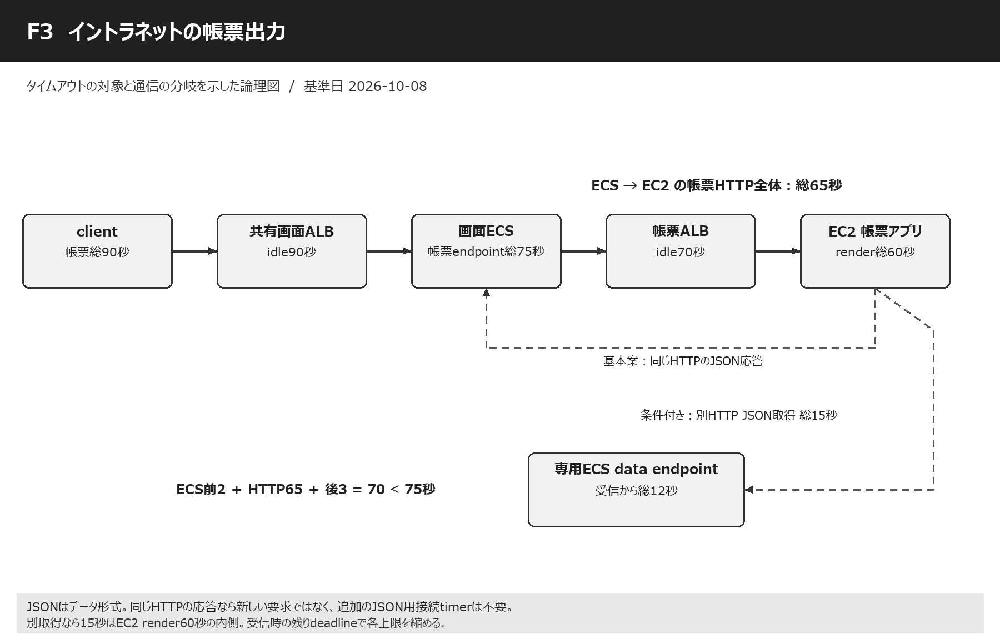

Mermaid対応の閲覧環境では、次の図も利用できます。

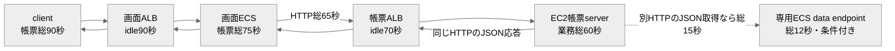

### 各接続点で設定する内容

| 段階 | 接続点 | 設定内容 | 設定ID | 整合性・動作のポイント |
| --- | --- | --- | --- | --- |
| 1 | client → 画面ALB | 帳票client90秒、画面ALB idle90秒。 | [C02](#setting-C02) [C03](#setting-C03) [A01](#setting-A01) | clientの90秒は総時間、ALBの90秒は無通信時間。値が同じでも時計が違う。 |
| 2 | 画面ALB → 画面ECS | 帳票endpoint75秒。 | [E02](#setting-E02) [E04](#setting-E04) [A09](#setting-A09) [E05](#setting-E05) | 通常画面E01の20秒を帳票に流用しない。header deadlineを受けて残り時間で短縮。 |
| 3 | 画面ECS → 帳票ALB | HTTP呼出し総65秒、connect3秒。 | [R01](#setting-R01) [C05](#setting-C05) [X02](#setting-X02) | readだけを65秒にして総時間無制限にならないよう外側deadlineを付ける。 |
| 4 | 帳票ALB → EC2 | ALB idle70秒、接続はAWS管理10秒。 | [A03](#setting-A03) [A06](#setting-A06) [A07](#setting-A07) [R03](#setting-R03) | EC2側keepalive100秒。接続待ちを引いた残りでEC2の60秒上限を短縮。 |
| 5 | EC2帳票処理 | render request総60秒。 | [R02](#setting-R02) [A09](#setting-A09) [X01](#setting-X01) | 帳票生成・JSON加工・応答準備を含む。無条件な再生成は重い仕事を二重化する。 |
| 6 | EC2 → ECSのJSON応答（基本案） | 同じHTTP response body。新しいTCP接続なし。 | [R01](#setting-R01) [E02](#setting-E02) [X02](#setting-X02) | 別のJSONサービス用timeoutという設定を作らない。受信サイズとJSON parse時間も総予算内。 |
| 7 | EC2 → ECSのJSON取得（条件付き） | 別HTTPなら取得15秒、data endpoint12秒。 | [R04](#setting-R04) [R05](#setting-R05) [A01](#setting-A01) [X02](#setting-X02) | 専用endpointへの追加線を描き、同じ待機中の画面処理へ再入して詰まらないようにする。 |
| 8 | ECS → clientの最終応答 | 前処理2秒＋呼出し65秒＋後処理3秒。 | [E02](#setting-E02) [C02](#setting-C02) | 計70秒 < ECS75秒 < client90秒。大きいファイルの送信時間も別途実測。 |

### 工作室のたとえ

ECSの係が工作室のEC2へ「このデータをきれいな紙にして」と頼みます。紙の作成に60秒の上限があるなら、ECSの電話はそれより長い65秒、画面係全体は75秒、利用者は90秒にします。内側の係が先に「間に合いません」と答える時間を用意する設計です。

### JSONという言葉の読み分け

JSONはデータの書き方です。「EC2 → JSON → ECS」がEC2の応答なら、往きのHTTPと同じやり取りに含まれます。一方、EC2がデータを取りにECSへ電話する意味なら新しい要求であり、接続・read・総時間・受けるECSの上限が必要です。記述だけでは決められないため、基本案と条件付き案を両方示します。

### 通常の帳票動作

t=0で画面要求、t=2でECSが帳票要求、t=3でEC2受付、t=38で生成完了、t=40でECSへJSONが戻り、t=43で画面に結果を返す例です。35秒間byteが戻らない場合でも帳票ALB70秒・画面ALB90秒なら無通信による切断を避けられます。これは動作例で性能保証ではありません。

### 別JSON取得がある場合

EC2の60秒の箱の中に、JSON取得15秒、帳票生成35秒、前後5秒を入れ、合計55秒とします。15＋60=75秒を許す形ではありません。ECS data endpoint12秒よりHTTP15秒を長くする一方、ALB共有idle90秒はこの15秒の停止条件にはなりません。

### 接続不良も考える

帳票ALBがEC2へ新規接続を作る時は最大10秒の接続待ちが別に存在します。10秒の後にEC2が60秒全部を使うとECS呼出し65秒を超えます。ECSが65秒のdeadlineを伝え、EC2が受信時点の残り時間から終了余裕を引いて60秒を短縮する必要があります。成功時の大小関係だけで保証しない理由です。 [S02](https://docs.aws.amazon.com/elasticloadbalancing/latest/application/load-balancer-troubleshooting.html)

### 長い帳票をどうするか

60秒で生成できない仕様があるなら、無理にこの例へ合わせず時間予算を作り直します。画面用ALBも影響するため、帳票だけのALB変更では足りません。生成時間が大きく変動する帳票では非同期受付と保存済ファイルの取得が選択肢ですが、今回の同期経路の前提とは分けて判断します。

### サイズと取消

JSONのサイズに上限を設け、parseが長引く場合も75秒以内へ収めます。PDF等の本体を返すなら回線速度によるdownload時間を含めて再計算します。利用者が閉じた時はrender子processを中止し、既に生成済ならjobIdで再利用することで、同じ重い生成を繰り返さずに済みます。

<a id="s06"></a>

## 06 イントラネットのAPI

**指定された接続線**

AWSのクライアント → API呼び出し → イントラネットAPI用ALB → ECS → Valkey → RDS Proxy → Aurora Serverless v2

**論理構成の読み方**

API用ALBは画面用ALBと別。ECS→Valkey照会とECS→RDS Proxy→Aurora照会はhit/missによる分岐として扱う。

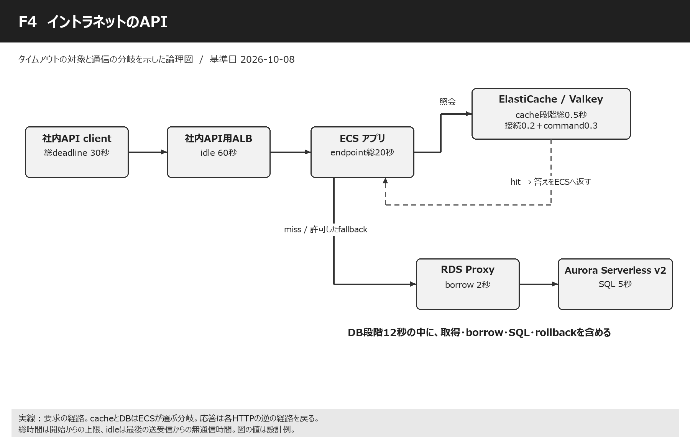

Mermaid対応の閲覧環境では、次の図も利用できます。

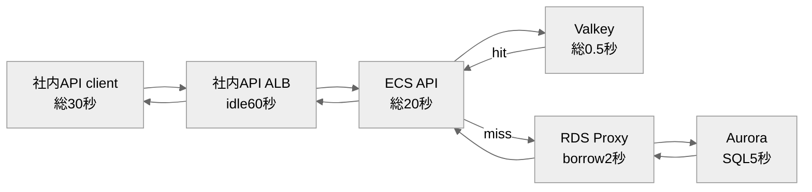

### 各接続点で設定する内容

| 段階 | 接続点 | 設定内容 | 設定ID | 整合性・動作のポイント |
| --- | --- | --- | --- | --- |
| 1 | AWS client → 社内API用ALB | 総30秒、接続3秒、pool待ち1秒。 | [C01](#setting-C01) [C03](#setting-C03) [C04](#setting-C04) [C05](#setting-C05) [X01](#setting-X01) | 社内SDKもbrowserも、明示した契約のdeadlineを持つ。 |
| 2 | 社内API用ALB → ECS | ALB idle60秒、ECS20秒。 | [A02](#setting-A02) [A06](#setting-A06) [A07](#setting-A07) [A08](#setting-A08) [E01](#setting-E01) [E04](#setting-E04) | 画面ALB90秒と異なるLBなので60秒を独立設定できる。 |
| 3 | ECS ↔ Valkey | 段階総0.5秒、missでDBへ。 | [V01](#setting-V01) [V02](#setting-V02) [V03](#setting-V03) [V04](#setting-V04) [V05](#setting-V05) [V06](#setting-V06) [V07](#setting-V07) | read cacheを経由しない更新処理もある。ユーザー記述の線を中継と誤解しない。 |
| 4 | ECS → RDS Proxy | DB段階総12秒、borrow2秒。 | [D01](#setting-D01) [D02](#setting-D02) [D03](#setting-D03) [D04](#setting-D04) [D06](#setting-D06) [D07](#setting-D07) [D08](#setting-D08) | task数×pool上限×service数を把握し、DB接続を無限に増やさない。 |
| 5 | Proxy ↔ Aurora | SQL5秒、engine別のlock/transaction上限。 | [D05](#setting-D05) [D09](#setting-D09) [D10](#setting-D10) [D11](#setting-D11) [D12](#setting-D12) [D13](#setting-D13) [D14](#setting-D14) [D15](#setting-D15) [D16](#setting-D16) [D17](#setting-D17) [D18](#setting-D18) [D19](#setting-D19) [D20](#setting-D20) | 短い同期待ちと長いbatchはrole・接続設計を分ける。 |
| 6 | clientへの結果・エラー返却 | JSON全体の応答と結果不明の処理。 | [E01](#setting-E01) [X01](#setting-X01) [X02](#setting-X02) [X03](#setting-X03) | 更新APIのtimeout後は結果照会または同じ冪等keyで再試行。 |

### 画面とAPIの違い

画面は人が見やすい形を返し、APIは別のプログラムが読めるJSONなどを返します。答えを作るECSとDBの仕組みは似ていますが、APIでは呼び出すプログラムのtimeout、retry、結果不明の扱いが大切になります。人がボタンを押し直す場合と同じように、プログラムも同じ処理を二度頼むことがあります。

### API用ALBの独立性

社内API用ALBは画面用ALBと別のため、帳票の75秒を守る必要がなければidle60秒で十分な設計例です。API業務上限20秒とclient30秒が先に働きます。画面・APIのコードが同じserver設定を共有するなら、server keepaliveは最大ALB90秒を見た120秒でも矛盾しません。 [S01](https://docs.aws.amazon.com/elasticloadbalancing/latest/application/edit-load-balancer-attributes.html)

### 社内だから無限待ちにしない

社内networkでもDBのlock、接続枯渇、deploy中の切断、DNSの更新、task停止は起こります。短い接続timeoutと総deadlineを決めるのは、悪い通信を疑うためだけでなく、待ち続けるthreadやconnectionをほかの要求へ返すためです。失敗の理由をrequestIdと一緒に返します。

### cache更新の注意

APIがAuroraへ更新したあとcacheを消せなかった場合、古い答えを返す可能性があります。SQLのtimeoutだけではcacheの鮮度は守れません。更新と失効の順序、TTL、version番号などを既存方式に合わせ、timeoutによりどこまで済んだかを把握します。

### 計算と再試行

通常画面と同じ17.5秒の処理予算を20秒へ入れます。client30秒でもECSを20秒ずつ2回呼ぶことはできません。safe readを再試行したい時は1回目が何秒かかったかを引き、残り時間と同時処理容量がある時だけ行います。

<a id="s07"></a>

## 07 インターネットのAPI

**指定された接続線**

外部API request → Cognito M2M（CloudFront）でtoken取得 → Regional REST API Gateway → VPC Link v2 → GWLBE → GWLB → Palo Alto → 公開API用ALB → ECS → RDS Proxy → Aurora Serverless v2

**論理構成の読み方**

①token取得HTTPSと②Bearer token付きAPI要求は別。VPC Link ENI↔ALBのroutingでGWLBE検査を挿入し、Palo Altoで検査後GWLB/GWLBEへ戻ってALBへ届く。

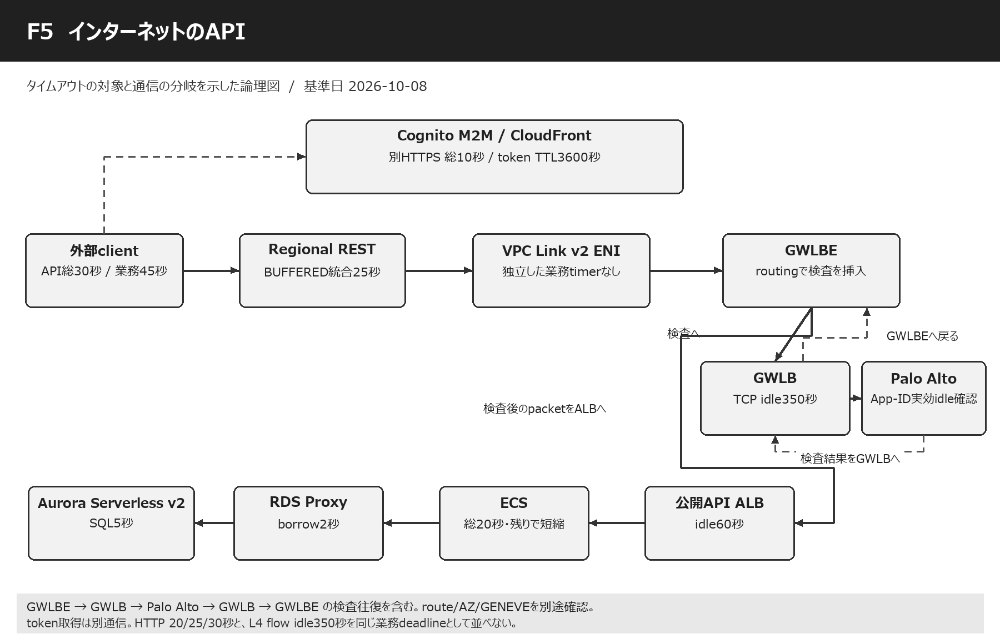

Mermaid対応の閲覧環境では、次の図も利用できます。

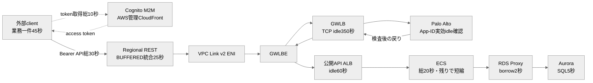

### 各接続点で設定する内容

| 段階 | 接続点 | 設定内容 | 設定ID | 整合性・動作のポイント |
| --- | --- | --- | --- | --- |
| 0a | 外部client → Cognito/CloudFront | 別HTTPS POST、token取得総10秒。 | [T01](#setting-T01) [T02](#setting-T02) [T03](#setting-T03) [T04](#setting-T04) | tokenを返す通信はALB/DBへ直列に通る業務requestではない。 |
| 0b | tokenを添えた業務API request | API要求総30秒、業務一件45秒。 | [C03](#setting-C03) [C04](#setting-C04) [C05](#setting-C05) [C06](#setting-C06) [T05](#setting-T05) | Authorization: BearerでAPI入口へ。tokenのexp1時間とHTTP30秒は別。 |
| 1 | Regional REST API Gateway | BUFFERED integration25秒。 | [G01](#setting-G01) [G02](#setting-G02) [G03](#setting-G03) [G06](#setting-G06) | 認証とintegrationを区別し、Gateway入口時刻でECSに残り時間を伝える。 |
| 2 | API Gateway → VPC Link v2 ENI | 同一account/利用Region/AZ確認。 | [G04](#setting-G04) [G05](#setting-G05) | VPC Link自身へ設定する独立HTTP timeoutはない。 |
| 3 | VPC Link ENI → GWLBE | subnet routeで検査へ誘導。 | [N01](#setting-N01) [X02](#setting-X02) | 単にGWLBEを作っただけではALB宛trafficが検査へ行く保証がない。 |
| 4 | GWLBE → GWLB → Palo Alto → GWLB → GWLBE | 元packetをGENEVEで運び、検査後戻す。 | [N02](#setting-N02) [N03](#setting-N03) [N06](#setting-N06) [N07](#setting-N07) [N08](#setting-N08) [N09](#setting-N09) [N10](#setting-N10) | TCP flow350秒と外側GENEVE UDPを区別。App-IDごとの実効timeoutと対称routeを確認。 |
| 5 | GWLBE検査後 → 公開API用ALB | ALB idle60秒。 | [A04](#setting-A04) [A06](#setting-A06) [A07](#setting-A07) | Palo Altoから直接ALBへTCP proxyする前提とは限らない。packet検査の挿入構成。 |
| 6 | ALB → ECS | 最大20秒。ただしGatewayの残り時間で短縮。 | [E01](#setting-E01) [E04](#setting-E04) [A08](#setting-A08) [E05](#setting-E05) [G06](#setting-G06) [X02](#setting-X02) | ALB接続10秒＋ECS20秒は30秒なので、固定値だけでは25秒に収まらない。 |
| 7 | ECS → RDS Proxy → Aurora | cacheなし。DB段階総12秒。 | [D01](#setting-D01) [D02](#setting-D02) [D03](#setting-D03) [D04](#setting-D04) [D05](#setting-D05) [D06](#setting-D06) [D07](#setting-D07) [D08](#setting-D08) [D09](#setting-D09) [D10](#setting-D10) [D11](#setting-D11) [D12](#setting-D12) [D13](#setting-D13) [D14](#setting-D14) [D15](#setting-D15) [D16](#setting-D16) [D17](#setting-D17) [D18](#setting-D18) [D19](#setting-D19) [D20](#setting-D20) | 他経路と同じProxyならborrow・InitQuery等も共有。network検査の対象は実routeで判定。 |
| 8 | 戻りtraffic → client | 検査pathも往復で対応。 | [N07](#setting-N07) [X01](#setting-X01) [X02](#setting-X02) [X03](#setting-X03) | 504後に更新が続く事故を試験し、取消・結果確認・冪等化を組み合わせる。 |

### 入場券と門のたとえ

最初にCognitoで機械用の入場券をもらいます。券を取る電話が終わってから、その券を見せてAPIの門へ別の電話をします。API Gatewayは券と権限を確認する門、VPC Linkは内部への通路、GWLBとPalo Altoは通路の検査係です。入場券を取る電話の待ち時間は、門の中で本を調べる時間と別です。 [S40](https://docs.aws.amazon.com/cognito/latest/developerguide/token-endpoint.html) [S44](https://docs.aws.amazon.com/cognito/latest/developerguide/cognito-user-pools-define-resource-servers.html)

### CognitoのCloudFront

Cognito custom domainのCloudFrontはAWSが管理します。利用者が自由にorigin timeoutを変えられる自分のdistributionと区別します。token取得clientの総10秒、token cache、再取得時期を設定します。tokenが有効なら毎回Cognitoへ取りに行く必要はありません。 [S41](https://docs.aws.amazon.com/cognito/latest/developerguide/cognito-user-pools-add-custom-domain.html) [S42](https://docs.aws.amazon.com/cognito/latest/developerguide/amazon-cognito-user-pools-using-tokens-caching-tokens.html)

### 検査経路を正しく読む

GWLBE→GWLB→Palo Altoは、元のIP packetを検査装置へ運ぶ部分です。検査したpacketはGWLB/GWLBE側へ戻り、その先のrouteでALBへ届きます。応答も同じ検査状態が見えるように戻します。VPC Link ENIとALBを適切なsubnetへ置くなど、実際のroute制約を満たす必要があります。図の矢印は設定完了を意味しません。 [S34](https://docs.aws.amazon.com/elasticloadbalancing/latest/gateway/gateway-load-balancers.html) [S36](https://docs.aws.amazon.com/vpc/latest/privatelink/concepts.html)

### 25秒と20秒の整合

健全時はbackendアプリ20秒＋network/応答余裕5秒でGateway25秒へ入れます。新規ALB target接続が10秒かかる異常時には、20秒全部は残りません。Gateway入口時刻を信頼できるheaderへ写し、入口22秒を内部予算、ECSの実行上限はmin(20, 残り−2)とする例で、取消と応答余裕を確保します。 [S02](https://docs.aws.amazon.com/elasticloadbalancing/latest/application/load-balancer-troubleshooting.html) [S58](https://docs.aws.amazon.com/apigateway/latest/developerguide/rest-api-parameter-mapping-sources.html) [S59](https://docs.aws.amazon.com/apigateway/latest/developerguide/api-gateway-variables-for-access-logging.html)

### 350秒を長くすれば速くなるか

GWLB350秒・Palo Alto3600秒は、黙った接続の状態をどれだけ覚えるかの時間です。SQLを速くする値ではありません。処理20秒のJSON APIなら本案でnetwork idleを長く変更する必要はありません。長時間streamやpoolを採用する時は、最短idleとprobe・接続寿命・ENIのconntrackを別に整合させます。 [S33](https://docs.aws.amazon.com/elasticloadbalancing/latest/gateway/gateway-listeners.html) [S35](https://docs.aws.amazon.com/elasticloadbalancing/latest/network/network-load-balancers.html) [S38](https://docs.aws.amazon.com/AWSEC2/latest/UserGuide/security-group-connection-tracking.html)

### TLS検査の前提

Palo AltoがTLSを復号しない構成では、暗号化された中身のJSON全文を検査できるとは限りません。復号する構成は証明書信頼・handshake・App-IDの待機を追加で確認します。証明書確認を無効化してtimeoutのように見えるTLSエラーを回避する方式は採用しません。

### 既定29秒を超えたい時

BUFFEREDのRegional/Private RESTでは延長申請が可能ですが、承認と統合値変更とstage deployは別作業です。request rate quotaの調整もあり得ます。本案は申請を必要としない25秒です。長い処理は非同期化かSTREAMの別設計を比較し、全機器を単純に90秒へ変更しません。 [S27](https://docs.aws.amazon.com/apigateway/latest/developerguide/api-gateway-execution-service-limits-table.html) [H08](https://aws.amazon.com/about-aws/whats-new/2024/06/amazon-api-gateway-integration-timeout-limit-29-seconds/) [S31](https://docs.aws.amazon.com/apigateway/latest/developerguide/response-transfer-mode.html)

<a id="s08"></a>

## 08 SalesforceのAPI

**指定された接続線**

Salesforce → API request → Cognito M2M（CloudFront）でtoken取得 → Private Connect（PrivateLink） → VPC endpoint service → NLB → VPC endpoint → Private REST API Gateway → VPC Link v2 → Salesforce API用ALB → ECS → RDS Proxy → Aurora Serverless v2

**論理構成の読み方**

token取得を別通信に分離。Salesforce transit VPCのconsumer endpoint → 顧客endpoint service/NLB → 顧客VPCのexecute-api endpoint ENI → Private REST → VPC Link v2 → ALBという二つのPrivateLink入口を区別する。

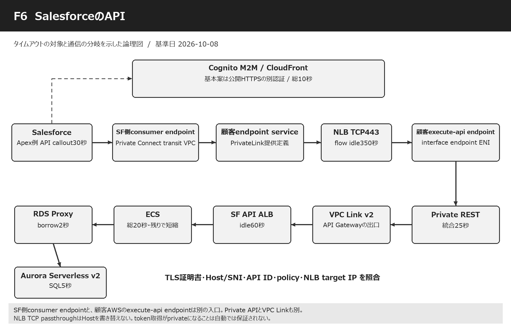

Mermaid対応の閲覧環境では、次の図も利用できます。

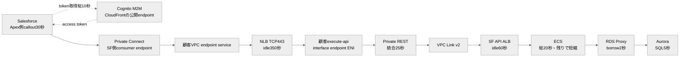

### 各接続点で設定する内容

| 段階 | 接続点 | 設定内容 | 設定ID | 整合性・動作のポイント |
| --- | --- | --- | --- | --- |
| 0 | Salesforce → Cognito token取得 | 基本案は公開HTTPSの別認証通信。 | [T01](#setting-T01) [T02](#setting-T02) [T03](#setting-T03) [T04](#setting-T04) [C06](#setting-C06) | Private Connectの業務経路を用意してもCognito domainへの認証通信が自動でprivateになるわけではない。 |
| 1 | Salesforce callout → Private Connect | ApexならsetTimeout30000ms。 | [C07](#setting-C07) [C08](#setting-C08) [C06](#setting-C06) [X01](#setting-X01) | 実際の実装がApex/Flow/MuleSoftのどれか未提供なので、Apex数値は条件付き。 |
| 2 | SF transit VPC consumer endpoint → 顧客endpoint service | PrivateLinkの利用側と提供側。 | [N01](#setting-N01) | Salesforce側に作るendpointと、後段のexecute-api endpointは別のENI入口。Named Credentialへ接続を関連付ける。 |
| 3 | 顧客endpoint service → NLB | 提供serviceがNLBを公開。TCP443例。 | [N04](#setting-N04) [N05](#setting-N05) [N09](#setting-N09) | TLS passthroughと終端を区別。endpoint serviceにHTTP処理時間の属性はない。 |
| 4 | NLB → execute-api endpoint ENI | NLBのIP targetにinterface endpointのprivate IPを指定する構成例。 | [N01](#setting-N01) [N04](#setting-N04) | DNS名・Host・SNI・API ID、ENI交換時のtarget更新、health checkを確認する。 |
| 5 | execute-api endpoint → Private REST API Gateway | endpoint policyとAPI resource policy、token scope。 | [G01](#setting-G01) [G02](#setting-G02) [G03](#setting-G03) [G06](#setting-G06) [T05](#setting-T05) | Private APIの入口とVPC Linkで内部ALBへ出る出口を区別。 |
| 6 | Private REST → VPC Link v2 | ENI経由のprivate integration。 | [G04](#setting-G04) [G05](#setting-G05) | Link作成APIはapigatewayv2でも業務API種別はRESTのまま。 |
| 7 | VPC Link → SF API用ALB → ECS | ALB idle60秒、ECS最大20秒。 | [A05](#setting-A05) [A06](#setting-A06) [A07](#setting-A07) [E01](#setting-E01) [E04](#setting-E04) [A08](#setting-A08) [E05](#setting-E05) [X02](#setting-X02) | Gateway25秒の残りを受けてECS処理を短縮。 |
| 8 | ECS → RDS Proxy → Aurora | cacheなし。DB段階12秒、SQL5秒。 | [D01](#setting-D01) [D02](#setting-D02) [D03](#setting-D03) [D04](#setting-D04) [D05](#setting-D05) [D06](#setting-D06) [D07](#setting-D07) [D08](#setting-D08) [D09](#setting-D09) [D10](#setting-D10) [D11](#setting-D11) [D12](#setting-D12) [D13](#setting-D13) [D14](#setting-D14) [D15](#setting-D15) [D16](#setting-D16) [D17](#setting-D17) [D18](#setting-D18) [D19](#setting-D19) [D20](#setting-D20) | 共有DB/Proxyの設定は他のrouteと矛盾しない値を使う。 |
| 9 | 結果 → Salesforce | token10＋API30＋余裕5=45秒例。 | [C06](#setting-C06) [C08](#setting-C08) [X03](#setting-X03) | 同一Apex transactionのほかのcalloutを含め累積120秒制約を確認。 |

### 専用通路のたとえ

Salesforceの建物から、一般の道へ出ない専用の通路でAWSの建物へ来るのがPrivate Connectです。入口のNLBの先に、Private API Gatewayへ入るためのexecute-api入口もあります。利用側の入口と、顧客AWS側の入口を同じ「VPC endpoint」という名前だけでまとめると、設定する場所を間違えます。 [S36](https://docs.aws.amazon.com/vpc/latest/privatelink/concepts.html) [S48](https://trailhead.salesforce.com/content/learn/modules/private-connect-outbound-connections/provision-and-use-outbound-connections) [S51](https://docs.aws.amazon.com/apigateway/latest/developerguide/apigateway-private-api-create.html)

### 成立するための前提

このNLB→execute-api endpoint構成は、endpoint ENIのIPをtargetにした到達、適切なHost/API ID/SNI、TLS証明書名、API resource policy等がそろうことが前提です。NLB DNS名へHTTPSを向けるだけでPrivate APIが呼べると保証するものではありません。実環境設定が未提供なので、到達可能性は検証項目として明示します。 [S51](https://docs.aws.amazon.com/apigateway/latest/developerguide/apigateway-private-api-create.html)

### HTTPを理解しないNLB

TCP passthroughのNLBはHTTPのHost headerを書き替える案内係ではありません。Salesforceの呼出しURLと証明書名が整合する必要があります。対応するPrivate API custom domainを使う設計、正しいHost/x-apigw-api-idを渡す設計、必要ならL7 proxyを置く設計を比較します。本案の数値は追加proxyを置かない場合です。 [S35](https://docs.aws.amazon.com/elasticloadbalancing/latest/network/network-load-balancers.html) [S51](https://docs.aws.amazon.com/apigateway/latest/developerguide/apigateway-private-api-create.html)

### Private Connectの状態

Salesforce側の接続をprovisionし、必要なら顧客側でendpoint接続をacceptしてReady状態を確認します。接続確立にかかる数分は管理操作の時間で、毎回の業務callout30秒と別です。Named Credentialが正しいOutbound Network Connectionを使っていることも確認します。 [S48](https://trailhead.salesforce.com/content/learn/modules/private-connect-outbound-connections/provision-and-use-outbound-connections)

### Apexの既定10秒の落とし穴

APIが20秒以内の仕様でもApexを既定10秒のままにすると、10秒でSalesforceが諦めることがあります。本案のApex例は30000msです。ただし同じtransactionでtoken取得・ほかのAPI・retryが増えると累積120秒に達し得ます。setTimeoutを120000へ上げるだけでは、Private REST統合25秒を延長できません。 [S49](https://help.salesforce.com/s/articleView?id=000212634&language=en_US&type=1) [S50](https://resources.docs.salesforce.com/latest/latest/en-us/sfdc/pdf/salesforce_apex_developer_guide.pdf)

### 認証もprivateにしたい場合

元のCognito domain/CloudFront経路は公開HTTPSとして扱います。2026年のGetClientTokenはdomain不要でPrivateLink対応の追加選択肢ですが、Salesforce Named CredentialがそのAPIをそのまま実行できるとは確認していません。別の認証実装・専用endpoint service等の要否を検証してから選ぶ条件付きの別案です。 [H12](https://aws.amazon.com/about-aws/whats-new/2026/08/amazon-cognito-get-client-token/) [S45](https://docs.aws.amazon.com/cognito-user-identity-pools/latest/APIReference/API_GetClientToken.html)

### 想定する失敗

誤ったHostなら403等、SGやNLB targetの誤りなら接続失敗、長いbackendならGateway504など、同じ「呼べない」に複数の原因があります。timeoutを広げる前にSF requestId、NLB target状態、Private REST access log、ECS requestIdを突き合わせ、到達していない段階と処理が遅い段階を分けます。

<a id="s09"></a>

## 09 タイムアウトの時計と動作原理

### なぜ待つ時間に上限が要るか

電話の相手が返事をしない時、ずっと待ち続けると電話、椅子、係の人を占有します。computerでもthread、socket、memory、DB connectionが占有されます。timeoutは「遅いものを急がせる魔法」ではなく、長すぎる待ちを終えて資源を返し、ほかの仕事を続けるための約束です。

### 接続の時計

connect timeoutは電話番号を調べ、相手へ電話し、つながるまでの待ちです。DNS・TCP・TLS・認証をどこまで含むかはclientによって異なります。「接続3秒」だけを設定しても、DNSが別の無限待ちなら3秒保証にはなりません。全段階を囲む総deadlineも必要です。

### 総時間の時計

total request deadlineは電話をかけ始めてからすべて終わるまでの時間です。途中で文字が届いても時計を戻しません。30秒のdeadlineなら、最初に10秒使った後で残るのは20秒です。child処理を始めるたびに30秒へ戻すと、全体は30秒を超えてしまいます。

### 無通信の時計

idle timeoutは相手が最後に話してから黙っている時間です。60秒idleの場合、40秒ごとに有効なdataが来れば総200秒の通信でもidleの期限に達しない場合があります。一方、DBが裏で働いていても、HTTPへbyteを返していなければALBにとっては無通信です。 [S01](https://docs.aws.amazon.com/elasticloadbalancing/latest/application/edit-load-balancer-attributes.html)

### 接続寿命の時計

connection lifetimeは同じ電話回線を作ってから何分使っているかです。話し続けていても長く使えば作り直す考え方です。ALB client_keep_aliveとDB pool maxLifetimeが該当します。idleと同じ名前のkeepaliveが混在するので、対象が「未使用時間」か「誕生からの時間」かを確認します。 [S01](https://docs.aws.amazon.com/elasticloadbalancing/latest/application/edit-load-balancer-attributes.html) [S10](https://docs.aws.amazon.com/AmazonRDS/latest/UserGuide/rds-proxy-connections.html)

### 借用待ちの時計

connection poolは共用の電話機を貸す場所です。全台が使用中なら借りる順番を待ちます。ECSのpool待ち、RDS ProxyのDB connection borrowは別の待ちです。すでに借りた電話で行うSQLの待ちも別です。Proxy borrowを120秒にしたままclient30秒だと、clientが帰った後まで借用待ちが続く危険があります。 [S10](https://docs.aws.amazon.com/AmazonRDS/latest/UserGuide/rds-proxy-connections.html)

### SQLとlockの時計

SQL timeoutは本棚を調べる一つの仕事の上限です。lock timeoutはほかの係が同じ本を使っている間の順番待ちです。PGのstatement timeoutにはlock待ちも入るので、lock1秒はSQL5秒の内側です。ただしlockを複数回取得するSQLでは各lock試行の上限とstatement全体の上限を両方理解します。 [S15](https://www.postgresql.org/docs/17/runtime-config-client.html)

### SQSの三つの時計

DelaySecondsは注文箱へ入れたあと取れるようになるまで、VisibilityTimeoutは取ったあとほかの係から隠す間、MessageRetentionPeriodは注文を何日保存するかです。どれも最初の画面HTTPを何秒待つかではありません。この区別ができると、非同期の設定を一本の大小関係に押し込む誤りを防げます。 [S20](https://docs.aws.amazon.com/AWSSimpleQueueService/latest/APIReference/API_SetQueueAttributes.html) [S21](https://docs.aws.amazon.com/AWSSimpleQueueService/latest/SQSDeveloperGuide/sqs-visibility-timeout.html)

### 健全性と終了の時計

HealthCheckTimeoutは「まだ働けるか」という短い確認の待ち、deregistration delayは係を交代させる時の残仕事の猶予、stopTimeoutは終了を頼んでから強制停止するまでです。request deadlineを長くしてもstopTimeout30秒のままでは、deploy中の帳票が途中で止まり得ます。 [S03](https://docs.aws.amazon.com/elasticloadbalancing/latest/application/edit-target-group-attributes.html) [S04](https://docs.aws.amazon.com/elasticloadbalancing/latest/application/target-group-health-checks.html) [S05](https://docs.aws.amazon.com/AmazonECS/latest/developerguide/task_definition_parameters.html)

### TCPの確認は業務の確認ではない

TCP ACKやkeepalive probeは通信相手や経路がいることを確かめるものです。「帳票を作れた」「SQLがcommitした」を知らせるものではありません。probeでL4の350秒idleを維持できても、アプリの20秒deadlineやSQL5秒を無効にはしません。 [S34](https://docs.aws.amazon.com/elasticloadbalancing/latest/gateway/gateway-load-balancers.html) [S38](https://docs.aws.amazon.com/AWSEC2/latest/UserGuide/security-group-connection-tracking.html)

### HTTPのheartbeatには条件がある

ALBはdata送受信でidleを更新しますが、HTTP/2 PINGはidleを更新しません。少量JSONにheartbeatを途中で混ぜるとJSON文法を壊す場合があります。STREAM・SSE・chunked転送の契約、clientの対応、Gatewayの転送方式をそろえてから使うものです。 [S01](https://docs.aws.amazon.com/elasticloadbalancing/latest/application/edit-load-balancer-attributes.html) [S31](https://docs.aws.amazon.com/apigateway/latest/developerguide/response-transfer-mode.html)

### 相手は止まるのか

待っていたclientのtimeoutと、serverの計算停止は独立です。HTTP接続が切れてもrenderやSQLが動き続け、後でcommitすることがあります。取消token、DB cancel、rollback、child process終了を実装し、結果が曖昧ならrequestIdで照会する仕組みを用意します。

### 「一番短い値」の正しい使い方

同じ通信で同時に監視している同種のidleなら、より短い装置が先に切ることを考えます。しかしSQL5秒・SQS visibility420秒・token寿命3600秒を並べて最小5秒が全体上限だと結論することはできません。時計の起点、対象、リセット、失効時の動作を先にそろえます。

<a id="s10"></a>

## 10 すべてを整合させる時間予算の作り方

### まず利用者との約束を決める

最初に「通常APIは30秒以内」「帳票は90秒以内」「非同期は5秒で受付」と決めます。その内側でECS・DB・外部HTTPへ使える時間を配ります。AWSの最大値を全部使うことから始めると、利用者が何分待つべきか決まらず、障害時に多くの資源が止まります。

### 内側を先に止める目的

通常APIならECS20秒、Gateway25秒、client30秒です。ECSが自分で失敗を判断してrollbackし、意味のあるJSONエラーを作り、Gateway経由で返す余地を残します。これは同じ1要求を囲む処理上限の関係です。ALB idle60秒をその列へ同じ種類の期限として足し込まないことが大切です。

### 逐次処理は足し算する

cache確認後にDBへ行き、JSONを作るならcache0.5 + DB12 + その他3 + 応答2 = 17.5秒です。17.5 <= ECS20なので2.5秒の余裕が残ります。同じ処理に含まれているSQL5秒やlock1秒をさらに加えると二重計上になります。Excelの計算シートは、この包含関係を説明付きで確認します。

### 並列処理は最長経路を見る

二つの独立した読取を同時に実行して両方必要なら、壁時計時間は原則長い方＋結合時間です。ただし共通のconnection poolが1本しかなければ実際は直列になる場合があります。短いtimeoutを付けた並列処理も、取消後にほかの処理が資源を使い続けないことを確認します。

### idleは最長無通信に余裕を足す

帳票EC260秒を無通信で待つ可能性があるなら帳票ALB70秒、画面ECS75秒を待つ可能性なら画面ALB90秒を置きます。通常APIのidle60秒は業務20秒を覆います。応答bodyを送った後の接続再利用にも同じidleが使われるため、server側keepaliveとpoolの掃除も合わせます。

### keepalive整合の向き

ALBとtargetの未使用HTTP接続では、ALB idle90秒よりtarget server keepalive120秒を長くします。一方clientが接続poolに保存する未使用接続は、次段の最短idle60秒より短い45秒で捨てます。「serverは長め」「借りて再使用するclientの未使用接続は早め」と、対象と役割を分けて理解します。 [S01](https://docs.aws.amazon.com/elasticloadbalancing/latest/application/edit-load-balancer-attributes.html) [S02](https://docs.aws.amazon.com/elasticloadbalancing/latest/application/load-balancer-troubleshooting.html)

### 新規接続10秒の反例

Gateway25秒、ECS20秒だけなら、ALBがtargetへ新規接続する10秒＋ECS20秒で30秒になり得ます。Gatewayは25秒で諦めるため、その後の処理継続を防ぐ必要があります。通常時の速い接続を仮定した表と、故障時まで守るdeadline伝播は別の確認です。 [S02](https://docs.aws.amazon.com/elasticloadbalancing/latest/application/load-balancer-troubleshooting.html)

### Gateway入口時刻を使う例

REST integration headerへcontext.requestTimeEpochを写し、ECSが入口22秒の内部deadlineを計算する例を示します。ECS20秒上限を、すでに使った時間と終了余裕2秒を差し引いた残り以下へ縮めます。入口時刻はintegration開始より早いので、認証が長引いた場合も保守的に短くなります。 [S58](https://docs.aws.amazon.com/apigateway/latest/developerguide/rest-api-parameter-mapping-sources.html) [S59](https://docs.aws.amazon.com/apigateway/latest/developerguide/api-gateway-variables-for-access-logging.html)

### 時計差とheaderの信頼

別computerのmonotonic clock値は比較できません。epoch時刻を受け取って時計差を管理し、受信時にlocalのmonotonic deadlineへ変換します。外部が未来時刻を送って上限を延ばせないようGatewayでheaderを上書きし、内部入口を制限します。時計差上限1秒以内の例なら、さらに2～3秒の余裕を残します。

### retryの最悪時間

1attemptがconnect3＋read8秒なら最大11秒です。3attemptsと待機1＋2秒なら概算36秒で、client30秒を超えます。read8秒が無通信時間である場合はさらに総時間が増え得ます。retryの回数だけでなく、attempt全体、backoff、jitter、総deadlineを同時に管理します。 [S52](https://docs.aws.amazon.com/sdkref/latest/guide/feature-retry-behavior.html)

### Lambdaの箱とSQSの箱

バックECS50 < HTTP55 < Lambda soft60 < Lambda hard70、visibility420 >= 6×70 + window0を満たします。50/55/60/70は実行の入れ子、420は注文を隠す別時計です。jobのSLO120秒はキュー待ち＋実行＋完了通知を計測して判定し、420をSLOへ置き換えません。 [S23](https://docs.aws.amazon.com/lambda/latest/dg/services-sqs-configure.html)

### 帳票でのdeadline短縮

ECS→EC2の総65秒は、接続・ALB待ち・render・JSON応答を含みます。EC2受信時の残りが52秒なら、固定60秒の上限を残り−応答余裕まで短縮します。EC2がECSへ別JSON取得する15秒も同じ残り予算を消費し、毎回65秒へ戻さないようにします。

### 共有設定と個別設定の境界

ALB idleはLB全体、deregistration delayはTG、ECS stopTimeoutはcontainer、request deadlineはendpoint、RDS Proxy borrowはProxyのTG、SQL timeoutはrole/session等です。最も狭い単位で業務契約を分け、共有資源の設定はそこを通る最も長い要求を踏まえて決めます。 [S01](https://docs.aws.amazon.com/elasticloadbalancing/latest/application/edit-load-balancer-attributes.html) [S03](https://docs.aws.amazon.com/elasticloadbalancing/latest/application/edit-target-group-attributes.html) [S05](https://docs.aws.amazon.com/AmazonECS/latest/developerguide/task_definition_parameters.html) [S12](https://docs.aws.amazon.com/AmazonRDS/latest/APIReference/API_ConnectionPoolConfiguration.html)

### 容量も整合させる

100要求/秒が20秒待つ状態なら概算2000要求が同時に存在します。同じ100要求/秒が1秒で終われば概算100です。待機上限を増やすと、必要thread・connection・memoryも増えます。20秒を60秒へ延長する判断では、平均・P95/P99、同時実行、queue age、DB接続数を同時に測ります。

### 全体保証の限界

本資料の値は、deadlineを実装し取消が働くことを条件に整合する設計例です。timeout発火からOS停止・SQL cancel完了までを数学的にゼロ秒にはできません。CPU starvation、network断、応答消失などの最悪時は「成功まで保証」ではなく、規定時間で待機を終え、状態を確認して回復できることを完了条件にします。

<a id="s11"></a>

## 11 Valkey・RDS Proxy・Auroraを深く理解する

### cacheは近道である

Auroraの結果の写しをValkeyへ置くと、毎回重いSQLをせずに済みます。cache hit、cache miss、cache errorは別の状態です。missは通常の分岐、errorは依存障害です。前者も後者もDBへ進める閲覧cacheと、errorなら処理を止める認証・lock用途を区別します。

### 0.5秒と600秒と300秒

cache段階0.5秒はECSの待ち、server idle600秒は未使用connectionを掃除する待ち、TTL300秒は古いデータを捨てる期限です。server timeout=600へ変えてもGETが600秒実行できる設定ではありません。TTL300へ変えてもGET timeout0.3秒にはなりません。 [S08](https://docs.aws.amazon.com/AmazonElastiCache/latest/dg/BestPractices.Clients.Redis.ServerTimeout.html) [S09](https://docs.aws.amazon.com/AmazonElastiCache/latest/dg/ParameterGroups.Engine.html)

### node-basedとServerless

node-based Valkeyは対応するcustom parameter groupでserver timeout等を扱えます。ElastiCache Serverlessのserver-side idle timeoutは利用者が同じ項目を設定する方式ではありません。Serverlessならclientのconnect/command/deadline、pool管理、cache障害時の動作を主に設定します。 [S08](https://docs.aws.amazon.com/AmazonElastiCache/latest/dg/BestPractices.Clients.Redis.ServerTimeout.html)

### Proxyの二種類の接続

ECS→Proxyはclient connection、Proxy→Auroraはdatabase connectionです。ECSがSQLを完了するとProxyがDB connectionをpoolへ戻せる場合があります。ECS側connectionを閉じても毎回DB側まで直ちに閉じるとは限りません。これにより接続作成の負担を減らせます。 [S10](https://docs.aws.amazon.com/AmazonRDS/latest/UserGuide/rds-proxy-connections.html)

### borrowが遅くなる原因

DB connection上限、長いtransaction、pinning、failover、容量不足で適切なDB connectionを借りられない場合があります。borrow2秒にするのは症状を早く利用者へ返すためです。同時にDatabaseConnectionsBorrowLatency、DatabaseConnections、MaxDatabaseConnectionsAllowed等を調べ、SQLと容量の原因を修正します。 [S10](https://docs.aws.amazon.com/AmazonRDS/latest/UserGuide/rds-proxy-connections.html)

### ProxyはSQLの万能stopwatchではない

ConnectionBorrowTimeoutは借用前の待ちです。IdleClientTimeoutはSQLの間でconnectionが未使用の待ちです。どちらも任意のSQLを5秒で中止する設定ではありません。SQL上限をDB/driverへ、transactionとDB段階上限をアプリへ設定します。 [S10](https://docs.aws.amazon.com/AmazonRDS/latest/UserGuide/rds-proxy-connections.html) [S12](https://docs.aws.amazon.com/AmazonRDS/latest/APIReference/API_ConnectionPoolConfiguration.html)

### PGの実効設定

業務専用roleやProxyのInitQueryでstatement_timeout5秒、lock_timeout1秒などを統一する案があります。すべてのDBへ一律適用せず、長い保守SQLは別roleにします。各requestの残り予算で動的にSETを使う場合は、Proxyのpinningにより接続多重化が変化する可能性を評価します。 [S15](https://www.postgresql.org/docs/17/runtime-config-client.html) [S13](https://docs.aws.amazon.com/AmazonRDS/latest/UserGuide/rds-proxy-pinning.html)

### MySQLの実効設定

max_execution_time5000は主にread-only SELECT向けです。更新SQLにも適用されたと思い込むと、clientが諦めたあと更新だけ進む事故になります。更新はdriverのquery timeout、実際の取消、transaction rollback、business idempotencyを試験します。InnoDB lock timeout1秒は行lock待ちで、metadata lockには別の扱いが必要です。 [S16](https://dev.mysql.com/doc/refman/8.0/en/server-system-variables.html) [S57](https://dev.mysql.com/doc/refman/8.0/en/innodb-parameters.html)

### キャンセルの通信にも時間が要る

query cancelは別の通信やcommandで行う実装があります。networkが切れていればcancelも届かない可能性があります。cancel/rollbackの所要時間と上限を決め、成功を確認できないconnectionは再利用しません。client read8秒の中へ取消余裕を入れ、最終的な状態はDB側の記録で照合します。 [S17](https://jdbc.postgresql.org/documentation/use/) [S18](https://dev.mysql.com/doc/connector-j/en/connector-j-connp-props-networking.html)

### transaction失敗後の掃除

PGではstatement失敗後のtransactionがaborted状態になり得ます。MySQLのlock timeoutでは通常statementだけがrollbackされます。例外を捕まえただけでconnectionをpoolへ返すと、次の要求へ失敗状態やlockが持ち越されます。成功/失敗の両方でcommit/rollbackとconnection破棄条件を明示します。 [S15](https://www.postgresql.org/docs/17/runtime-config-client.html) [S57](https://dev.mysql.com/doc/refman/8.0/en/innodb-parameters.html)

### pinningのたとえ

共用電話をみんなで使うはずが、一人の係が設定を変えて自分専用にしてしまうのがpinningのイメージです。その間ほかの係は借りられません。SET、session state、temp table等で起こり得ます。InitQueryへの統一や短いtransactionを検討し、DatabaseConnectionsCurrentlySessionPinnedを測ります。 [S13](https://docs.aws.amazon.com/AmazonRDS/latest/UserGuide/rds-proxy-pinning.html)

### poolを大きくしすぎない

例えば3service×最大20task×pool10なら、client側の候補は600接続です。Proxyは多重化しても、すべて長いtransactionやpinningになるとDB接続も多く要ります。最大task数、deploy時の増加、バック処理10並列、管理接続を含めてDBの収容力を確認します。

### Serverless v2の意味

負荷に応じたcapacity調整は便利ですが、lock待ちや悪いSQLを自動で消すものではありません。Min2/Max16 ACUは説明用の容量例です。Minが小さく初動が遅いのか、Maxに達したのか、SQLが重いのかを分けて確認し、timeoutを伸ばす前に測ります。 [H05](https://press.aboutamazon.com/2022/4/aws-announces-general-availability-of-amazon-aurora-serverless-v2)

### Proxyと0 ACUの注意

対応するAurora Serverless v2版では0 ACUの自動停止ができますが、関連付けたRDS Proxyが各DB instanceへの接続を保つ場合はauto-pauseしません。今回のProxy併用経路に「常に休眠して15秒で復帰する」時間を固定加算する説明は適切ではありません。Proxyを外す開発環境では別途再開時間を計測します。 [S14](https://docs.aws.amazon.com/AmazonRDS/latest/AuroraUserGuide/aurora-serverless-v2-auto-pause.html)

<a id="s12"></a>

## 12 非同期処理の時間・状態・再試行

### 受付・実行・結果の三段階

受付HTTPの成功は注文を保存できたこと、workerの成功は仕事が終わったこと、clientの完了確認は結果が見えたことです。三つを別の状態として記録します。例の状態はaccepted→running→succeeded、またはfailed/expired/cancelledです。runningのままworkerが消えた時の回復も設計します。

### visibilityとLambda70秒

Lambdaの標準Timeout70秒に対し、visibility420秒は6倍＋window0です。単純な「70秒より1秒長く」ではAWSのthrottling等に備える推奨を満たしません。windowを5秒へ変えたらvisibility425秒以上を検討します。変更後はESM、queue、functionの実効値を一緒に取得します。 [S23](https://docs.aws.amazon.com/lambda/latest/dg/services-sqs-configure.html)

### 自前pollerの25秒

自分でReceiveMessageを呼ぶconsumerならlong poll20秒に対してHTTP read25秒以上にします。20秒待つqueueへread10秒を指定すると、空のqueueから正常に返る前にclientがtimeoutします。Lambda ESMのpollerはAWS管理であり、利用者が同じSDK read項目を設定する作業はありません。 [S22](https://docs.aws.amazon.com/AWSSimpleQueueService/latest/SQSDeveloperGuide/best-practices-setting-up-long-polling.html) [S26](https://docs.aws.amazon.com/lambda/latest/dg/with-sqs.html)

### batchで増える時間

1件50秒の仕事をbatch10件で直列に呼べば500秒になり得ます。Lambda70秒のままでは入りません。本案はBatchSize1で予算を明確にします。batchを大きくする時は全件最悪時間、並列HTTP数、ECS容量、partial batch応答を含めて計算し直します。 [S23](https://docs.aws.amazon.com/lambda/latest/dg/services-sqs-configure.html)

### partial batchとtimeout

ReportBatchItemFailuresは、batchの中で失敗したIDを返して成功分を再配信させない仕組みです。ただしhandlerが70秒で強制終了するとその応答自体を返せません。したがってsoft60秒で仕事を切り上げ、failure応答を作る余裕10秒を取り、冪等化も必要になります。 [S24](https://docs.aws.amazon.com/lambda/latest/dg/services-sqs-errorhandling.html)

### at least onceの意味

注文は失われないよう再配信され得ます。そのため「同じ仕事が一回だけ届く」ことに依存しません。処理済jobIdを永続記録して同じ結果を返し、同時に二つ来てもunique制約や状態遷移で一方だけが業務更新できるようにします。visibilityが有効な間でも重複を完全には排除できません。 [S21](https://docs.aws.amazon.com/AWSSimpleQueueService/latest/SQSDeveloperGuide/sqs-visibility-timeout.html) [S26](https://docs.aws.amazon.com/lambda/latest/dg/with-sqs.html)

### throttlingとキュー滞留

バックECSの許容並列数よりLambdaが多く起動すると、HTTP待ちとDB借用待ちが増え、70秒失敗と再配信が連鎖します。ESM MaximumConcurrency10は例です。バックserviceのtask数、1taskの処理数、DB connection上限に合わせ、queue ageとthroughputで容量を決めます。 [S23](https://docs.aws.amazon.com/lambda/latest/dg/services-sqs-configure.html)

### SLO120秒は初回の目標

通常時のキュー待ち30秒＋実行60秒＋完了反映10秒なら100秒で目標120秒内に収まります。しかしworker故障でvisibility420秒を待つ再試行は120秒を超え得ます。その場合は遅延中・失敗・retry待ちを表示します。全再試行込みでも必ず120秒という要求なら、別の回復設計が必要です。

### 保存期間と期限

source保存4日、DLQ保存14日と、業務期限1時間は別です。1時間を過ぎたjobをworkerが受け取ったら、DB更新を始めずexpiredを記録します。queueの保存期間を短縮すると既存messageを期限切れにする可能性があるため、変更時は保存中のmessage ageを確認します。 [S20](https://docs.aws.amazon.com/AWSSimpleQueueService/latest/APIReference/API_SetQueueAttributes.html)

### DLQから戻す時

DLQは失敗した注文を保管する場所です。戻す前にエラー原因、同じjobIdの処理済結果、expiresAt、二重更新が起きないことを確認します。冪等記録を24時間で消してDLQに14日保存すると、10日後の再投入で二重処理を防げません。保存期限は業務のreplay window以上にします。 [S56](https://docs.aws.amazon.com/AWSSimpleQueueService/latest/SQSDeveloperGuide/sqs-dead-letter-queues.html)

### 利用者が画面を閉じた時

受付済jobは画面のTCP接続と切り離されています。画面を閉じただけで自動取消されません。取消を許す業務ならjob状態へcancel requestedを保存し、workerが安全な区切りで確認します。すでにcommitした処理を無条件に巻き戻すのではなく、業務の補償処理を決めます。

### 長い仕事へ変更する時

標準Lambdaの最大は900秒ですが、上限いっぱいにする理由があるか確認します。2026年のManaged Instancesでは対象async/ESMに5400秒が追加されていますが、環境モデルと再試行の前提が異なります。どちらを選んでもbackend HTTP、SQS visibility、業務期限、deploy時の停止を再設計します。 [S25](https://docs.aws.amazon.com/lambda/latest/dg/configuration-timeout.html) [S55](https://docs.aws.amazon.com/lambda/latest/dg/lambda-managed-instances-execution-environment.html) [H13](https://aws.amazon.com/about-aws/whats-new/2026/09/aws-lambda-90-minute-function/)

<a id="s13"></a>

## 13 認証・PrivateLink・検査装置の仕組みと設定

### M2Mは機械用の入場券

機械がclient IDとsecretを示して、特定APIを使えるscopeのaccess tokenを受け取ります。利用者がログインするID tokenと機械のaccess tokenを混同しません。OAuth client credentialsはaccess tokenの再取得で更新し、refresh tokenが返る前提にはしません。 [S40](https://docs.aws.amazon.com/cognito/latest/developerguide/token-endpoint.html) [S44](https://docs.aws.amazon.com/cognito/latest/developerguide/cognito-user-pools-define-resource-servers.html)

### tokenの時計を分ける

取得のHTTP10秒、token寿命3600秒、再取得2700秒より少し前は三つの時計です。寿命を長くしてもtoken取得が速くなるわけではありません。API開始時の残り期限が少なければ先に再取得し、時計差やnetwork遅延の余裕を確保します。 [S42](https://docs.aws.amazon.com/cognito/latest/developerguide/amazon-cognito-user-pools-using-tokens-caching-tokens.html) [S43](https://docs.aws.amazon.com/cognito-user-identity-pools/latest/APIReference/API_CreateUserPoolClient.html)

### Cognito authorizer

REST APIでCognitoのaccess tokenを使う時はmethodのAuthorization scopesを設定します。HTTP APIのJWT authorizer設定例をRESTへそのまま移しません。token検証のため毎回clientがCognitoを同期呼出しする構成とも区別します。Lambda authorizerを追加する場合はそのtimeoutとcold startも対象になります。 [S44](https://docs.aws.amazon.com/cognito/latest/developerguide/cognito-user-pools-define-resource-servers.html)

### 管理されるCloudFrontと自分のCloudFront

Cognito custom domainのdistributionはAWS管理です。一方、自分で追加するCloudFrontならConnectionTimeout、OriginReadTimeout、ResponseCompletionTimeout等の設定を検討できます。readはpacket間の待ち、completionはretryも含む全応答の上限です。T06～T08は後者を採用した場合だけの条件付き例です。 [S41](https://docs.aws.amazon.com/cognito/latest/developerguide/cognito-user-pools-add-custom-domain.html) [S46](https://docs.aws.amazon.com/AmazonCloudFront/latest/DeveloperGuide/DownloadDistValuesOrigin.html) [S47](https://docs.aws.amazon.com/AmazonCloudFront/latest/DeveloperGuide/cloudfront-limits.html)

### Private APIとprivate integration

Private APIはAPI Gatewayの入口をexecute-api interface endpoint経由へ限定する性質です。private integrationはAPI Gatewayの出口から内部ALB等へVPC Linkを使う性質です。Regional API＋private integrationも、Private API＋private integrationもあります。入口と出口がともにprivateでも、同じendpointを通るわけではありません。 [S30](https://docs.aws.amazon.com/whitepapers/latest/best-practices-api-gateway-private-apis-integration/rest-api.html) [S51](https://docs.aws.amazon.com/apigateway/latest/developerguide/apigateway-private-api-create.html)

### VPC Link v2とREST API

REST APIにもVPC Link v2でALBへ直接接続する機能が2025年11月に追加されています。VPC Link作成はapigatewayv2、REST methodの統合はapigatewayを使う形です。「v2だからHTTP APIの30秒上限」と機械的に判断しません。REST integration-targetはLB ARNを指定する現行方式を使います。 [H11](https://aws.amazon.com/blogs/compute/build-scalable-rest-apis-using-amazon-api-gateway-private-integration-with-application-load-balancer/) [S29](https://docs.aws.amazon.com/apigateway/latest/developerguide/set-up-private-integration.html)

### endpoint serviceは何をするか

endpoint serviceは「このNLB/GWLBのserviceへ利用者を接続させる」という提供側の定義です。interface endpointは利用側VPCへ作るENI入口です。service定義自体にSQL待機やHTTP処理のdeadlineはありません。NLB/GWLBのflow idleと、HTTP client/API Gatewayの時計を合わせます。 [S36](https://docs.aws.amazon.com/vpc/latest/privatelink/concepts.html) [S37](https://docs.aws.amazon.com/vpc/latest/privatelink/privatelink-share-your-services.html)

### GWLBEの挿入

GWLBEはroute tableから検査へtrafficを渡す入口です。VPC Link subnetとALB subnetの間のroute、返りのroute、AZ対応、appliance側のGENEVE UDP6081を確認します。SGを許可してもrouteが違えば検査しません。timeoutの資料でも、この到達条件を確認しないと「検査装置が遅い」と誤診します。 [S34](https://docs.aws.amazon.com/elasticloadbalancing/latest/gateway/gateway-load-balancers.html) [S36](https://docs.aws.amazon.com/vpc/latest/privatelink/concepts.html)

### L4 idleの最短値

GWLB350秒、NLB TCP350秒、Palo Alto実効3600秒、対象ENI conntrack350秒なら、L4状態が350秒付近で切れる候補を考えます。ただし各区間でpacketが実際に通りtimerが更新されるかが条件です。client pool45秒やDB pool240秒は、長いidle再利用を避ける方向の設定です。 [S34](https://docs.aws.amazon.com/elasticloadbalancing/latest/gateway/gateway-load-balancers.html) [S35](https://docs.aws.amazon.com/elasticloadbalancing/latest/network/network-load-balancers.html) [S38](https://docs.aws.amazon.com/AWSEC2/latest/UserGuide/security-group-connection-tracking.html) [S39](https://docs.paloaltonetworks.com/ngfw/help/11-1/device/device-setup-session/session-timeouts)

### PAN-OSのApp-ID

PAN-OSではglobal TCP timeoutだけでなく、識別されたapplicationのtimeoutがEstablished sessionに適用され、個別設定が優先し得ます。global3600を見て安全と断定せず、実sessionのapplication、end reason、設定override、decryptionを取得します。PAN-OS11.1の資料は参照例で、実稼働版の値は別途確認します。 [S39](https://docs.paloaltonetworks.com/ngfw/help/11-1/device/device-setup-session/session-timeouts)

### 片道だけでは成功しない

requestが通ってもresponseが別の検査装置へ戻ると、session stateが合わずdropすることがあります。clientからserverまでとserverからclientまでをtraceし、同じflowを同じ装置が扱える構成を確認します。単純にTCP idleを3600へ増やしてもroute不整合は直りません。 [S34](https://docs.aws.amazon.com/elasticloadbalancing/latest/gateway/gateway-load-balancers.html)

### APIの証明書名

PrivateLinkやNLBを経由する場合もHTTPSは相手の名前と証明書を照合します。NLB DNS名、API custom domain、Host header、SNI、execute-api API IDが整合する必要があります。TCP passthroughのNLBが自動でHostを置換するわけではありません。 [S35](https://docs.aws.amazon.com/elasticloadbalancing/latest/network/network-load-balancers.html) [S51](https://docs.aws.amazon.com/apigateway/latest/developerguide/apigateway-private-api-create.html)

### 新しいM2M方式の範囲

GetClientTokenは2026年8月に追加され、domainなしのSDK/API呼出しとPrivateLink対応が選べるようになりました。本依頼のCognito M2M（CloudFront）経路は従来OAuthを基本に残し、新方式は別案として示します。Salesforce側の認証機構との適合まで確認済とは記載しません。 [H12](https://aws.amazon.com/about-aws/whats-new/2026/08/amazon-cognito-get-client-token/) [S45](https://docs.aws.amazon.com/cognito-user-identity-pools/latest/APIReference/API_GetClientToken.html)

<a id="s14"></a>

## 14 登場の背景と、古い説明から変わった点

### 一台から分業へ

昔ながらの一台のserverで画面もSQLも帳票も動かす構成では、ひとつのtimerで考えやすい反面、負荷や故障がまとめて影響しました。分業するとscale・保守がしやすくなり、その代わり電話の待ち、接続の再利用、queueの注文保持を別々に決める必要が生まれます。

### TCP・HTTPから現在のcloudへ

通信には、届いたことを確認する仕組みと、お願いした仕事が完了したことを確認する仕組みがあります。Webのconnection再利用、proxy、分散DB、queue、短時間functionが重なるにつれて、一つの「timeout」という言葉の中へ別の時計が増えました。各製品がtimeoutを一つに統一しない理由は、守る資源と失敗の意味が異なるためです。

### Cognitoの背景

Cognitoは人や機械が誰で何をできるかをアプリごとに重複管理する負担を減らす役割です。利用者向け認証とM2Mは同じtokenという名前でも契約が異なります。本資料ではM2Mを中心に、domain-based OAuthと2026年追加のdomain不要APIを分けます。 [S40](https://docs.aws.amazon.com/cognito/latest/developerguide/token-endpoint.html) [S44](https://docs.aws.amazon.com/cognito/latest/developerguide/cognito-user-pools-define-resource-servers.html) [H12](https://aws.amazon.com/about-aws/whats-new/2026/08/amazon-cognito-get-client-token/)

### 更新が特に必要な古い記憶

「RESTはNLBしかつなげない」「29秒は必ず変更不可」「NLB/GWLB TCP idleは350秒固定」「CloudFront origin readはどの場合も60秒が絶対上限」「Lambdaはどの実行形態も15分まで」という一律の説明は現行仕様の条件を欠きます。表では現行の機能と、変わっていない例外を併記します。 [H08](https://aws.amazon.com/about-aws/whats-new/2024/06/amazon-api-gateway-integration-timeout-limit-29-seconds/) [H09](https://aws.amazon.com/about-aws/whats-new/2024/09/aws-network-load-balancer-tcp-idle-timeout/) [H10](https://aws.amazon.com/about-aws/whats-new/2024/09/aws-gateway-load-balancer-tcp-idle-timeout/) [H11](https://aws.amazon.com/blogs/compute/build-scalable-rest-apis-using-amazon-api-gateway-private-integration-with-application-load-balancer/) [S47](https://docs.aws.amazon.com/AmazonCloudFront/latest/DeveloperGuide/cloudfront-limits.html) [H13](https://aws.amazon.com/about-aws/whats-new/2026/09/aws-lambda-90-minute-function/)

### 歴史資料の読み方

発表、preview、一般提供、Region拡大は別の出来事です。歴史資料に書かれた当時の上限・料金・Regionを現在の設定値へ使いません。現行の設定はdeveloper guide/API reference、背景は当時の公式発表を使い分けています。

### 登場・仕様変更の年表

| 時期 | 技術 | 必要になった背景 | 現在のtimeout設計へ与える意味 | 公式出典 |
| --- | --- | --- | --- | --- |
| 2004 beta／2006本稼働 | SQS | 別々のserverが同じ速さで働くとは限らないため、注文をいったん箱へ保存して渡す方法が必要になった。 | visibility・retentionをHTTPの待ちと分離し、再配信に耐える設計へ。 | [H01](https://aws.amazon.com/blogs/aws/amazon-sqs-15-years-and-still-queueing/) |
| 2006-08-25 beta | EC2 | 必要な時に仮想serverを借りられるようになり、帳票製品など既存softwareをcloudへ置く選択肢が生まれた。 | OSのTCP timerに加え、Web server・帳票アプリ自身のtimeoutが必要。 | [H14](https://aws.amazon.com/jp/blogs/aws/amazon_ec2_beta/) |
| 2014-11-12 発表 | Aurora | cloud向けのRDBで可用性・保存・処理を改善する狙い。速いDBでもlockや重いSQLは残る。 | SQL、transaction、通信のtimeoutを用途別に設定。 | [H19](https://aws.amazon.com/blogs/aws/highly-scalable-mysql-compat-rds-db-engine/) |
| 2014-11-13 preview | ECS | 多数のcontainerを手作業で配置する負担を減らし、taskとserviceで動かす仕組み。 | containerの起動/停止timerとHTTP処理timerを分ける。 | [H15](https://aws.amazon.com/blogs/aws/cloud-container-management/) |
| 2014-11-13 preview | Lambda | eventが来た時にcodeを実行し、server管理を減らす仕組み。 | 実行時間を制限するfunction Timeoutが重要。古い発表時の上限は現在の仕様と別。 | [H16](https://aws.amazon.com/blogs/aws/run-code-cloud/) [S25](https://docs.aws.amazon.com/lambda/latest/dg/configuration-timeout.html) |
| 2015-07-09 | API Gateway | API公開、認証、監視、流量制御を各アプリで重複実装する負担を減らす。 | front doorに統合待ち上限が入り、backendだけ長くしてもclientへ成功を返せない。 | [H17](https://aws.amazon.com/about-aws/whats-new/2015/07/introducing-amazon-api-gateway/) |
| 2016-08-11 | ALB | HTTPのpath/hostなどを見て、containerやmicroserviceへ要求を振り分ける。 | L7のidle、client keepalive、target側server keepaliveが別の時計として現れる。 | [H02](https://aws.amazon.com/about-aws/whats-new/2016/08/announcing-application-load-balancer-for-elastic-load-balancing/) |
| 2017-09-07 | NLB | L4で大量の接続を振り分け、長く使うTCPの状態も扱う。 | HTTP総時間とは別にTCP flow idleが必要。TLS listenerとの制約差もある。 | [H18](https://aws.amazon.com/blogs/aws/new-network-load-balancer-effortless-scaling-to-millions-of-requests-per-second/) [S35](https://docs.aws.amazon.com/elasticloadbalancing/latest/network/network-load-balancers.html) |
| 2017-11-08 | PrivateLink | public IPやinternet経路を使わず、特定serviceへprivateに到達するための方式。 | privateだからtimeoutが不要にはならない。endpoint、NLB、clientの管理範囲を分ける。 | [H03](https://aws.amazon.com/about-aws/whats-new/2017/11/introducing-aws-privatelink-for-aws-services/) |
| 2020-05 release（公式回顧） | Salesforce Private Connect | Salesforceと顧客AWS serviceの間にprivateなHTTP/S通信を作るための機能。 | Named Credentialと専用経路を関連付けてもApex callout待機は別管理。 | [H20](https://admin.salesforce.com/blog/2024/enhance-agentforce-data-security-with-private-connect-for-data-cloud) [S48](https://trailhead.salesforce.com/content/learn/modules/private-connect-outbound-connections/provision-and-use-outbound-connections) |
| 2020-06-30 一般提供 | RDS Proxy | serverlessやcontainerの増減でDB接続が急増し、DBのmemory/CPUを圧迫する問題へ対処。 | 借用待ち・client idle・SQL待ちを分け、poolとpinningを監視する。 | [H04](https://aws.amazon.com/about-aws/whats-new/2020/06/amazon-rds-proxy-generally-available/) |
| 2020年代の検査経路 | GWLB・GWLBE・Palo Alto | 検査applianceをscaleさせながらtrafficを挿入し、session stateを保つ必要がある。 | GENEVE packet path、flow idle、App-ID timeout、往復routeの整合が必要。年の厳密な初出はこの行で断定しない。 | [S34](https://docs.aws.amazon.com/elasticloadbalancing/latest/gateway/gateway-load-balancers.html) [S39](https://docs.paloaltonetworks.com/ngfw/help/11-1/device/device-setup-session/session-timeouts) |
| 2022-04-21 一般提供 | Aurora Serverless v2 | ピークに合わせた常時capacity確保から、負荷に合わせた細かな調整へ。 | scaleは処理期限の保証ではなく、容量とSQL timeoutを両方設計する。 | [H05](https://press.aboutamazon.com/2022/4/aws-announces-general-availability-of-amazon-aurora-serverless-v2) |
| 2024-03-28／10-08 | Valkey発足／ElastiCache対応 | Redisのlicense変更を背景にopen source開発を継続し、AWSもmanaged cacheで提供。 | 旧Redis表を無条件にcopyせず、Valkey familyとnode-based/Serverlessを確認。 | [H06](https://www.linuxfoundation.org/press/linux-foundation-launches-open-source-valkey-community?hs_amp=true) [H07](https://aws.amazon.com/about-aws/whats-new/2024/10/amazon-elasticache-valkey/) |
| 2024-06-04 | REST統合29秒超の延長 | 生成AI等の長い応答で、従来の上限を超える必要が増えた。 | Regional/Private RESTでquota承認と実統合設定を別々に確認。 | [H08](https://aws.amazon.com/about-aws/whats-new/2024/06/amazon-api-gateway-integration-timeout-limit-29-seconds/) |
| 2024-09-03／09-05 | NLB／GWLB TCP idle可変化 | 長いflowで350秒固定が再接続や検査の中断を招く用途に対応。 | TCPは60～6000秒へ設定可能。NLB TLSやGWLB stickiness条件は別。 | [H09](https://aws.amazon.com/about-aws/whats-new/2024/09/aws-network-load-balancer-tcp-idle-timeout/) [H10](https://aws.amazon.com/about-aws/whats-new/2024/09/aws-gateway-load-balancer-tcp-idle-timeout/) |
| 2025-11-21 | REST VPC Link v2 ALB直接接続 | RESTと内部ALBの間に置いていたNLBの費用と管理を減らす。 | RESTはNLBのみという古い説明を更新。ただしSalesforce入口のNLBは役割が別。 | [H11](https://aws.amazon.com/blogs/compute/build-scalable-rest-apis-using-amazon-api-gateway-private-integration-with-application-load-balancer/) |
| 現行REST APIの追加選択肢 | レスポンスSTREAM | 長い応答や逐次dataをbuffering完了前からclientへ届ける。 | 最大15分・Regional/Private idle5分等の別設計。本案のBUFFERED25秒と混ぜない。 | [S31](https://docs.aws.amazon.com/apigateway/latest/developerguide/response-transfer-mode.html) [S32](https://docs.aws.amazon.com/apigateway/latest/developerguide/response-streaming-http.html) |
| 2026-08-31 | Cognito GetClientToken | user pool domainを用意しないM2M取得経路を追加。 | token取得の到達・SDK timeout・Salesforce適合を別途設計。既存OAuth経路も継続。 | [H12](https://aws.amazon.com/about-aws/whats-new/2026/08/amazon-cognito-get-client-token/) |
| 2026-09 | Lambda Managed Instances 90分 | 対象async/ESMの長い仕事への対応。 | 標準Lambda15分を一律90分と書き替えない。capacity modeと対象invocationを確認。 | [H13](https://aws.amazon.com/about-aws/whats-new/2026/09/aws-lambda-90-minute-function/) [S25](https://docs.aws.amazon.com/lambda/latest/dg/configuration-timeout.html) |

<a id="s15"></a>

## 15 異常時の動作と、証拠から原因を探す方法

### 接続timeout

約3秒でclientが失敗するなら、名前解決、SG/NACL、route、TLS、PrivateLink Ready、target登録を確認します。ECSのrequest logがない場合はアプリに届く前の候補です。ただしlog出力遅延や収集障害もあるため、logがないことだけで経路障害と断定しません。

### ALB 504

target新規接続/TLSの10秒、target応答がidleまで来ない場合、不完全body等が候補です。ALBのelb_status_codeとtarget_status_code、request/target/response processing timeを確認します。ALB側の504とアプリが返した504は分けます。 [S02](https://docs.aws.amazon.com/elasticloadbalancing/latest/application/load-balancer-troubleshooting.html)

### ALB 502

targetが処理中にFIN/RST、server keepaliveがALB idleより短い、応答header不正、deregistration途中で処理期限が切れた場合等を調べます。keepalive120とidle90、SIGTERM、TG draining、process終了時刻を同じrequestで突き合わせます。 [S02](https://docs.aws.amazon.com/elasticloadbalancing/latest/application/load-balancer-troubleshooting.html)

### Gateway 504

統合25秒に達したのか、ALBが先に504を返したのかを区別します。Gateway requestId、integration latency/status/error、ALB log、ECS到着時刻、DB完了時刻を並べます。client timeout後のDB完了が見つかれば、単にGatewayを延長する前に残りdeadlineと取消を検査します。 [S27](https://docs.aws.amazon.com/apigateway/latest/developerguide/api-gateway-execution-service-limits-table.html) [S59](https://docs.aws.amazon.com/apigateway/latest/developerguide/api-gateway-variables-for-access-logging.html)

### 401/403とtimeoutを混同しない

token期限切れ、scope不足、Private API policy拒否、誤ったHost/API IDなどは認証/到達設定の問題です。token endpointのinvalid clientやinvalid scopeを、backendが遅い理由と同じにしません。HTTP statusとrequestIdを残し、secretやtoken本文はlogへ出さないようにします。 [S40](https://docs.aws.amazon.com/cognito/latest/developerguide/token-endpoint.html) [S44](https://docs.aws.amazon.com/cognito/latest/developerguide/cognito-user-pools-define-resource-servers.html) [S51](https://docs.aws.amazon.com/apigateway/latest/developerguide/apigateway-private-api-create.html)

### Proxy borrow失敗

borrow2秒で失敗する時はconnection数、pinning、long transaction、failoverの状態を見ます。DB接続を増やす前にMaxDatabaseConnectionsAllowedと実利用、capacity、lockを調べます。短いborrowは障害の早期返却に役立ちますが、原因解決ではありません。 [S10](https://docs.aws.amazon.com/AmazonRDS/latest/UserGuide/rds-proxy-connections.html) [S13](https://docs.aws.amazon.com/AmazonRDS/latest/UserGuide/rds-proxy-pinning.html)

### SQL/lock timeout

statement5秒とlock1秒を別metricにし、SQL種別、plan、lock保持元、transaction durationを確認します。PGとMySQLでrollback範囲が異なるため、driver例外を捕まえたあとのsession状態も確認します。改善前後のP95/P99とエラー率を比較します。 [S15](https://www.postgresql.org/docs/17/runtime-config-client.html) [S57](https://dev.mysql.com/doc/refman/8.0/en/innodb-parameters.html)

### Valkey timeoutとmiss

GETが返って「値なし」のmissと、0.3秒で返らなかったerrorを分けて数えます。CacheHits/CacheMisses、CurrConnections、engine CPU、memory、network、clientのconnect/command待ちを突き合わせます。fallback増加とDB borrow増加が同時なら連鎖障害の候補です。

### L4 idleの切断

長く使わなかったconnectionの次の利用でRST、またはpacket dropと再送が見える場合、NLB/GWLB350秒、PAN-OS実効idle、ENI conntrack、pool掃除を確認します。RST送信源とsession end reasonを調べ、packetがどこまで届いたかで絞り込みます。 [S33](https://docs.aws.amazon.com/elasticloadbalancing/latest/gateway/gateway-listeners.html) [S34](https://docs.aws.amazon.com/elasticloadbalancing/latest/gateway/gateway-load-balancers.html) [S35](https://docs.aws.amazon.com/elasticloadbalancing/latest/network/network-load-balancers.html) [S38](https://docs.aws.amazon.com/AWSEC2/latest/UserGuide/security-group-connection-tracking.html) [S39](https://docs.paloaltonetworks.com/ngfw/help/11-1/device/device-setup-session/session-timeouts)

### SQS/Lambdaの失敗

Duration、Errors、Throttles、ConcurrentExecutions、queueのApproximateAgeOfOldestMessage、visible/not visible件数、DLQ件数を追います。ApproximateReceiveCountとjobIdをlogへ残し、70秒強制終了、HTTP55秒失敗、業務50秒失敗のどれかを分けます。 [S21](https://docs.aws.amazon.com/AWSSimpleQueueService/latest/SQSDeveloperGuide/sqs-visibility-timeout.html) [S23](https://docs.aws.amazon.com/lambda/latest/dg/services-sqs-configure.html) [S24](https://docs.aws.amazon.com/lambda/latest/dg/services-sqs-errorhandling.html)

### 業務成功とHTTP成功の分離

DBへ保存済なのにclientがtimeoutしたら「結果不明」です。「処理されていない」と決めて再送すると二重更新が起きます。requestId/idempotency keyで受理・開始・commit・応答の状態を照合し、成功済なら同じ結果を返します。

### ALB全target不健康

すべての登録targetが不健康の時、ALBはfail openとして不健康targetへも送る動作があり得ます。readinessでDB障害を検知したから完全にtrafficが止まると考えません。アプリの容量制限、短いdeadline、circuit breakerと、readiness/livenessを合わせて確認します。 [S04](https://docs.aws.amazon.com/elasticloadbalancing/latest/application/target-group-health-checks.html)

### 推奨する共通log項目

requestId、traceId、jobId、endpoint、開始/終了時刻、経過ms、設定上限、受信時残りms、connect/cache/pool/borrow/SQL/JSON各段階時間、timeout種別、attempt番号、業務結果状態を記録します。資格情報、token、個人情報を含むJSON bodyをそのまま出力しません。

### alarmの決め方

最初の候補は、API total P99が契約の70～80%へ近づく、queue ageが初回SLOの半分を超える、borrow latencyが上昇する、DLQ件数が増える、timeout率が通常baselineを超える、などです。閾値は業務量と実測で決め、資料の秒数を監視保証値と同一視しません。

<a id="s16"></a>

## 16 設定場所と、実環境へ反映する順序

### 1 現状を読み取る

client/SDK版、ECS launch type・task/service設定、ALB属性/TG属性、Lambda Timeout/ESM、SQS属性、Gateway method統合/stage、Proxy本体/TG、DB engine/parameter group、Valkey種類/family、PAN-OS版/App-ID、routeとENI値を取得します。取得値を提案値と別列に保存し、違う値がある理由を確認します。

### 2 適用範囲を決める

画面ALBは共通90秒、API用3ALBは各60秒、帳票ALB70秒。通常request20秒、画面帳票75秒、バック50秒はアプリendpoint単位です。画面TGが帳票も受けるならdrain90秒を選びます。共通の環境変数だけで全endpointを20秒へ変えないようにします。

### 3 clientとアプリのdeadlineを用意

client総30/90/10秒、token取得10秒を明示し、server受信からの上限を実装します。子HTTP・cache・DB・JSON処理へ残り時間を渡し、timeout時にcancel/rollbackします。server単位のI/O timeoutだけの設定では総deadline実装を完了したことにしません。

### 4 内側DBとcacheを設定

Valkey client0.2/0.3秒、DB phase12秒、Proxy borrow2秒、SQL5秒・lock1秒を適用範囲ごとに用意します。Proxy InitQueryやrole設定を使う場合はsession状態とpinningの影響を評価します。DB全体の保守・batchへ短い値を無条件適用しません。 [S11](https://docs.aws.amazon.com/AmazonRDS/latest/UserGuide/rds-proxy-modifying-proxy.html) [S13](https://docs.aws.amazon.com/AmazonRDS/latest/UserGuide/rds-proxy-pinning.html)

### 5 ALB/ECS終了をそろえる

EC2/ECS server keepaliveを100/120秒へ整合し、ALB idle70/90/60秒を設定します。TG drain30または90秒、container stop120秒、起動猶予60秒を計測で確認します。設定変更で既存connection/flowが旧値のまま残る機能は、新しい接続でも試験します。 [S01](https://docs.aws.amazon.com/elasticloadbalancing/latest/application/edit-load-balancer-attributes.html) [S03](https://docs.aws.amazon.com/elasticloadbalancing/latest/application/edit-target-group-attributes.html) [S05](https://docs.aws.amazon.com/AmazonECS/latest/developerguide/task_definition_parameters.html)

### 6 Gatewayを反映

Regional/Private RESTのmethod integrationへtimeoutInMillis25000とBUFFEREDを確認します。VPC Link v2のintegration-targetはLB ARN、HTTPS URIは証明書名とHostに一致させます。変更後にstageへdeployし、get-integrationとstage設定を再取得します。29秒超ならquota承認が先に必要です。 [S27](https://docs.aws.amazon.com/apigateway/latest/developerguide/api-gateway-execution-service-limits-table.html) [S29](https://docs.aws.amazon.com/apigateway/latest/developerguide/set-up-private-integration.html)

### 7 非同期の整合を反映

Lambda70、window0、batch1、visibility420、DLQ最大受信5回と14日保存をセットで確認します。function timeoutを増やす時はqueue visibilityを先に十分大きくし、短縮時はfunction側を先に調整する段階計画を作ります。in-flight jobと変更伝播時間を考慮します。 [S20](https://docs.aws.amazon.com/AWSSimpleQueueService/latest/APIReference/API_SetQueueAttributes.html) [S23](https://docs.aws.amazon.com/lambda/latest/dg/services-sqs-configure.html)

### 8 認証とprivate経路を確認

token TTL3600秒と再取得2700秒前後、Cognito scopes、SF Named Credential、consumer endpoint Ready、execute-api endpoint policy、API resource policy、NLB target IP、Host/SNIを確認します。OAuth token取得が公開経路か、新方式のprivate認証かを図へ記録します。 [S40](https://docs.aws.amazon.com/cognito/latest/developerguide/token-endpoint.html) [S48](https://trailhead.salesforce.com/content/learn/modules/private-connect-outbound-connections/provision-and-use-outbound-connections) [S51](https://docs.aws.amazon.com/apigateway/latest/developerguide/apigateway-private-api-create.html)

### 9 検査装置は実効値を取得

GWLB/NLBのlistener idle350秒、GWLBのstickiness、PAN-OS application timeout、target ENI conntrack、GENEVE、往復routeを確認します。本案で変更が不要なtimerも一覧へ記録し、既定値の推測だけで済ませません。 [S33](https://docs.aws.amazon.com/elasticloadbalancing/latest/gateway/gateway-listeners.html) [S35](https://docs.aws.amazon.com/elasticloadbalancing/latest/network/network-load-balancers.html) [S38](https://docs.aws.amazon.com/AWSEC2/latest/UserGuide/security-group-connection-tracking.html) [S39](https://docs.paloaltonetworks.com/ngfw/help/11-1/device/device-setup-session/session-timeouts)

### 10 段階的に試験・展開

非本番で遅延・接続断・deploy・重複・SQL lockを作り、受入条件を確認します。段階展開中の旧task/新task、旧connection/新connection、旧stage/新stageを含めて監視します。問題時に元の設定へ戻せる値と手順を保存し、外部設定変更は実施権限・運用手順に従います。

### 設定後の読み戻し

設定の保存成功だけで実効値を保証しません。ALB describe属性、Gateway get-integration、ECS task definition/service、Lambda function/ESM、SQS get-queue-attributes、Proxy describe、DB SHOW、Valkey describe parameter、PAN-OS sessionを取得し、同じrequestのelapsed時間と一致するか確認します。

### 古い接続の扱い

ALB client keepalive等は既存connectionへ新しい値が適用されないことがあります。rolling更新やpool再生成の計画に、request中断やjob二重処理が起きないようdrainを含めます。既存flowを無差別切断して変更を早める操作は、通常の設定確認とは区別します。 [S01](https://docs.aws.amazon.com/elasticloadbalancing/latest/application/edit-load-balancer-attributes.html)

<a id="s17"></a>

## 17 設定と実装例

以下は説明用の設定抜粋・読み取りcommand・疑似codeです。本作業ではAWS、DB、Salesforceへ反映・実行していません。部分JSONは完全なresource定義ではなく、示した適用条件に従って実際の構成へ組み込みます。

### 01 ALB/TGの現在値を取得

まず実設定を保存し、初期案の提案値と比較する。

```powershell
# Windows PowerShell。ARNは対象環境の変数として渡す。
aws elbv2 describe-load-balancer-attributes --load-balancer-arn $env:SCREEN_ALB_ARN
aws elbv2 describe-target-group-attributes --target-group-arn $env:SCREEN_TG_ARN
aws elbv2 describe-target-health --target-group-arn $env:SCREEN_TG_ARN
aws ecs describe-task-definition --task-definition $env:TASK_DEFINITION
aws ecs describe-services --cluster $env:ECS_CLUSTER --services $env:ECS_SERVICE
```

読み取り例。画面ALB/TGだけでなく、API用3ALBと帳票ALB/TGにも個別に実施する。CLI credentials、Region、profileは環境で決める。秘密情報をこの資料へ貼り付けない。 [S01](https://docs.aws.amazon.com/elasticloadbalancing/latest/application/edit-load-balancer-attributes.html) [S03](https://docs.aws.amazon.com/elasticloadbalancing/latest/application/edit-target-group-attributes.html) [S05](https://docs.aws.amazon.com/AmazonECS/latest/developerguide/task_definition_parameters.html) [S06](https://docs.aws.amazon.com/AmazonECS/latest/APIReference/API_CreateService.html)

### 02 SQS/Lambda/Proxyの現在値を取得

相互依存する設定を同時に読み取る。

```powershell
aws sqs get-queue-attributes --queue-url $env:QUEUE_URL --attribute-names All
aws lambda get-function-configuration --function-name $env:FUNCTION_NAME
aws lambda get-event-source-mapping --uuid $env:ESM_UUID
aws rds describe-db-proxies --db-proxy-name $env:PROXY_NAME
aws rds describe-db-proxy-target-groups --db-proxy-name $env:PROXY_NAME
```

読み取り例。sourceとDLQの保存期間を両方確認し、Lambda Timeout70秒、window0、visibility420秒、BatchSize1の組合せを照合する。 [S20](https://docs.aws.amazon.com/AWSSimpleQueueService/latest/APIReference/API_SetQueueAttributes.html) [S23](https://docs.aws.amazon.com/lambda/latest/dg/services-sqs-configure.html) [S25](https://docs.aws.amazon.com/lambda/latest/dg/configuration-timeout.html) [S12](https://docs.aws.amazon.com/AmazonRDS/latest/APIReference/API_ConnectionPoolConfiguration.html)

### 03 API Gateway統合の読み戻し

REST methodの値と、stageへ反映したdeploymentを確認する。

```powershell
aws apigateway get-integration --rest-api-id $env:REST_API_ID --resource-id $env:RESOURCE_ID --http-method GET
aws apigateway get-stage --rest-api-id $env:REST_API_ID --stage-name $env:STAGE_NAME
aws apigatewayv2 get-vpc-link --vpc-link-id $env:VPC_LINK_ID
```

HTTP methodは実際のGET/POST等へ置換する。REST APIでもVPC Link v2の管理はapigatewayv2。stageの既存deploymentが変更済統合を含むか確認し、非本番疎通で実効時間も測定する。 [S28](https://docs.aws.amazon.com/apigateway/latest/developerguide/apigateway-vpc-links-v2.html) [S29](https://docs.aws.amazon.com/apigateway/latest/developerguide/set-up-private-integration.html)

### 04 共有画面ALBの属性ファイル

ALB全体のidleとclient接続寿命を明示する設計例。

```json
[
  {"Key": "idle_timeout.timeout_seconds", "Value": "90"},
  {"Key": "client_keep_alive.seconds", "Value": "3600"}
]
```

CLI modify-load-balancer-attributesの--attributes file://alb-attributes.jsonへ渡せる配列。変更コマンドは本作業では実行しない。API用ALBはidle60、帳票用ALBは70の別ファイル/値とする。既存接続のkeepaliveは旧値を保持し得る。 [S01](https://docs.aws.amazon.com/elasticloadbalancing/latest/application/edit-load-balancer-attributes.html)

### 05 ECS task definitionの抜粋

終了猶予と健全性確認の時計を業務deadlineと分離する。

```json
{
  "containerDefinitions": [{
    "name": "business-app",
    "essential": true,
    "stopTimeout": 120,
    "healthCheck": {
      "command": ["CMD-SHELL", "curl -fsS http://localhost:8080/live || exit 1"],
      "interval": 15, "timeout": 5, "retries": 3, "startPeriod": 30
    }
  }]
}
```

完全なtask definitionではなく差分項目の説明用。Fargate Linuxを仮定。curlと/live endpointがimageに存在することが必要。ALBには/readinessを別に設け、サービスhealthCheckGracePeriodSeconds60秒を起動実測で調整する。startTimeoutは依存関係が必要な場合だけ。 [S05](https://docs.aws.amazon.com/AmazonECS/latest/developerguide/task_definition_parameters.html) [S06](https://docs.aws.amazon.com/AmazonECS/latest/APIReference/API_CreateService.html)

### 06 RDS Proxyのconnection pool設定

borrow2秒と容量上限の80%/40%を分けて指定する。

```json
{
  "ConnectionBorrowTimeout": 2,
  "MaxConnectionsPercent": 80,
  "MaxIdleConnectionsPercent": 40
}
```

modify-db-proxy-target-groupのconnection-pool-config用のobject例。IdleClientTimeout1800秒はProxy本体の別項目。InitQueryは業務専用Proxyでengine/roleを確認してから追加し、パスワードやkeyを入れない。80%/40%は実測前の容量例であり推奨の固定値ではない。 [S12](https://docs.aws.amazon.com/AmazonRDS/latest/APIReference/API_ConnectionPoolConfiguration.html) [S10](https://docs.aws.amazon.com/AmazonRDS/latest/UserGuide/rds-proxy-connections.html) [S13](https://docs.aws.amazon.com/AmazonRDS/latest/UserGuide/rds-proxy-pinning.html)

### 07 PostgreSQLの確認とtransaction局所設定

現在のengineで使える項目を確認し、SQLとlockの上限を分ける。

```sql
SELECT name, setting, unit
FROM pg_settings
WHERE name IN ('statement_timeout', 'lock_timeout',
              'idle_in_transaction_session_timeout', 'transaction_timeout');

BEGIN;
SET LOCAL statement_timeout = '5s';
SET LOCAL lock_timeout = '1s';
-- 対象の業務SQLを実行。失敗時は必ずROLLBACKする。
COMMIT;
```

SQL実行例であり本作業ではDBへ接続しない。transaction_timeoutは存在確認後に候補8秒を検討。SET LOCALでもRDS Proxyのpinningへの影響を評価し、戻した設定が次のrequestへ漏れないことを試験する。残り時間が3秒ならSQL5秒を3秒未満へ縮める。 [S15](https://www.postgresql.org/docs/17/runtime-config-client.html) [S13](https://docs.aws.amazon.com/AmazonRDS/latest/UserGuide/rds-proxy-pinning.html)

### 08 MySQLの確認とSELECT用上限

SELECTの実行上限とInnoDB行lock待ちを分離する。

```sql
SHOW VARIABLES WHERE Variable_name IN
  ('max_execution_time','innodb_lock_wait_timeout',
   'wait_timeout','net_read_timeout','net_write_timeout');

SET SESSION max_execution_time = 5000;
SET SESSION innodb_lock_wait_timeout = 1;
-- 更新SQLはdriver取消とtransaction総deadlineを別途実装。
```

max_execution_timeは主にread-only SELECT用で、更新SQLの停止保証ではない。lock timeout後もtransaction全体が自動rollbackされたと考えず、アプリが明示rollbackする。上のSESSION変更はconnection再利用・pinningを評価した上で適用する。 [S16](https://dev.mysql.com/doc/refman/8.0/en/server-system-variables.html) [S57](https://dev.mysql.com/doc/refman/8.0/en/innodb-parameters.html) [S18](https://dev.mysql.com/doc/connector-j/en/connector-j-connp-props-networking.html) [S13](https://docs.aws.amazon.com/AmazonRDS/latest/UserGuide/rds-proxy-pinning.html)

### 09 REST integration設定objectの抜粋

BUFFERED25秒と、信頼できる入口時刻headerを示す。

```json
{
  "type": "HTTP_PROXY",
  "httpMethod": "POST",
  "connectionType": "VPC_LINK",
  "connectionId": "REPLACE_WITH_VPC_LINK_V2_ID",
  "integrationTarget": "REPLACE_WITH_ALB_ARN",
  "uri": "https://api.example.com:443/jobs",
  "timeoutInMillis": 25000,
  "responseTransferMode": "BUFFERED",
  "requestParameters": {
    "integration.request.header.X-Gateway-Start-Ms": "context.requestTimeEpoch"
  }
}
```

REST PutIntegration APIの部分object。OpenAPI拡張ではintegration-targetという別表記なので混同しない。api.example.comは予約された例示用domain。ALB側証明書・Host/SNIと整合させ、headerはGatewayで上書きし、外部からALBへ直接入る要求を制限する。統合変更後はstage deployが必要。 [S29](https://docs.aws.amazon.com/apigateway/latest/developerguide/set-up-private-integration.html) [S58](https://docs.aws.amazon.com/apigateway/latest/developerguide/rest-api-parameter-mapping-sources.html) [S59](https://docs.aws.amazon.com/apigateway/latest/developerguide/api-gateway-variables-for-access-logging.html) [S31](https://docs.aws.amazon.com/apigateway/latest/developerguide/response-transfer-mode.html)

### 10 アプリdeadlineの疑似code

epochで渡した入口時刻を受け、local monotonicで残り時間を管理する。

```text
trusted_start_ms = 検証済みGateway header
elapsed = max(0, wall_clock_ms - trusted_start_ms) / 1000
remaining = 22 - elapsed - 1   # 内部22秒、時計差余裕1秒
work_budget = min(20, remaining - 2)  # 応答用2秒を予約
if work_budget <= 0:
    新しい仕事を始めずtimeout応答を返す
local_deadline = monotonic_now + work_budget
child_budget = min(child_cap, local_deadline - monotonic_now - child_cleanup)
if child_budget <= 0:
    依存先を呼ばず、取消と結果照合へ進む
```

疑似code。入口headerが欠ける/不正/未来すぎる場合の拒否または厳しいlocal上限を決め、未来時刻で20秒を延ばさない。同期HTTPの待機終了、SQL取消、rollback、子process終了はそれぞれ実装し、取消失敗なら結果不明として照合する。別machineのmonotonic値をそのまま比較しない。

### 11 SQS属性とESMの抜粋

source queueとESMの時間・batch設定をまとめて確認する。

```json
{
  "sourceQueueAttributes": {
    "VisibilityTimeout": "420", "DelaySeconds": "0",
    "MessageRetentionPeriod": "345600"
  },
  "eventSourceMapping": {
    "BatchSize": 1, "MaximumBatchingWindowInSeconds": 0,
    "FunctionResponseTypes": ["ReportBatchItemFailures"],
    "ScalingConfig": {"MaximumConcurrency": 10}
  },
  "functionConfiguration": {"Timeout": 70}
}
```

説明用に異なるAPIの項目を一つへまとめたobjectで、これをそのままAWSへ送るものではない。sourceのRedrivePolicyでmaxReceiveCount5とDLQ ARNを指定し、DLQのMessageRetentionPeriodは1209600秒。10並列はバックECS/DB容量に合わせる。 [S20](https://docs.aws.amazon.com/AWSSimpleQueueService/latest/APIReference/API_SetQueueAttributes.html) [S23](https://docs.aws.amazon.com/lambda/latest/dg/services-sqs-configure.html) [S24](https://docs.aws.amazon.com/lambda/latest/dg/services-sqs-errorhandling.html) [S56](https://docs.aws.amazon.com/AWSSimpleQueueService/latest/SQSDeveloperGuide/sqs-dead-letter-queues.html)

### 12 SQS部分失敗応答の形

soft deadlineで失敗IDを返し、成功済jobの再配信を抑える。

```json
{
  "batchItemFailures": [
    {"itemIdentifier": "REPLACE_WITH_FAILED_SQS_MESSAGE_ID"}
  ]
}
```

itemIdentifierはSQS messageIdで、業務jobIdと区別する。全件成功ならbatchItemFailuresは空配列。FIFOでは順序を守るため最初の失敗後の未処理分も返す。hard timeoutでは応答できないため業務冪等化が必要。 [S24](https://docs.aws.amazon.com/lambda/latest/dg/services-sqs-errorhandling.html)

### 13 Cognito token取得とApex callout

OAuth取得は別HTTP、業務calloutは30秒という二つの時計。

```text
token: POST https://AUTH_DOMAIN/oauth2/token
Content-Type: application/x-www-form-urlencoded
grant_type=client_credentials&scope=RESOURCE_SERVER/SCOPE
Authorization: client ID/secretを安全な認証設定から適用
取得総deadline10秒。access token本文やsecretをlogへ出さない。

Apex例:
HttpRequest req = new HttpRequest();
req.setEndpoint('callout:BUSINESS_NAMED_CREDENTIAL/jobs');
req.setMethod('POST');
req.setTimeout(30000);
```

Apexは抜粋。Named Credentialに認証とOutbound Network Connectionを正しく関連付ける。認証実装が内部でtokenを取得する場合、その時間がcallout全体へどう含まれるか測定する。120秒累積制約には同transactionのほかのcalloutも含む。M2Mのrefreshはrefresh tokenではなく新規取得。 [S40](https://docs.aws.amazon.com/cognito/latest/developerguide/token-endpoint.html) [S48](https://trailhead.salesforce.com/content/learn/modules/private-connect-outbound-connections/provision-and-use-outbound-connections) [S49](https://help.salesforce.com/s/articleView?id=000212634&language=en_US&type=1) [S50](https://resources.docs.salesforce.com/latest/latest/en-us/sfdc/pdf/salesforce_apex_developer_guide.pdf)

<a id="s18"></a>

## 18 実環境の検証計画

次の32件は**今後、非本番で実施する受入試験計画**です。この資料作成では未実施です。資料生成時のExcel構造・数式・日本語・リンク・図の検査とは分けて扱います。

| ID | 対象 | 条件 | 操作/観測 | 受入条件 | 確認ポイント | 実施状態 |
| --- | --- | --- | --- | --- | --- | --- |
| T01 | 全同期経路 | 正常な小さい要求 | client/ALB/ECS/DBの時刻を同一IDで照合 | client総30秒以内、ECS20秒以内。P95/P99とerror率を記録 | 設定の上限だけで性能保証しない | 未実施 |
| T02 | 画面・社内API | cache hit / miss | 同じkeyのhitと初回missを作る | hitではDB照会なし、missはECSからProxyへ照会 | ValkeyがSQL中継していないことを確認 | 未実施 |
| T03 | cache障害 | Valkey GETの遅延・切断 | 非本番でclient接続/応答を遅らせる | cache段階0.5秒で打切り、許可されたfallbackだけ実行 | 同時fallbackを抑えDB容量とcircuit breakerも見る | 未実施 |
| T04 | DB取得 | アプリpool枯渇 | pool全connectionを占有する | 取得3秒以内で失敗、DB phase12秒へ収まる | 新規driver接続3秒を二重加算しない | 未実施 |
| T05 | Proxy借用 | DB pool枯渇・failover | 借用不能状態を安全な非本番で作る | borrow2秒で失敗、意味あるerror応答 | DatabaseConnectionsBorrowLatency/pinningを記録 | 未実施 |
| T06 | PostgreSQL | 遅いSELECT | 非本番でpg_sleep等の遅延SQL | statement5秒付近で停止、rollbackしclean connectionへ | 発火/取消/応答までの実時間を別計測 | 未実施 |
| T07 | PostgreSQL | lock待ち | 別transactionで対象行lockを保持 | lock1秒で失敗、statement5秒を超えない | 失敗後のtransaction/connection状態を確認 | 未実施 |
| T08 | MySQL SELECT | 遅いread-only SELECT | 対象engineで遅延読取を作る | max_execution_time適用範囲と実停止を確認 | stored procedure/更新へ同じ保証を転用しない | 未実施 |
| T09 | MySQL更新 | 更新SQLの遅延・取消 | 更新を遅らせdriver query timeoutを発火 | DB側で実停止/rollback、取消失敗なら結果不明を照合 | socket切断だけをcancel成功と判定しない | 未実施 |
| T10 | transaction | 複数SQLの逐次実行 | 各SQLが数秒かかる処理を用意 | transaction8秒・DB12秒内へ残り予算で短縮 | 単独SQL5秒を毎回満額使わない | 未実施 |
| T11 | 公開/SF API | Gateway25秒超相当のbackend遅延 | 非本番で応答を遅らせる | 統合25秒とECS早期終了のlogを照合 | Gateway504とtarget504を分ける | 未実施 |
| T12 | 公開/SF API | ALB→target新規接続の遅延 | 許可された検証環境で接続段階を遅らせる | ECS到着時に残りを縮め、Gateway後の業務継続を防ぐ | 固定10＋20=30秒の反例を再現して比較 | 未実施 |
| T13 | deadline header | 未来・欠落・外部偽装header | clientから入口時刻headerを送信する | Gateway上書き・入口制限が働き、処理20秒を延ばせない | 時計差1秒の前提もNTP/計測で確認 | 未実施 |
| T14 | slow response | 少量byteを連続送信 | I/O idle未到達だが総時間を超える応答 | client総deadlineで終了する | HTTP/2 PINGをALB idleリセットと扱わない | 未実施 |
| T15 | 帳票基本 | 60秒以内のrenderと大きめJSON | サイズ別・生成時間別に計測 | EC260、HTTP65、ECS75、client90の箱へ収まる | parseと最終送信も含める | 未実施 |
| T16 | 帳票別JSON | EC2からECSへ別のJSON要求 | data endpoint12秒・取得15秒の遅延試験 | 15＋生成35＋前後5≤render60で取消も伝播 | 画面requestのthread pool再入を避ける | 未実施 |
| T17 | 帳票取消 | 利用者切断・子processが長時間動作 | clientをdeadline前後に終了 | render子process/依存HTTPを停止、生成済結果を照合 | 中断直後のcommit/生成済みの扱いを確認 | 未実施 |
| T18 | 接続再利用 | ALB/server/client idleの競合 | 各idle付近で再利用を繰り返す | client45秒破棄、server120/100秒で不要な502を抑える | 旧値のconnectionと新規connectionを両方試す | 未実施 |
| T19 | deploy終了 | 通常/帳票/バック処理中にrolling更新 | SIGTERM、drain、強制kill時刻を記録 | TG30/90秒とstop120秒で残要求を処理または明確に取消 | SIGTERMの発生順序を実測する | 未実施 |
| T20 | 起動/健康 | 遅い起動と依存障害 | 起動時間、readiness、livenessを別測定 | grace/check設定が起動実測へ合い、過剰再起動しない | ALB全target不健康時のfail openも試験 | 未実施 |
| T21 | SQS受付 | 送信成功後に202応答を消失 | 送信とclient結果の間で接続を切る | 同じjobId再照会で二重受付/業務更新なし | outbox等が必要なら業務整合性で判断 | 未実施 |
| T22 | SQS再配信 | バックcommit後のHTTP応答消失 | Lambdaが結果を受け取れない状態を作る | 再配信でも同一jobIdは同じ結果、DB効果一回 | FIFOでも外部DBとのexactly-onceを仮定しない | 未実施 |
| T23 | Lambda soft/hard | HTTP55秒・handler60/70秒境界 | 時間境界に遅延を設定 | softでfailure応答、hard停止でも重複安全 | 強制終了時はpartial responseが出ないことを確認 | 未実施 |
| T24 | visibility/window | Lambda timeoutやwindowを変更 | 70→80秒、window0→5秒の候補を比較 | 6×hard＋windowを満たしESM実効値を読み戻す | 再受信までの待ちと初回SLOを分けて記録 | 未実施 |
| T25 | batch/concurrency | batch件数/並列数を増加 | 1件50秒を10件逐次等で比較 | 70秒へ収まらない設定を拒否し、DB容量を超えない | FIFO partial failureの未処理順序も確認 | 未実施 |
| T26 | DLQ/期限 | 5回失敗・1時間超・再投入 | expired jobと処理済jobをDLQから検証再投入 | expiredは新規実行なし、済jobは二重更新なし | 保存4/14日と業務1時間を区別 | 未実施 |
| T27 | token | 期限・再取得・大量同時miss | 期限近辺、2700秒、認証endpoint障害を試す | 取得10秒以内、single-flight/jitter、正しいscope | token/secretをlogに残さない | 未実施 |
| T28 | 認証拒否 | invalid token・scope不足・policy拒否 | 401/403を意図的に作る | 接続timeoutと区別し未認証要求をbackendへ通さない | Gateway/Cognito/SalesforceログのIDで照合 | 未実施 |
| T29 | Salesforce private | Host/SNI/API ID・ENI IP変更 | private URL、NLB target、endpoint policyを確認 | TLS検証有効でPrivate RESTまで到達する | consumer endpointとexecute-api endpointを別々に確認 | 未実施 |
| T30 | GWLB/Palo Alto | 往復route・App-ID・idle | 同じflowの両方向と350秒付近のidleを観測 | GENEVE検査戻り、実効App-ID timer、ENI stateが整合 | global3600秒だけで合格としない | 未実施 |
| T31 | VPC Link | AVAILABLE/INACTIVEの復帰 | 利用の少ない検証linkの状態と疎通を観察 | 再作成中の数分失敗を運用手順で扱う | 25秒統合の延長で休眠復帰を解決しない | 未実施 |
| T32 | 容量/運用 | 負荷・DB最大/最小ACU・alarm | 目標throughputでP95/P99/並列/queue ageを測定 | 時間を守る容量を決め、borrow/timeout/DLQを監視 | 計算シートOKはこの試験の成功ではない | 未実施 |

<a id="s19"></a>

## 19 小学生にも伝わる用語集

| 用語 | 意味 |
| --- | --- |
| timeout | 待つ時間の上限。何を、いつから待つのかが名前と同じくらい大事。 |
| deadline | これ以上は待たないという終了時刻。残り時間を子の仕事へ渡せる。 |
| idle | 接続を保ったままdataが流れていない状態。裏で計算していても無通信ならidle。 |
| HTTP keep-alive | 一度作ったHTTP用connectionを次の要求でも使う仕組み。寿命と未使用時間を区別する。 |
| TCP keepalive | 少量のprobeでTCP相手/経路の生存を調べる。SQL・帳票の進み具合を保証しない。 |
| ALB | HTTPのHost/path等を見て空いているtargetへ振り分ける案内係。 |
| NLB | TCP/TLS等のconnectionをL4で振り分ける案内係。TCP passthroughでHostを書き替えない。 |
| ECS task | ひとまとまりのcontainerを起動する単位。ECS serviceは必要なtask数等を管理する。 |
| Fargate | server管理の負担を減らしてtaskを動かす実行方式。HTTP業務期限を自動で決めるものではない。 |
| EC2 | 借りて使う仮想server。帳票software・Web server・OSの設定は別に管理する。 |
| Valkey | memory上でkeyと値を速く扱うstore。本文では主にDB結果のcacheとして扱う。 |
| cache hit / miss | 写しがある / ない。通信が失敗したcache errorとは別。 |
| TTL | データや記録が利用できる期限。HTTPの待機上限とは別。 |
| RDS Proxy | DB connectionを共有して借りやすくする係。SQLの万能timeout係ではない。 |
| connection pool | すでに作ったconnectionを保存し、必要な時に貸す場所。 |
| borrow | 共用connectionを借りること。全台使用中なら待ちが発生する。 |
| pinning | session状態等によりDB connectionが特定client専用になり、多重化できなくなる状態。 |
| Aurora Serverless v2 | 負荷で処理容量を調整するAurora。SQLのdeadlineは別に必要。 |
| ACU | Auroraのcapacity単位。timeoutの秒数ではない。 |
| transaction | 複数のDB操作を成功ならcommit、失敗ならrollbackするまとまり。 |
| lock | ほかの処理と同じデータを同時変更しないための順番制御。 |
| SQS | 後から処理できるよう注文messageを保存するqueue。 |
| visibility timeout | 受信したmessageを、ほかのconsumerから一定時間見えにくくする時間。 |
| DLQ | 何度も失敗したmessageを分けて置き、原因調査や再投入に使うqueue。 |
| ESM | event source mapping。LambdaがSQS等を読み取りfunctionを起動する連携設定。 |
| Lambda | 要求/eventに応じcodeを実行する仕組み。functionの実行上限がある。 |
| at least once | 少なくとも一度届くことを目指す配送。複数回届くことに備える。 |
| idempotency（冪等性） | 同じ依頼が再び来ても業務効果を重複させず、同じ結果を扱える性質。 |
| circuit breaker | 依存先が壊れている間の連続呼出しを抑え、回復を確認して再開する仕組み。 |
| retry / jitter | 再試行 / 一斉再試行を避けるためのランダムな時間差。 |
| API Gateway REST | APIの入口で認証・流量・統合を扱うservice。HTTP APIは別のAPI種別。 |
| Regional / Private | 公開Regional endpoint / interface endpoint経由のprivate endpointという入口種別。 |
| VPC Link v2 | API GatewayからVPC内のALB等へ届くprivate integrationの通路。 |
| PrivateLink | 利用VPCから特定serviceへprivateに接続する方式。提供側serviceと利用側endpointがある。 |
| GWLBE / GWLB | 検査経路へtrafficを入れるendpoint / 検査applianceへpacketを振り分けるLB。 |
| GENEVE | 元packetを包んで検査applianceへ運ぶprotocol。GWLBではUDP6081を使う。 |
| App-ID | Palo Altoがtrafficのapplicationを識別する機能。識別結果ごとのtimeoutも確認する。 |
| conntrack | SGやnetwork機器が往復connection状態を覚える仕組み。idle期限と収容数がある。 |
| Cognito M2M | 人の代わりにmachine clientへaccess tokenを発行する認証/認可方式。 |
| scope / exp | tokenで許可された操作範囲 / tokenの有効終了時刻。 |
| CloudFront | edgeとoriginをつなぐ配信service。Cognito管理と顧客所有のdistributionを区別する。 |
| Host / SNI | HTTPの宛先名 / TLS接続時に知らせる宛先名。PrivateLinkでも整合が必要。 |
| Private Connect | Salesforceと顧客cloudのprivate通信を作る機能。callout timeoutは別設定。 |
| Named Credential | Salesforceの呼出し先と認証等を管理する設定。private経路との関連付けも行う。 |
| SLO / P99 | サービスの目標 / 100件のうち約99件がその値以下となる指標。最大時間保証とは別。 |
| drain / graceful shutdown | 新しい仕事を止めて残仕事を終える / 強制kill前に正常終了する仕組み。 |
| BUFFERED / STREAM | 応答をまとめて返す方式 / 応答dataを順次送る方式。timeoutや機能条件が違う。 |

<a id="s20"></a>

## 20 公式出典

閲覧基準日：2026-10-08。設定/API仕様は現行guide・API reference、歴史と背景は当時の発表や公式回顧を根拠にします。公開資料の更新日がない場合、閲覧基準日から公開日を推測しません。DB/PAN-OS/driverの版は各sourceの対象を確認します。

| ID | 資料名 | 公開元 | 使う内容 | 公式URL |
| --- | --- | --- | --- | --- |
| S01 | ALB属性：idleとHTTP keepalive | AWS | idle 60秒、1～4000秒。keepalive 3600秒、60～604800秒。HTTP/2 PINGの扱い。 | [S01 公式資料](https://docs.aws.amazon.com/elasticloadbalancing/latest/application/edit-load-balancer-attributes.html) |
| S02 | ALBの502・504と接続確立 | AWS | ターゲット接続とTLS handshakeの10秒、切断とkeepalive不整合。 | [S02 公式資料](https://docs.aws.amazon.com/elasticloadbalancing/latest/application/load-balancer-troubleshooting.html) |
| S03 | ALBターゲットグループ属性 | AWS | deregistration delayなど、切り替え中の接続保護。 | [S03 公式資料](https://docs.aws.amazon.com/elasticloadbalancing/latest/application/edit-target-group-attributes.html) |
| S04 | ALBヘルスチェック | AWS | チェックtimeout、interval、成功・失敗回数。 | [S04 公式資料](https://docs.aws.amazon.com/elasticloadbalancing/latest/application/target-group-health-checks.html) |
| S05 | ECS Fargateタスク定義 | AWS | stopTimeout、startTimeout、container health check、systemControls。 | [S05 公式資料](https://docs.aws.amazon.com/AmazonECS/latest/developerguide/task_definition_parameters.html) |
| S06 | ECSサービス作成API | AWS | healthCheckGracePeriodSecondsの意味。 | [S06 公式資料](https://docs.aws.amazon.com/AmazonECS/latest/APIReference/API_CreateService.html) |
| S07 | ECS Service Connectのtimeout | AWS | 採用時に追加されるidleTimeoutSeconds、perRequestTimeoutSeconds。 | [S07 公式資料](https://docs.aws.amazon.com/AmazonECS/latest/APIReference/API_TimeoutConfiguration.html) |
| S08 | Valkey/Redisサーバ側idle timeout | AWS | サーバ側idle timeoutとServerlessで設定できない点。 | [S08 公式資料](https://docs.aws.amazon.com/AmazonElastiCache/latest/dg/BestPractices.Clients.Redis.ServerTimeout.html) |
| S09 | ElastiCacheエンジン別パラメータ | AWS | timeout、tcp-keepaliveとエンジンfamily差。古い表を現行値と混同しない。 | [S09 公式資料](https://docs.aws.amazon.com/AmazonElastiCache/latest/dg/ParameterGroups.Engine.html) |
| S10 | RDS Proxy接続の考慮事項 | AWS | borrow 120秒、idle 1800秒、クライアント接続寿命24時間とプール。 | [S10 公式資料](https://docs.aws.amazon.com/AmazonRDS/latest/UserGuide/rds-proxy-connections.html) |
| S11 | RDS Proxy変更手順 | AWS | Proxy本体とdefault target groupの設定場所の違い。 | [S11 公式資料](https://docs.aws.amazon.com/AmazonRDS/latest/UserGuide/rds-proxy-modifying-proxy.html) |
| S12 | RDS Proxy接続プールAPI | AWS | ConnectionBorrowTimeoutは0～300秒。InitQuery、接続比率。 | [S12 公式資料](https://docs.aws.amazon.com/AmazonRDS/latest/APIReference/API_ConnectionPoolConfiguration.html) |
| S13 | RDS Proxyのpinning | AWS | SET、初期化クエリ、session pinningによる多重化の変化。 | [S13 公式資料](https://docs.aws.amazon.com/AmazonRDS/latest/UserGuide/rds-proxy-pinning.html) |
| S14 | Aurora Serverless v2のauto-pause | AWS | 0 ACU、再開、RDS Proxy併用で自動停止しない条件。 | [S14 公式資料](https://docs.aws.amazon.com/AmazonRDS/latest/AuroraUserGuide/aurora-serverless-v2-auto-pause.html) |
| S15 | PostgreSQL 17の接続・SQL timeout | PostgreSQL | statement、lock、transaction、idle in transactionの意味。実DBバージョンは別途確認。 | [S15 公式資料](https://www.postgresql.org/docs/17/runtime-config-client.html) |
| S16 | MySQL 8.0サーバ変数 | Oracle MySQL | max_execution_timeのSELECT限定、wait_timeout、net_read/write等。 | [S16 公式資料](https://dev.mysql.com/doc/refman/8.0/en/server-system-variables.html) |
| S17 | pgJDBCの接続パラメータ | pgJDBC | connectTimeout、socketTimeout、cancelSignalTimeout等の単位。 | [S17 公式資料](https://jdbc.postgresql.org/documentation/use/) |
| S18 | MySQL Connector/J networking | Oracle MySQL | connectTimeout、socketTimeout、tcpKeepAlive等。 | [S18 公式資料](https://dev.mysql.com/doc/connector-j/en/connector-j-connp-props-networking.html) |
| S19 | HikariCP公式README | HikariCP | connectionTimeout、idleTimeout、maxLifetime、validationTimeoutとminIdle。 | [S19 公式資料](https://github.com/brettwooldridge/HikariCP) |
| S20 | SQSキュー属性API | AWS | visibility、retention、delay、long polling、RedrivePolicyの設定。 | [S20 公式資料](https://docs.aws.amazon.com/AWSSimpleQueueService/latest/APIReference/API_SetQueueAttributes.html) |
| S21 | SQS visibility timeout | AWS | 受信からの不可視時間、再配信、最大12時間、延長。 | [S21 公式資料](https://docs.aws.amazon.com/AWSSimpleQueueService/latest/SQSDeveloperGuide/sqs-visibility-timeout.html) |
| S22 | SQS long pollingの設定 | AWS | 最大20秒とHTTP応答timeoutをそれより長くする原則。 | [S22 公式資料](https://docs.aws.amazon.com/AWSSimpleQueueService/latest/SQSDeveloperGuide/best-practices-setting-up-long-polling.html) |
| S23 | Lambda SQS event source mapping | AWS | visibility >= 6×function timeout + batch windowの推奨。 | [S23 公式資料](https://docs.aws.amazon.com/lambda/latest/dg/services-sqs-configure.html) |
| S24 | Lambda SQSのエラー処理 | AWS | ReportBatchItemFailures、バックオフ、FIFOの失敗処理。 | [S24 公式資料](https://docs.aws.amazon.com/lambda/latest/dg/services-sqs-errorhandling.html) |
| S25 | Lambda function timeout | AWS | 標準Lambda 3秒既定・最大900秒。Managed Instancesの追加条件。 | [S25 公式資料](https://docs.aws.amazon.com/lambda/latest/dg/configuration-timeout.html) |
| S26 | LambdaによるSQS処理 | AWS | Lambdaがポーリングし、成功時に削除。at least onceとbatch window。 | [S26 公式資料](https://docs.aws.amazon.com/lambda/latest/dg/with-sqs.html) |
| S27 | REST APIの実行クォータ | AWS | BUFFERED統合50ms～29秒、Regional/Privateの延長、idle 310秒。 | [S27 公式資料](https://docs.aws.amazon.com/apigateway/latest/developerguide/api-gateway-execution-service-limits-table.html) |
| S28 | VPC links V2 | AWS | ENI、同一アカウント、subnet/SG変更不可、60日でINACTIVE。 | [S28 公式資料](https://docs.aws.amazon.com/apigateway/latest/developerguide/apigateway-vpc-links-v2.html) |
| S29 | REST private integration設定 | AWS | REST VPC Link v2はLB ARN integration-target、HTTPS URIでHostと証明書検証。 | [S29 公式資料](https://docs.aws.amazon.com/apigateway/latest/developerguide/set-up-private-integration.html) |
| S30 | Private API設計ベストプラクティス | AWS | Private API入口とprivate integration出口、V1/V2、PrivateLinkの区別。 | [S30 公式資料](https://docs.aws.amazon.com/whitepapers/latest/best-practices-api-gateway-private-apis-integration/rest-api.html) |
| S31 | REST APIレスポンスストリーミング | AWS | STREAMは最大15分、Regional/Privateのidle 5分。BUFFEREDとの相違。 | [S31 公式資料](https://docs.aws.amazon.com/apigateway/latest/developerguide/response-transfer-mode.html) |
| S32 | HTTP_PROXY streaming設定 | AWS | responseTransferMode、STREAM時の統合timeout最大15分。 | [S32 公式資料](https://docs.aws.amazon.com/apigateway/latest/developerguide/response-streaming-http.html) |
| S33 | GWLBのlistener属性 | AWS | tcp.idle_timeout.seconds、RST送信属性。 | [S33 公式資料](https://docs.aws.amazon.com/elasticloadbalancing/latest/gateway/gateway-listeners.html) |
| S34 | GWLBの動作と制約 | AWS | GENEVE、TCP 350秒、UDP 120秒、5-tuple、ENI conntrack。 | [S34 公式資料](https://docs.aws.amazon.com/elasticloadbalancing/latest/gateway/gateway-load-balancers.html) |
| S35 | NLBの接続idle timeout | AWS | TCP 350秒・60～6000秒、TLS 350秒固定、UDP 120秒。 | [S35 公式資料](https://docs.aws.amazon.com/elasticloadbalancing/latest/network/network-load-balancers.html) |
| S36 | AWS PrivateLinkの概念 | AWS | サービス提供側と利用側、interface endpointとGWLB endpoint。 | [S36 公式資料](https://docs.aws.amazon.com/vpc/latest/privatelink/concepts.html) |
| S37 | PrivateLink endpoint serviceの共有 | AWS | endpoint service、NLB、cross-RegionとカスタムTCP idleの制約。 | [S37 公式資料](https://docs.aws.amazon.com/vpc/latest/privatelink/privatelink-share-your-services.html) |
| S38 | EC2セキュリティグループのconntrack | AWS | Nitro v6の350秒既定、他の世代との差、TCP keepalive。 | [S38 公式資料](https://docs.aws.amazon.com/AWSEC2/latest/UserGuide/security-group-connection-tracking.html) |
| S39 | PAN-OS 11.1 Session Timeouts | Palo Alto Networks | TCP 3600秒、init 5秒、handshake 10秒、App-ID個別設定の優先。 | [S39 公式資料](https://docs.paloaltonetworks.com/ngfw/help/11-1/device/device-setup-session/session-timeouts) |
| S40 | Cognito /oauth2/token | AWS | HTTPS POST、client credentialsではaccess tokenのみ。 | [S40 公式資料](https://docs.aws.amazon.com/cognito/latest/developerguide/token-endpoint.html) |
| S41 | Cognitoカスタムドメイン | AWS | Cognitoが作るCloudFront distributionはAWS管理。 | [S41 公式資料](https://docs.aws.amazon.com/cognito/latest/developerguide/cognito-user-pools-add-custom-domain.html) |
| S42 | Cognito token期限とcache | AWS | 約75%で再取得する指針とclient token cache。 | [S42 公式資料](https://docs.aws.amazon.com/cognito/latest/developerguide/amazon-cognito-user-pools-using-tokens-caching-tokens.html) |
| S43 | Cognito app client作成API | AWS | AccessTokenValidityとTokenValidityUnits、OAuth flow設定。 | [S43 公式資料](https://docs.aws.amazon.com/cognito-user-identity-pools/latest/APIReference/API_CreateUserPoolClient.html) |
| S44 | Cognito scopes/M2M | AWS | REST Cognito authorizerにはAuthorization scopesを設定。 | [S44 公式資料](https://docs.aws.amazon.com/cognito/latest/developerguide/cognito-user-pools-define-resource-servers.html) |
| S45 | Cognito GetClientToken API | AWS | domain不要のM2M、ALLOW_CLIENT_TOKEN_AUTH、client secret。 | [S45 公式資料](https://docs.aws.amazon.com/cognito-user-identity-pools/latest/APIReference/API_GetClientToken.html) |
| S46 | CloudFront origin設定 | AWS | connection attempts、connection/read/completion/keepalive timeout。顧客所有distribution向け。 | [S46 公式資料](https://docs.aws.amazon.com/AmazonCloudFront/latest/DeveloperGuide/DownloadDistValuesOrigin.html) |
| S47 | CloudFront quotas | AWS | origin response 1～120秒等。Cognito管理distributionへ流用しない。 | [S47 公式資料](https://docs.aws.amazon.com/AmazonCloudFront/latest/DeveloperGuide/cloudfront-limits.html) |
| S48 | Salesforce Private Connect outbound | Salesforce Trailhead | Salesforce transit VPC側endpoint、Named Credential、Ready状態。 | [S48 公式資料](https://trailhead.salesforce.com/content/learn/modules/private-connect-outbound-connections/provision-and-use-outbound-connections) |
| S49 | Apex callout timeout説明 | Salesforce | 既定10秒、HttpRequest.setTimeoutと最大120秒。 | [S49 公式資料](https://help.salesforce.com/s/articleView?id=000212634&language=en_US&type=1) |
| S50 | Apex Developer Guide（公式PDF） | Salesforce | 単一transactionのcallout累積120秒。 | [S50 公式資料](https://resources.docs.salesforce.com/latest/latest/en-us/sfdc/pdf/salesforce_apex_developer_guide.pdf) |
| S51 | Private APIの作成 | AWS | execute-api interface endpoint、DNS、API resource policy。 | [S51 公式資料](https://docs.aws.amazon.com/apigateway/latest/developerguide/apigateway-private-api-create.html) |
| S52 | AWS SDK retry behavior | AWS | max_attemptsには初回を含む、standardとjitter、SDK差。 | [S52 公式資料](https://docs.aws.amazon.com/sdkref/latest/guide/feature-retry-behavior.html) |
| S53 | NGINX proxy module | NGINX | proxy_connect/read/send_timeout、readは連続したread間の時間。 | [S53 公式資料](https://nginx.org/en/docs/http/ngx_http_proxy_module.html) |
| S54 | NGINX core module | NGINX | keepalive_timeout、client_body/header_timeout、send_timeout。 | [S54 公式資料](https://nginx.org/en/docs/http/ngx_http_core_module.html) |
| H01 | SQSの15年を振り返る | AWS（2021年） | 2004年beta、2006年本稼働と分散処理の緩衝材。 | [H01 公式資料](https://aws.amazon.com/blogs/aws/amazon-sqs-15-years-and-still-queueing/) |
| H02 | ALB提供開始 | AWS（2016-08-11） | HTTPの内容でcontainerやserviceへ振り分ける背景。 | [H02 公式資料](https://aws.amazon.com/about-aws/whats-new/2016/08/announcing-application-load-balancer-for-elastic-load-balancing/) |
| H03 | PrivateLink提供開始 | AWS（2017-11-08） | public IPを使わずサービスへ接続する背景。 | [H03 公式資料](https://aws.amazon.com/about-aws/whats-new/2017/11/introducing-aws-privatelink-for-aws-services/) |
| H04 | RDS Proxy一般提供 | AWS（2020-06-30） | 接続急増とDB負荷をプールで吸収する背景。 | [H04 公式資料](https://aws.amazon.com/about-aws/whats-new/2020/06/amazon-rds-proxy-generally-available/) |
| H05 | Aurora Serverless v2一般提供 | Amazon（2022-04-21） | ピーク負荷用の常時確保から細かい容量調整へ。 | [H05 公式資料](https://press.aboutamazon.com/2022/4/aws-announces-general-availability-of-amazon-aurora-serverless-v2) |
| H06 | Valkey発足 | Linux Foundation（2024-03-28） | Redisライセンス変更を背景としたopen source継続。 | [H06 公式資料](https://www.linuxfoundation.org/press/linux-foundation-launches-open-source-valkey-community?hs_amp=true) |
| H07 | ElastiCache for Valkey提供開始 | AWS（2024-10-08） | Valkeyをマネージドcacheとして提供。 | [H07 公式資料](https://aws.amazon.com/about-aws/whats-new/2024/10/amazon-elasticache-valkey/) |
| H08 | API Gatewayの29秒超延長 | AWS（2024-06-04） | Regional/Private REST限定で旧上限を延長。 | [H08 公式資料](https://aws.amazon.com/about-aws/whats-new/2024/06/amazon-api-gateway-integration-timeout-limit-29-seconds/) |
| H09 | NLB TCP idleの変更可能化 | AWS（2024-09-03） | 350秒固定から60～6000秒へ。 | [H09 公式資料](https://aws.amazon.com/about-aws/whats-new/2024/09/aws-network-load-balancer-tcp-idle-timeout/) |
| H10 | GWLB TCP idleの変更可能化 | AWS（2024-09-05） | 長いflowの状態ful検査を継続するための変更。 | [H10 公式資料](https://aws.amazon.com/about-aws/whats-new/2024/09/aws-gateway-load-balancer-tcp-idle-timeout/) |
| H11 | REST VPC Link v2でALB直接統合 | AWS（2025-11-21） | REST APIとALBの間に置いていたNLBを省略可能。 | [H11 公式資料](https://aws.amazon.com/blogs/compute/build-scalable-rest-apis-using-amazon-api-gateway-private-integration-with-application-load-balancer/) |
| H12 | Cognito domain不要M2M | AWS（2026-08-31） | GetClientToken追加。従来のOAuth endpointは継続。 | [H12 公式資料](https://aws.amazon.com/about-aws/whats-new/2026/08/amazon-cognito-get-client-token/) |
| H13 | Lambda Managed Instancesの90分timeout | AWS（2026-09） | Managed Instancesのasync/対象ESM限定。標準Lambdaへ一般化しない。 | [H13 公式資料](https://aws.amazon.com/about-aws/whats-new/2026/09/aws-lambda-90-minute-function/) |
| S55 | Lambda Managed Instances実行環境 | AWS | 通常のLambdaとの実行モデルの違い。 | [S55 公式資料](https://docs.aws.amazon.com/lambda/latest/dg/lambda-managed-instances-execution-environment.html) |
| S56 | SQS DLQと保存期間 | AWS | standard/FIFOのenqueue timestamp、DLQ retentionと再投入。 | [S56 公式資料](https://docs.aws.amazon.com/AWSSimpleQueueService/latest/SQSDeveloperGuide/sqs-dead-letter-queues.html) |
| S57 | MySQL 8.0 InnoDB変数 | Oracle MySQL | innodb_lock_wait_timeout、行lockとstatement rollbackの範囲。 | [S57 公式資料](https://dev.mysql.com/doc/refman/8.0/en/innodb-parameters.html) |
| S58 | REST API parameter mappingの入力 | AWS | proxy/非proxyでcontext変数をintegration headerへ渡す方式。 | [S58 公式資料](https://docs.aws.amazon.com/apigateway/latest/developerguide/rest-api-parameter-mapping-sources.html) |
| S59 | REST APIのcontext変数 | AWS | requestTimeEpochの単位はms。integration/requestの監視値。 | [S59 公式資料](https://docs.aws.amazon.com/apigateway/latest/developerguide/api-gateway-variables-for-access-logging.html) |
| H14 | EC2 beta開始 | AWS（2006-08-25） | 必要時に仮想serverを借りるという背景。 | [H14 公式資料](https://aws.amazon.com/jp/blogs/aws/amazon_ec2_beta/) |
| H15 | ECS preview開始 | AWS（2014-11-13） | 多数のcontainerをclusterへ配置・管理する背景。 | [H15 公式資料](https://aws.amazon.com/blogs/aws/cloud-container-management/) |
| H16 | Lambda preview開始 | AWS（2014-11-13） | eventに応じた実行と当時の短いtimeout。歴史資料の値を現行値にしない。 | [H16 公式資料](https://aws.amazon.com/blogs/aws/run-code-cloud/) |
| H17 | API Gateway提供開始 | AWS（2015-07-09） | APIの公開・監視・権限制御をまとめる入口。 | [H17 公式資料](https://aws.amazon.com/about-aws/whats-new/2015/07/introducing-amazon-api-gateway/) |
| H18 | NLB提供開始 | AWS（2017-09-07） | L4で大規模接続を扱う背景。 | [H18 公式資料](https://aws.amazon.com/blogs/aws/new-network-load-balancer-effortless-scaling-to-millions-of-requests-per-second/) |
| H19 | Aurora発表 | AWS（2014-11-12） | cloudに適したRDB設計。発表と一般提供を区別。 | [H19 公式資料](https://aws.amazon.com/blogs/aws/highly-scalable-mysql-compat-rds-db-engine/) |
| H20 | Private Connectの背景 | Salesforce Admins（2024年回顧） | Private Connectは2020年5月releaseと説明。 | [H20 公式資料](https://admin.salesforce.com/blog/2024/enhance-agentforce-data-security-with-private-connect-for-data-cloud) |
